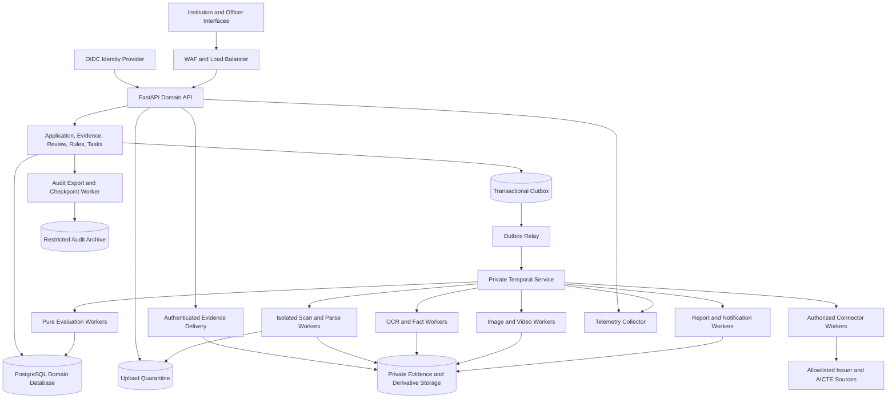
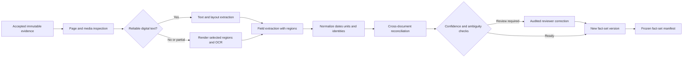
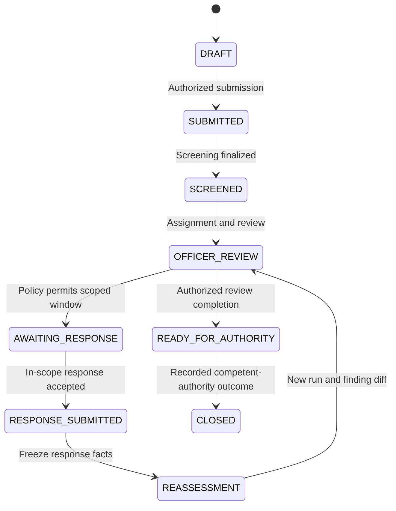
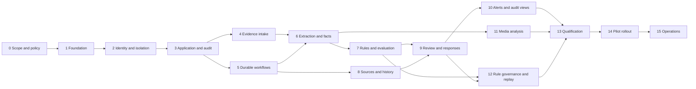

# AICTE PS26261 — Complete Backend Implementation Plan

Implementation progress: Phases 0–1 have the [foundation verification record](development/PHASE_0_1_VERIFICATION.md). Phases 2–4 have a [concrete implementation and runbooks](development/PHASE_2_4_IMPLEMENTATION.md), [API contract](api/openapi.json), and [verification record](development/PHASE_2_4_VERIFICATION.md). These describe local synthetic development capabilities; subsequent phases and cloud/organizational qualification remain separate gates.

**Document version:** 1.0  
**Prepared:** 26 October 2026  
**Product:** AICTE Evidence and Compliance Workbench  
**Scope:** Backend architecture, services, engineering implementation, phased deliverables, verification, deployment, and operations  
**Status:** Proposed implementation specification. This document does not establish that the services, integrations, benchmarks, or controls have already been implemented.

## Contents

1. [Outcome and implementation assumptions](#1-outcome-and-implementation-assumptions)
2. [Architecture principles and decisions](#2-architecture-principles-and-decisions)
3. [System architecture and deployment boundaries](#3-system-architecture-and-deployment-boundaries)
4. [Technology and managed-service inventory](#4-technology-and-managed-service-inventory)
5. [Backend modules and responsibilities](#5-backend-modules-and-responsibilities)
6. [Data architecture and invariants](#6-data-architecture-and-invariants)
7. [API and integration contracts](#7-api-and-integration-contracts)
8. [Processing and workflow implementation](#8-processing-and-workflow-implementation)
9. [Security, privacy, and operational design](#9-security-privacy-and-operational-design)
10. [Delivery phases and detailed subphases](#10-delivery-phases-and-detailed-subphases)
11. [Testing and evaluation programme](#11-testing-and-evaluation-programme)
12. [Infrastructure, deployment, and recovery](#12-infrastructure-deployment-and-recovery)
13. [Delivery schedule, ownership, and dependencies](#13-delivery-schedule-ownership-and-dependencies)
14. [Demo implementation and traceability](#14-demo-implementation-and-traceability)
15. [Completion criteria and handover](#15-completion-criteria-and-handover)
16. [Technical references and claim boundaries](#16-technical-references-and-claim-boundaries)

## 1. Outcome and implementation assumptions

### 1.1 What the backend must accomplish

Build a system that accepts an institution's application evidence, preserves the submitted version, extracts reviewable facts, checks authorized source records, evaluates the correct approved rule release, and supports an officer through a controlled review and rectification process.

The essential technical outcome is a traceable chain:

> Source document and approved interpretation → published rule release → frozen application evidence and facts → explained evaluation → authorized reviewer action → permitted response → reproducible reassessment.

The backend must deliver all of the following:

- Secure intake of application records, PDFs, images, selected videos, and authorized historical records.
- Versioned extraction with exact page or frame provenance and audited human correction.
- Separate completeness, source verification, forensic concern, document validity, compliance, and workflow states.
- A deterministic evaluator with approved applicability, date, unit, rounding, and supersession rules.
- Durable asynchronous processing that survives worker restarts and external-source outages.
- Officer and applicant reports generated from the same frozen evaluation, with appropriate disclosure policies.
- Permissioned rectification with immutable submissions, new response versions, and a clear finding diff.
- Rule drafting, impact simulation, independent approval, publication, rollback by new release, and historical replay.
- Alerts, pending tasks, access history, audit exports, operational monitoring, and tested recovery.
- Honest integration and model labels: simulated results remain visible as simulated, and unsupported conclusions remain unknown.

### 1.2 Relationship to the completed research

This implementation plan builds on the [revised research and solution specification](../output/AICTE_PS26261_Revised_Solution_Context.md), [source register](../output/AICTE_PS26261_Source_Register.json), and [draft rule-evidence register](../output/AICTE_PS26261_Rule_Evidence_Register.json).

The existing rule register is a seed for the policy-authoring workflow. All 22 records are draft research records, with production and adverse-action flags disabled. Importing them must not automatically publish them. The faculty-cadre arithmetic ambiguity, amendment currency limitations, and jurisdiction-dependent issuer questions remain open until resolved by the authorized policy owner.

This is an implementation plan for the team's backend. The inspected competitor code remains research evidence and must not be copied into the product without a separate license and engineering review.

### 1.3 Planning assumptions

| Item | Working assumption | Implementation consequence |
| --- | --- | --- |
| Primary deployment | AWS reference deployment in Mumbai, `ap-south-1`, subject to procurement, region/service checks, and owner approval | Infrastructure is parameterized; the selection is a design proposal, not a residency or procurement certification |
| Pilot workload | 100 institutions, 1,000 application packets per cycle, median 50 pages per packet | Capacity planning starts from a declared pilot, not an untested nationwide load claim |
| Load-test profile | 200 simultaneous authenticated sessions; 25 API requests/second sustained, with a 75 requests/second short burst | Reads, writes, uploads, and long-running jobs are tested separately |
| Media profile | Videos are a separately bounded workload with per-tenant quotas | Video work cannot consume every OCR or API worker |
| Development team | Three backend engineers, one document/ML engineer, one platform engineer, one QA/automation engineer | Policy, security, product, and frontend support are additional part-time/shared roles |
| Production pilot horizon | Approximately 20–24 weeks with parallel workstreams and external dependencies | A short SIH demonstration is a separate milestone, not a substitute for pilot gates |
| AICTE integration | No production API contract, credentials, or writeback authority is currently established in this workspace | Implement a labelled simulator and an adapter boundary; activate a real provider only after onboarding |
| Decision authority | Authorized officers retain statutory decisions | Machine findings are preliminary; official notices and decisions require the approved process |
| Data | Synthetic fixtures initially; approved real data only under an agreed purpose, access, and retention policy | Demo data and live institutional evidence are separated |

These are design inputs to validate in Phase 0. Changing a workload assumption triggers capacity and budget review, not an unannounced service rewrite.

### 1.4 Three release levels

| Release | Intended use | Required boundary |
| --- | --- | --- |
| R1: demonstration | End-to-end synthetic case with the seven additions, source failure, rule simulation, and rectification | Local or isolated demo environment; visible simulation badges; no official decisions or live applicant messaging |
| R2: controlled pilot | Authorized users review a limited approved dataset under supervision | Production security, approved rule subset, measured quality, restore drill, documented unresolved integrations |
| R3: operational service | Agreed institution coverage and service levels | Signed operating ownership, source contracts, policy releases, capacity evidence, security review, and production acceptance |

## 2. Architecture principles and decisions

### 2.1 Recommended architecture

Use a **modular FastAPI backend with a shared transactional PostgreSQL domain store, durable Temporal workflows, and independently deployable worker pools**. Keep business modules within one well-structured codebase initially. Isolate document parsing, media processing, external connectors, and report rendering as separate runtime processes because their resource and trust requirements differ.

This provides explicit domain boundaries and independent scaling while retaining simple transactions for application revisions, findings, permissions, tasks, and audit events. Separate a module into its own network service only when an observed scaling need, security boundary, ownership boundary, or release constraint justifies the extra operational cost.

FastAPI's official deployment guidance discusses process replication, restarts, memory, and deployment concerns; it does not remove the need to design durable background processing. Long-running work therefore belongs in workers rather than API-process background tasks. [T01]

### 2.2 Non-negotiable design invariants

1. A submitted application revision is immutable. Corrections and responses create new versions.
2. Every finalized run pins its evidence manifest, fact set, institutional-record versions, source observations, process policy, rule release, and evaluator version.
3. The evaluator performs no network calls and reads no mutable current-time or current-rule state.
4. A source outage cannot become an issuer mismatch or a compliance penalty.
5. A forensic flag cannot change a source-verification result.
6. A missing document has no verification result for a nonexistent evidence version.
7. An institution cannot obtain another institution's document, derivative, report, task, or search result by changing identifiers.
8. A rule author cannot approve their own rule release. Role changes cannot evade the distinct-person check.
9. A job retry cannot create duplicate evidence versions, finalized evaluations, reviewer actions, or in-app alerts.
10. Access events describe what the server observed. Bytes served do not prove a person read a document.
11. Audit integrity requires independent checkpoints and restricted privileges. A hash chain alone is not an absolute immutability guarantee.
12. No automated finding approves, rejects, or accuses an institution of fraud.
13. Published rule content is immutable; corrections create a new approved release.
14. A model-generated field without resolvable document grounding is unknown.
15. A simulator result is labelled at persistence, API, report, and metric layers.

### 2.3 Architecture decision records to create

| ADR | Decision | Rationale and revisit condition |
| --- | --- | --- |
| ADR-001 | Modular domain backend before independent business microservices | Shared consistency matters early; split after measured module contention or separate ownership requires it |
| ADR-002 | PostgreSQL is the authoritative domain store | Relational constraints, transactions, typed facts, JSONB evidence payloads, and RLS fit the initial scope |
| ADR-003 | Temporal owns durable orchestration; a PostgreSQL outbox connects committed domain changes to workflows | Human response windows, retries, timers, cancellation, and resumable processing need durable coordination |
| ADR-004 | Object storage owns bytes; PostgreSQL owns metadata and relationships | Large evidence and derivatives should not inflate the transactional database |
| ADR-005 | Deterministic, typed rule DSL | Published regulatory behavior must be bounded, explainable, testable, and free from arbitrary code execution |
| ADR-006 | Provider adapters isolate government and issuer integrations | Coverage, consent, credentials, and schemas vary by source and jurisdiction |
| ADR-007 | Evidence processing runs in isolated containers | Untrusted documents and codecs have different risks from application handlers |
| ADR-008 | Human correction creates new facts, not modified source files | Preserve evidence and support replay |
| ADR-009 | ECS-based AWS reference deployment | Container scaling without making Kubernetes administration a prerequisite; platform policy can later select EKS |
| ADR-010 | AI assistance is optional to core correctness | Extraction and explanations may improve with models; policy decisions remain deterministic and reviewable |
| ADR-011 | No public cross-institution similarity or hash lookup | Duplicate analysis must not expose another institution's evidence |
| ADR-012 | Retention is a versioned policy, separate from media-processing and cache lifetimes | Evidence, security logs, backups, legal holds, and temporary files have different obligations |

### 2.4 Technologies intentionally deferred

Do not add Kafka, a graph database, a vector database, a service mesh, Kubernetes, a blockchain ledger, or an autonomous decision agent to the first pilot simply to increase the architecture's apparent sophistication. Introduce them through an ADR with a demonstrated requirement.

Examples of legitimate triggers: OpenSearch for an approved search use case that PostgreSQL cannot meet at measured scale; a dedicated event bus for several independent external consumers; a vector index for approved document retrieval with tenant filtering and measured relevance. None is required to perform a sourced rule evaluation.

## 3. System architecture and deployment boundaries

### 3.1 Logical architecture



The diagram shows logical responsibilities. Most domain boxes are Python packages within the same backend. Workers use domain application services with explicit permissions and repository contracts; they do not perform unrestricted updates to any table.

### 3.2 Runtime deployment units

| Deployment unit | Runtime responsibility | Scaling signal | Failure boundary |
| --- | --- | --- | --- |
| `api` | Authenticated domain commands and reads, upload initiation, job status | Request latency, concurrency, CPU, database pool pressure | No OCR, video decoding, or unbounded report work inside request handlers |
| `evidence-delivery` | Authorized page/original/report streaming and range requests | Concurrent streams, bandwidth, memory | Can initially share the API image but is a separately scaled service before large media use |
| `outbox-relay` | Lease pending events, start/signal workflow executions, record acknowledgements | Oldest undelivered event age | Duplicate delivery is safe; committed events survive relay failure |
| `workflow-worker` | Temporal workflow definitions, orchestration, timers, business coordination | Workflow-task backlog and schedule delay | Keeps sensitive payloads out of workflow histories |
| `scan-worker` | Malware screening and bounded file inspection | Quarantined bytes, scan age | Dedicated restrictive task role and no issuer-network access |
| `document-worker` | Parsing, rendering, OCR, extraction, fact assembly | Pending pages and estimated page processing seconds | CPU/memory-bounded; no applicant-facing server execution |
| `connector-worker` | Authorized source calls, signature/network evidence checks | Per-provider backlog and rate budget | Dedicated egress, credentials, circuit breakers, and limits |
| `evaluation-worker` | Frozen-rule/fact evaluation, diffs, scenarios | Pending runs and evaluation duration | No external network or mutable source lookup |
| `media-worker` | Video metadata, sampled frames, similarity, optional equipment detection | Pending media minutes and memory/GPU use | Separate quotas; GPU jobs use a supported EC2-based pool if needed |
| `report-worker` | PDF/JSON reports, replay manifests, redaction, approved deliveries | Report queue age and memory | Renderer has no arbitrary external-resource access |
| `audit-worker` | Audit-chain validation, checkpoints, archive batches, reconciliation | Checkpoint lag and archive lag | Separate write role and restricted destination account/bucket |
| `temporal-service` | Workflow persistence and scheduling | Service health, history pressure, database latency | Private managed container infrastructure; independently operated from app workers |

For a local demonstration, several worker entry points may run in fewer containers. Keep task queues and code boundaries intact so the pilot can separate them without changing domain contracts.

### 3.3 Trust zones

1. **Public edge:** authenticated application API and upload grants only; WAF, TLS, bounded request bodies.
2. **Application zone:** private API tasks, domain database access, authorized object reads, outbox relay.
3. **Untrusted processing zone:** private isolated scan/render/OCR/media tasks with limited object access, fixed tools/models, and no general internet egress.
4. **Integration zone:** connector tasks with narrowly allowlisted HTTPS egress and provider-specific credentials.
5. **Control zone:** private Temporal services, CI deployment roles, migration roles, and operational dashboards.
6. **Audit and recovery zone:** separately administered archive, key policies, backups, and integrity checkpoints.

An OCR worker's credentials must not allow publishing rules, reading arbitrary provider secrets, or modifying audit retention.

## 4. Technology and managed-service inventory

### 4.1 Application and processing stack

| Layer | Selected baseline | Use | Deployment and implementation note |
| --- | --- | --- | --- |
| Language | Python 3.12 baseline, subject to dependency compatibility testing | API, domain logic, workflows, evaluators, adapters | Freeze a supported patch release and image digest; document any isolated OCR image requiring a different supported Python version |
| HTTP framework | FastAPI, Uvicorn, Pydantic v2 | Typed REST API, request/response validation, OpenAPI | Package versions are locked after the compatibility spike [T01] |
| Persistence library | SQLAlchemy 2, Alembic, PostgreSQL driver | Transactions, repositories, reviewed migrations | Separate runtime and migration credentials |
| Domain database | PostgreSQL | Applications, versions, findings, rule registry, outbox, tasks, access events | RDS in pilot; containerized PostgreSQL locally |
| Workflow orchestration | Temporal Python SDK and self-hosted Temporal Server | Durable pipeline coordination, human waits, retry schedules | No Celery/Redis queue alongside it for the same jobs; private deployment [T02] |
| Disposable cache | Valkey-compatible cache | Rate-limit counters, safe derived metadata, short-lived session support if required | No authoritative workflow, finding, or permission state stored only here |
| Malware screening | ClamAV as the initial scanner candidate | Malware signatures and file screening within the scan tier | Pin engine/signature versions; signature updates use a separate trusted update job; malware scanning is one control, not proof that a document is safe [T17] |
| PDF parsing/rendering | pypdf, pdfplumber, pypdfium2; tool-specific review before adoption | Text layer, page geometry, safe derivatives | Each library has a defined role; execute on immutable object versions in isolated workers |
| OCR | PaddleOCR behind `OCRProvider` | Scanned-region transcription and geometry | Benchmark candidate models/languages and pin weight hashes; Tesseract is an evaluation baseline, not a silent automatic substitute [T03] |
| Image processing | OpenCV and Pillow | Deskew, quality checks, overlays, perceptual-hash inputs | Retain coordinate transforms and image-processing parameters |
| Video | FFmpeg and ffprobe | Metadata, bounded frame sampling, contact sheets | Pin build and codecs; prohibit network protocols in file-processing jobs |
| Digital signatures | pyHanko/cryptography candidate stack | PDF signature inspection and trust evidence | Final adoption follows a supported-format and revocation-validation spike; identity/issuer binding is separate |
| QR/barcode | Maintained decoder selected by fixture testing | Decode payloads for permitted structured checks | Decoding is not authentication; URLs are handled only by the connector zone |
| Rule evaluation | Project-owned typed DSL and pure Python interpreter | Comparisons, ratios, applicability, rounding, explanation traces | No `eval`, arbitrary SQL, or model-authored executable rules |
| Reports | Jinja2 templates, ReportLab, embedded approved fonts | Versioned PDF plus structured JSON | No remote template resource fetching; templates are versioned |
| Observability | OpenTelemetry SDK/Collector plus cloud log/metric services | Traces, metrics, operational logs | Redact identifiers and document contents before export [T04] |
| Testing | pytest, Hypothesis, HTTPX, Testcontainers, k6, security scanners | Unit, property, API, database, load, and abuse tests | Use real PostgreSQL/Temporal integration environments for critical behavior |
| Build tools | `uv` lock files, Ruff, type checking, Docker/BuildKit | Reproducible dependency and image builds | Pin third-party build actions and images; generate SBOMs |

### 4.2 AWS reference services

| Service | Planned role | Required configuration / adoption condition |
| --- | --- | --- |
| VPC, subnets, security groups, VPC endpoints | Network separation and private service access | Public ingress restricted to the load balancer; application and worker tasks in private subnets |
| Application Load Balancer, ACM, AWS WAF | TLS termination, routing, edge protection | API quotas and object authorization remain enforced by the application |
| Amazon ECS with Fargate | API and supported CPU worker containers | Separate task roles and resource limits; Fargate is a container runtime option, not a guarantee that application scaling is correct [T05] |
| ECS on EC2 or AWS Batch on EC2, optional | GPU-dependent OCR/CV jobs | Adopt one GPU execution path only if benchmarks justify it; no GPU assumption for Fargate tasks |
| Amazon RDS for PostgreSQL | Domain database | Multi-AZ for pilot, encryption, PITR, private access, tested migrations; standby is for availability, not read scaling [T06] |
| Separate RDS PostgreSQL instance for Temporal | Workflow persistence and visibility databases | Separate databases/credentials from domain data; resource isolation and workflow-aware backup/recovery |
| Amazon S3 | Quarantine, original evidence, derivatives, reports, source packs | Separate buckets/policies, encryption, version-aware reads, lifecycle rules, no public access |
| S3 Object Lock, conditional | Approved audit/replay retention classes | Use only under an approved retention policy; protection applies to versions and does not prevent new versions or delete markers [T07] |
| AWS KMS | Encryption keys and optional signing/checkpoint keys | Scoped decrypt permissions; rotation and recovery ownership; separate audit-key administration |
| Secrets Manager | Provider secrets and application credentials | Workload identities fetch only required secrets; rotation tested |
| Amazon Cognito | Pilot OIDC authentication and federation | TOTP MFA for local privileged users; upstream IdP must enforce MFA for federated users [T08] |
| Amazon ElastiCache for Valkey, conditional | Cache and distributed rate limiting | May be omitted in the first low-load deployment; cache loss must not corrupt domain state |
| Amazon ECR | Signed container-image distribution | Immutable release tags/digests, scanning, lifecycle retention for rollback images |
| CloudWatch and OpenTelemetry Collector | Metrics, logs, alarms, trace export | Operational evidence is separate from the regulatory audit ledger |
| CloudTrail and selected S3 data events | Cloud administrative/object-access evidence | Configure only required sensitive buckets/prefixes; correlate with application access events |
| AWS Backup / RDS backups / S3 lifecycle | Recovery and controlled retention | Restore tests prove recovery; a backup setting alone is insufficient |
| Amazon SES, later and optional | Approved outbound email alerts | Disabled for real recipients in demo; sender, recipient, disclosure, and operational authorization required |
| Route 53, where adopted | DNS and service routing | Production domain and DNS ownership established by the owner |

Do not claim every named service is available with the desired feature set in every India region. Verify availability, quotas, contractual processing terms, support paths, and costs before provisioning. No price estimate in this plan is a current provider quotation.

### 4.3 Local development equivalents

Use Docker Compose for the API, workers, PostgreSQL, Temporal development server, an S3-compatible development object store, and Mailpit. Use a development OIDC provider such as Keycloak with test identities; verify the Cognito-specific behavior in a cloud integration environment before pilot.

Treat the development object store as a protocol convenience. Tests for S3 version IDs, conditional writes, bucket policies, encryption, Object Lock, and delivery logs must also run against a restricted AWS integration environment. Local emulators do not prove cloud security behavior.

### 4.4 External service integration inventory

| Provider boundary | Purpose | First implementation | Production prerequisite |
| --- | --- | --- | --- |
| AICTE record adapter | EoA, approved intake, TER, prior deficiencies, application references | Deterministic synthetic fixture provider | Owner-issued schema, authentication, data-sharing and writeback terms |
| DigiLocker requester adapter | Supported individual issued documents | Consent-flow simulator and contract tests | Requester onboarding, user authorization, covered document types [T09] |
| EntityLocker adapter | Supported institutional/entity documents | Capability registry and fixture provider | Authorized entity representative, partner access, actual issuer coverage [T10] |
| State/local issuer adapters | Fire, land, building, occupancy records | One jurisdiction-specific simulator | Permitted endpoint/manual method, authority mapping, rate limits, identifiers |
| Structural-engineer verification | Registration/identity and certificate context | Audited manual confirmation task | Accepted registration source and review process; does not certify structural safety |
| Accreditation adapters | NBA/NAAC institution/programme/time scope | Approved frozen public fixture | Permitted source use, scope matching, freshness policy |
| ICAI/UDIN boundary | Audited-account identifier and source comparison | Recorded manual workflow | Authorized permitted lookup; no invented API |
| CCA/trust material and OCSP/CRL | Certificate-chain and revocation evidence | Frozen signed test documents, controlled trust bundle | Approved trust policy, allowlisted revocation access, recorded freshness |
| AICTE portal writeback | Authorized status/report exchange | Disabled interface and simulator | Explicit write authority, sandbox, idempotency/reconciliation contract |

The existence of DigiLocker or EntityLocker documentation does not establish this project's access or the availability of a particular fire, land, or degree certificate. Each adapter has a documented coverage statement.

## 5. Backend modules and responsibilities

### 5.1 Module catalogue

| Module | Owns | Important commands/queries | Must not do |
| --- | --- | --- | --- |
| `identity_access` | Identity mapping, memberships, assignments, policy decisions | Resolve actor, authorize object/action, grant scoped assignment | Trust a client-supplied role or institution ID |
| `institutions` | Institution identity, jurisdiction, programme context | Register/link institution, read approved identity history | Treat an unverified name match as identity confirmation |
| `applications` | Drafts, submitted revisions, manifests, category/cycle | Create draft, submit revision, read history | Overwrite a submitted revision |
| `evidence` | Upload sessions, evidence metadata, versions, derivatives | Initiate/finalize upload, authorized retrieval, supersede slot | Serve quarantine objects as trusted documents |
| `extraction` | Extraction jobs, fields, geometry, corrections | Parse/OCR, propose facts, record correction | Replace source bytes with corrected values |
| `claims` | Claim subjects, periods, evidence links, record matches | Assemble fact sets, reconcile identity/units, read provenance | Flatten contradictory evidence into one unexplained number |
| `institutional_records` | Imported record versions and portal reconciliation | Import/diff records, query effective history | Rewrite old records when the provider changes |
| `verification` | Providers, attempts, observations, manual confirmations | Start attempt, normalize result, inspect source evidence | Convert a timeout or forensic flag into mismatch |
| `rule_registry` | Sources, interpretations, typed rules, releases, approvals | Draft, validate, simulate, approve, publish, supersede | Allow self-approval or mutable published content |
| `evaluation` | Run manifests, outcomes, findings, calculation traces | Evaluate, compare, replay, scenario-check | Fetch current source data or make statutory decisions |
| `review` | Officer observations, stage transitions, review dispositions | Assign, annotate, request evidence, mark ready | Provide an unrestricted administrative decision bypass |
| `rectification` | Authorized windows, scope, responses, reassessments | Open window, submit response, compare versions | Permit arbitrary post-submission application edits |
| `media_analysis` | Media metadata, samples, similarity candidates, count overlays | Analyze role/duration, sample frames, flag candidates | Infer ownership or complete inventory from a partial image |
| `reporting` | Audience policy, report versions, exports | Render officer/applicant report, replay package | Leak internal notes or cross-institution personal information |
| `tasks_alerts` | Pending work, deadlines, alert/delivery history | Create/resolve task, remind, acknowledge, escalate | Treat email sent as recipient acknowledgement |
| `audit_access` | Audit stream, access events, checkpoints | Record event, query authorized history, verify integrity | Store raw documents, credentials, or tokens in audit payloads |
| `retention` | Policy versions, legal holds, purge manifests | Classify, expire, hold, delete approved objects | Delete a retained original because a cache TTL expired |
| `operations` | Health, reconciliation, provider state, feature capabilities | Inspect health, retry safe work, reconcile missing events | Change regulatory outcomes through an operational retry |

### 5.2 Internal layering

Use four layers inside each business module:

1. **Domain:** value objects, invariants, state transitions, pure calculations, domain errors.
2. **Application:** commands, queries, transactions, authorization checks, module contracts.
3. **Infrastructure:** SQL repositories, object storage, provider clients, workflow activities, delivery transports.
4. **Interface:** REST handlers, workflow entry points, scheduled/reconciliation commands.

Business modules depend on contracts rather than importing another module's ORM tables into request handlers. Enforce import boundaries in CI. Shared code contains technical primitives and stable value types; it must not become a collection of hidden business logic.

### 5.3 Proposed repository layout

```text
backend/
  pyproject.toml
  uv.lock
  src/workbench/
    api/                    # Composition, middleware, routes, error mapping
    modules/
      identity_access/
      institutions/
      applications/
      evidence/
      extraction/
      claims/
      institutional_records/
      verification/
      rule_registry/
      evaluation/
      review/
      rectification/
      media_analysis/
      reporting/
      tasks_alerts/
      audit_access/
      retention/
    workflows/              # Deterministic orchestration definitions
    activities/             # Typed side-effect boundaries
    adapters/               # Storage, IdP, issuer and portal implementations
    contracts/              # API/event schemas and compatibility tests
    platform/               # Configuration, telemetry, database setup
  migrations/
  tests/
    unit/
    property/
    integration/
    contract/
    security/
    workflow_replay/
    acceptance/
  tools/                    # Seeds, replay verifier, administrative CLI
infra/
  compose/
  terraform/modules/
  terraform/environments/
benchmarks/
  manifests/
  fixtures/synthetic/
  evaluation/
docs/
  architecture/adr/
  api/
  data/
  policy/
  runbooks/
```

This tree is a delivery target. It does not describe application code already present in the research repository.

## 6. Data architecture and invariants

### 6.1 Ownership and tenancy

An **institution** is the evidence ownership boundary. A **regulatory organization** is a separate actor organization that receives explicit case/jurisdiction assignments. Do not model every officer as an unrestricted member of every institution.

Every institutional domain row carries `institution_id`; application-level rows also carry `application_id` and the relevant version/run ID. Global rule sources/releases live in a separate read-controlled policy domain. Reviewer access is derived from server-side assignments, jurisdiction, role, purpose, and process stage.

For each command, the application service derives an authorized context from the authenticated identity and current assignments. It never trusts the institution ID in a body or URL as authorization. Database RLS provides an additional boundary; query-level checks remain required. PostgreSQL documents both default-deny policies and owner/`BYPASSRLS` exceptions, so runtime roles must not own the protected tables or have bypass privileges. [T11]

### 6.2 Core tables and minimum fields

| Table/group | Minimum fields | Required integrity rule |
| --- | --- | --- |
| `institutions`, `institution_identity_versions` | Internal ID, permitted portal references, name/address history, jurisdiction, effective dates | External reference uniqueness is scoped to its issuing system |
| `actor_identities`, `memberships`, `case_assignments` | IdP subject, organization, role, scope, validity, grant authority, revoked time | Distinct human identity is retained for approval separation |
| `applications`, `application_revisions` | Category, cycle-start year, process stage, declared facts, revision, submitted timestamp | Submitted revision payload cannot be updated by runtime roles |
| `evidence_slots`, `evidence_versions` | Requirement slot, parent version, object bucket/key/version ID, SHA-256, media type, upload status, classification | Same-institution/application foreign keys; original version never replaced |
| `upload_sessions` | Grant ID, expected size/checksum, allowed type, expiry, completion token, actual object version | Completion is idempotent; only verified immutable bytes become evidence |
| `derivatives` | Parent evidence ID, object version, generator version/config, source transform, hash | A derivative is never treated as the original |
| `extraction_runs`, `extracted_fields` | Source version, tool/model digest, raw/normalized value, region, confidence, uncertainty | Missing/ambiguous values remain typed unknowns |
| `field_corrections` | Prior/new field references, reason, actor, time, authority | Append-only correction chain; source document unchanged |
| `fact_sets`, `fact_set_members` | Canonical facts, immutable member references, canonicalization version, hash | Finalized sets cannot change membership |
| `claims`, `claim_evidence_links` | Subject, predicate, period, support/contradict relationship, evidence/field/record references | Links cannot cross institutions without an explicit authorized shared-record model |
| `institutional_record_versions` | Provider, record key, effective interval, retrieval time, hash, source-mode label | Bitemporal history: effective time differs from system observation time |
| `verification_attempts`, `source_observations` | Provider/method, request fingerprint, timestamps, raw-response reference, normalized result, expiry/freshness, simulated flag | Attempt history persists; newer attempts do not overwrite older observations |
| `rule_sources`, `rule_interpretations` | Publisher, source hash, clause/page locator, scope, ambiguity and approvals | Source checking and interpretation approval are distinct |
| `rule_versions`, `rule_releases`, `release_members` | DSL version, applicability, effective interval, supersession, release hash, publication state | Published members immutable; conflicting scope blocks release |
| `rule_approvals` | Release ID/hash, author and approver identities, decision, reason, time | Author and approver must be different authorized people |
| `evaluation_runs`, `run_inputs` | Frozen manifests/hashes, evaluator digest, evaluation-as-of date, status, limitations | Finalized inputs/output cannot be edited |
| `requirement_outcomes`, `findings` | Requirement, result, observed/expected values, rule/evidence references, trace | Machine output carries `adverse_action_allowed=false` |
| `review_actions`, `review_dispositions` | Actor, scope, stage, action, reason, prior/new state, linked finding | Review disposition overlays machine finding; original result retained |
| `response_windows`, `response_versions` | Policy basis, allowed scope, deadline/timezone, rounds, manifest, supersession | Cannot accept expired, revoked, stale, or out-of-scope submission |
| `tasks`, `alerts`, `delivery_attempts` | Owner, trigger, semantic dedup key, due time, channel, state, provider reference | One open alert per semantic condition; retries retained |
| `audit_events`, `access_events` | Actor/service, permitted scope, event/request IDs, object version, action, result, sequence/hash | Routine roles cannot update/delete; independent checkpointing |
| `outbox_events`, `consumer_receipts` | Event ID/type/schema, aggregate revision, opaque references, lease/retry data | Event and domain state commit together; consumers deduplicate |
| `retention_policies`, `legal_holds`, `purge_manifests` | Data class, approved basis, expiry, approver, hold status, deletion evidence | Legal holds and policy constraints evaluated before deletion |

### 6.3 Constraints, indexes, and transactions

- Use UUID identifiers generated by trusted server code; identity unpredictability supplements but never replaces authorization.
- Use composite uniqueness/foreign keys such as `(institution_id, application_id, evidence_version_id)` where necessary to prevent cross-owner relationships.
- Index `(institution_id, application_id, created_at, id)`, task owner/state/due time, run IDs, source record identifiers, and outbox delivery state according to measured query plans.
- Use cursor pagination for histories and findings; do not load complete audit/evidence datasets into memory.
- Store timestamps in UTC with explicit timezone-aware types. Retain the source timezone or date-only basis for legal deadlines and certificate dates.
- Use `Decimal` and explicit units/rounding for numeric regulatory checks. Do not rely on binary float or locale-dependent parsing.
- Use expected revision/ETag checks for editable drafts, assignments, response windows, and review actions. Return a conflict when a stale revision is used.
- Lock the application aggregate for submission/response-finalization transitions so two simultaneous submissions cannot both become current.
- Commit a business state change, its audit event, and its outbox event in one database transaction.
- Use `SET LOCAL` authorization context inside a transaction and reset pooled sessions. A task/connection must not retain the prior request's institution or assignment context.
- Partition high-volume audit/access/outbox tables only after measuring volume; design indexes and purge policy so partitioning is possible without changing API contracts.

RLS tests must cover institution users, assigned officers, unassigned officers, auditors, workers, migration accounts, and connection-pool reuse. Constrain `SECURITY DEFINER` functions and fix their search path where any are approved.

### 6.4 State contracts

| Dimension | Internal states | Implementation rule |
| --- | --- | --- |
| Completeness | `COMPLETE`, `MISSING`, `INCOMPLETE`, `NOT_APPLICABLE` | Requirement/slot result; no implied issuer result |
| Source verification | `VERIFIED`, `MISMATCH_DETECTED`, `EXPIRED`, `VERIFICATION_PENDING`, `SOURCE_UNAVAILABLE`, `MANUAL_REVIEW_REQUIRED` | Per claim, evidence version, method, and observation |
| Forensic concern | `NONE_OBSERVED`, `FLAGGED`, `INCONCLUSIVE`, `REVIEWED_BENIGN`, `REVIEWED_ESCALATE` | Detector output plus independent human disposition |
| Document validity | `VALID_ON_REVIEW_DATE`, `EXPIRED_ON_REVIEW_DATE`, `UNKNOWN` | Date assessment and its source/basis |
| Compliance | `PASS`, `POTENTIAL_DEFICIENCY`, `NOT_EVALUABLE`, `NOT_APPLICABLE` | Pure scoped rule outcome; no statutory decision |
| Case workflow | `DRAFT`, `SUBMITTED`, `SCREENED`, `OFFICER_REVIEW`, `AWAITING_RESPONSE`, `RESPONSE_SUBMITTED`, `REASSESSMENT`, `READY_FOR_AUTHORITY`, `CLOSED` | Transition matrix controlled by process policy and actor authority |

`EXPIRED` in the source-verification dimension requires a matched issuer record or appropriately issuer-bound signed evidence under the approved method. A date read from an unauthenticated scan can set document validity while source verification remains pending.

No single precedence list replaces these dimensions. The API returns counts and limitations for each dimension, and any “ready” result explains unresolved items accepted by an authorized reviewer.

### 6.5 Frozen run contract

An `EvaluationRunManifest` must contain:

```json
{
  "schema_version": "1.0",
  "run_id": "server-issued-uuid",
  "institution_id": "server-issued-uuid",
  "application_revision_id": "immutable-revision-id",
  "evidence_manifest_sha256": "computed-64-character-hex-digest",
  "fact_set_id": "immutable-fact-set-id",
  "fact_set_sha256": "computed-64-character-hex-digest",
  "institutional_record_version_ids": [],
  "source_observation_ids": [],
  "rule_release_id": "approved-or-explicit-demo-release-id",
  "rule_release_sha256": "computed-64-character-hex-digest",
  "process_policy_version_id": "version-id",
  "evaluator_image_digest": "sha256:resolved-container-digest",
  "canonicalization_version": "jcs-and-project-types-v1",
  "evaluation_as_of": "2026-10-26",
  "execution_mode": "DEMONSTRATION",
  "contains_simulated_sources": true
}
```

The strings are illustrative placeholders, not valid production IDs/hashes. Runtime validation rejects placeholders and mismatched hashes. Model and parser digests are retained by extraction manifests; replay uses frozen extracted facts and does not rerun OCR.

### 6.6 Finding, rule, and correction contracts

Implement typed contracts before exposing the evaluator to frontend or connector consumers. A finding needs `finding_id`, `run_id`, stable `semantic_key`, requirement/scope, result, observed/expected typed values, units, calculation trace, rule version/source locator, supporting and contradicting evidence references, uncertainty/limitations, recommended next action, audience-safe explanation, and `adverse_action_allowed=false`.

The semantic key identifies a requirement instance such as a building's fire-certificate validity for a particular period. It excludes run-specific UUIDs so reassessment can match the finding across versions. It includes the subject/scope so two buildings or programmes cannot be incorrectly merged. Human disposition is a separate versioned object; a dismissed finding still retains the original machine result.

A rule contract must explicitly capture:

| Contract area | Required content |
| --- | --- |
| Identity and release | Rule ID/version, DSL version, content hash, release membership |
| Source and interpretation | Source file/hash, clause/page, content-check state, interpretation decision, approver |
| Applicability | Programme, level, category, jurisdiction, institution class, academic cycle and legal effective interval |
| Inputs | Typed field paths, claim scope/period, provenance requirements, unknown behavior |
| Calculation | Bounded operator tree, units, precision, rounding, comparator, date/calendar basis |
| Output | Preliminary outcome, trace template, officer/applicant explanation, no machine adverse action |
| Change governance | Supersession/conflict links, tests, simulation evidence, publication approvals |

Use decimal strings or another explicitly specified exact representation for canonical numeric facts. Define array ordering, null-versus-unknown encoding, Unicode handling, timestamps/date-only values, unit normalization, and excluded nonsemantic metadata. A replay's canonical result excludes newly generated execution timestamps and IDs; compare the semantic outcomes and traces under the pinned canonicalization version.

### 6.7 Historical data and late observations

Preserve both the period a record describes and when the workbench learned it. For example, an approved intake record effective for 2025 but retrieved in 2026 may support an historical claim; it is not automatically evidence of current-year intake.

An evaluation closes over a declared observation cutoff. Source checks completing after that cutoff create newer observations and a new run request; they cannot append facts to an already finalized run. If an officer accepts an unresolved item for review, record that disposition without rewriting the run's original limitation. Define this behavior in the UI/API so an old report does not silently change when a delayed provider responds.

## 7. API and integration contracts

### 7.1 API conventions

Use versioned REST endpoints under `/api/v1`, JSON request/response schemas, and a checked-in OpenAPI contract. Require OIDC bearer-token validation or an approved server-side session boundary, server-side scope resolution, request correlation IDs, and structured errors.

For browser deployments, use an approved OIDC authorization-code/PKCE flow and a documented token/session policy. If an HTTP-only cookie session/BFF is selected, implement CSRF protection and origin checks. Never store privileged roles in editable client state.

Commands that create jobs, submissions, windows, responses, releases, or deliveries require an `Idempotency-Key`. Bind it to actor/scope, route, and a canonical request hash; a reused key with different content returns `409`. Keep idempotency records for a documented period covering the allowed retry window. Long-lived external side effects additionally use permanent business deduplication keys.

Return `202 Accepted` plus an operation ID for asynchronous commands. Clients poll job status with bounded intervals or use an authenticated event stream; progress must come from actual stages rather than invented percentages. Use conditional reads/ETags where appropriate.

Example error shape:

```json
{
  "type": "urn:workbench:error:response-scope-violation",
  "title": "Response changes exceed the permitted scope",
  "status": 409,
  "code": "RESPONSE_SCOPE_VIOLATION",
  "request_id": "correlation-id",
  "details": {"disallowed_fields": ["approved_intake"]}
}
```

Error responses must not reveal another institution's object existence. Distinguish validation errors, concurrency conflicts, policy denial, unsupported provider capability, and temporary provider failure without exposing secrets.

### 7.2 Endpoint inventory

| Group | Required endpoints | Contract and control |
| --- | --- | --- |
| Identity/context | `GET /me`, `GET /me/assignments`, scoped membership/assignment commands | Identity provider authenticates; backend resolves authority |
| Institutions | `GET /institutions/{id}`, authorized identity-history/import operations | Sensitive fields and cross-institution access restricted |
| Applications | `POST /applications`, `GET/PATCH /applications/{id}`, `POST /applications/{id}/submit`, `GET /applications/{id}/revisions` | PATCH affects draft only; submit freezes manifest under a lock |
| Uploads | `POST /applications/{id}/upload-sessions`, `POST /upload-sessions/{id}/complete`, `GET /upload-sessions/{id}` | Quarantine-first, checksum/version verification, quota enforcement |
| Evidence | `GET /evidence/{version_id}`, `GET /evidence/{version_id}/content`, `GET /evidence/{version_id}/pages/{page}`, `GET /evidence/{version_id}/media` | Per-object policy, access events, private caching, safe range requests |
| Extraction | `GET /evidence/{version_id}/fields`, `POST /evidence/{version_id}/corrections`, `GET /fact-sets/{id}` | Corrections need authority/reason and produce new facts |
| Verification | `POST /claims/{id}/verification-attempts`, `GET /verification-attempts/{id}`, `POST /claims/{id}/manual-confirmations` | Provider capability, authorization, method/evidence, freshness recorded |
| Runs | `POST /applications/{id}/evaluations`, `GET /evaluations/{id}`, `GET /evaluations/{id}/findings`, `GET /evaluations/{id}/compare?to=...` | Frozen references, scoped comparison, explicit run mode |
| Provenance | `GET /findings/{id}/evidence`, `GET /claims/{id}/provenance` | Every returned link must resolve under the same audience policy |
| Review | `POST /applications/{id}/review-actions`, `POST /findings/{id}/dispositions` | Stage/action matrix, expected revision, reason and authority |
| Responses | `POST /applications/{id}/response-windows`, `POST /response-windows/{id}/responses`, `POST /responses/{id}/submit`, `GET /responses/{id}/diff` | Authorized scope, deadline, round count, no original overwrite |
| Rules | `/rule-sources`, `/rule-drafts`, `/rule-releases`, `POST /rule-releases/{id}/validate`, `/simulate`, `/approve`, `/publish` | Separate source review, interpretation, testing, and approval |
| Media | `GET /evidence/{id}/media-analysis`, `POST /media-observations/{id}/corrections` | Advisory outputs and model/coverage metadata |
| Reports | `POST /evaluations/{id}/reports`, `GET /reports/{id}`, `GET /reports/{id}/content` | Officer/applicant audience, template/policy version, logged download |
| Tasks/alerts | `GET /tasks`, `POST /tasks/{id}/actions`, `GET /alerts`, `POST /alerts/{id}/acknowledge` | Assigned scope, actual deadlines, semantic deduplication |
| Audit | `GET /applications/{id}/audit-events`, `GET /evidence/{id}/access-events`, `POST /applications/{id}/replay-exports` | Scoped auditor permission, redaction, export logging |
| Integrations | Approved import/webhook endpoints and `GET /capabilities` | Signature/replay validation, no arbitrary provider URL, simulated/real capability labels |
| Operations | `/health/live`, `/health/ready`, private operational status and reconciliation commands | Public health output contains no infrastructure details or credentials |

### 7.3 Provider adapter interface

Define typed methods such as `capabilities()`, `build_request()`, `verify_claim()`, `normalize_response()`, and `health_state()`. Provider clients accept internal claim/evidence references and validated source identifiers, never arbitrary URLs from a document.

Every observation includes provider and adapter version, authorized access basis, matching criteria, exact evidence version, claim coverage, source-record time, query time, response hash/reference, signature evidence where applicable, source mode, and freshness policy.

Separate these result layers:

- **Transport:** success, timeout, throttled, unauthorized, unavailable, invalid response.
- **Source comparison:** match, authoritative conflict, no supported match, ambiguous identity, source-confirmed expiry.
- **Product mapping:** one of the six required verification states with an explanation.

An HTTP 200 response containing an HTML error page is not a successful verification. An identifier's valid syntax is not a source match. Stale or weakly matched records cannot produce an unsupported definitive result.

### 7.4 Event contracts

Use explicit events such as:

`ApplicationSubmitted`, `EvidenceAccepted`, `EvidenceQuarantined`, `ExtractionCompleted`, `FactSetFrozen`, `VerificationAttemptCompleted`, `EvaluationFinalized`, `FindingDispositionRecorded`, `ResponseWindowOpened`, `ResponseSubmitted`, `RuleReleasePublished`, `ReportGenerated`, `TaskDue`, and `RetentionPurgeCompleted`.

Event envelope:

```json
{
  "event_id": "unique-event-id",
  "event_type": "EvaluationFinalized",
  "schema_version": 1,
  "aggregate_id": "application-id",
  "aggregate_revision": 4,
  "institution_id": "institution-id",
  "occurred_at": "2026-10-26T12:00:00Z",
  "correlation_id": "request-or-workflow-id",
  "causation_id": "prior-event-id",
  "payload": {"evaluation_run_id": "immutable-run-id"}
}
```

Keep event payloads small and reference-based. Consumer compatibility tests reject breaking schema changes. The outbox uses leased rows with `FOR UPDATE SKIP LOCKED`; a lease expiry returns unfinished deliveries to eligibility. A receipt is written only after an idempotent workflow start/signal is acknowledged.

The outbox addresses the database/event dual-write gap, while consumers still need deduplication because delivery can repeat. [T12]

## 8. Processing and workflow implementation

### 8.1 Upload and quarantine workflow

1. Authorize the application slot, expected file type, size, per-user quota, and process-stage permission.
2. Create an `UploadSession` and a unique quarantine object key. Issue a short-lived constrained upload grant; bind checksum/type where supported.
3. For multipart upload, validate the final object and multipart completion; enforce total size independently of individual part size.
4. Finalization resolves the exact object version, verifies size/type/checksum, and records server-observed SHA-256. Do not treat a multipart ETag as SHA-256.
5. Start a scan workflow through the committed outbox. Workers inspect the exact uploaded object version; later writes to the same key cannot change the accepted evidence.
6. Scan/inspect in bounded tasks, with temporary storage limits, parser timeouts, malware signatures, active-content and embedded-file policy, and encrypted-file handling.
7. Preserve accepted original bytes in a private evidence object/version and create metadata atomically with its outbox transition. Derivatives are separate objects.
8. Quarantine or reject failures with a safe reason, cleanup policy, and officer/applicant visibility appropriate to the stage.

AWS documents that presigned URLs can be reused until expiry and an upload can replace an existing key. Therefore the application must use unique keys, exact version binding, and verified completion; the grant is not a one-time token by itself. Conditional writes may supplement the selected upload path where supported and enforced. [T13, T14]

The production implementation must test time-of-check/time-of-use races: reusing a grant after completion, multipart completion after session expiry, wrong checksum, source object replacement, and duplicate completion requests.

### 8.2 Extraction and fact assembly workflow



Preserve page rotation, crop, deskew, resolution, and coordinate transforms so the viewer highlights the actual supporting region. Store page dimensions and coordinate convention in the API. A field must include raw text, normalized value, method, tool/model version, quality/confidence, and unknown reason.

Build document-type extractors using typed schemas and layout/text evidence. Begin with the certificate, intake, faculty roster, bandwidth, and inventory fields needed by the approved rule subset. Use a classifier with an `UNKNOWN_DOCUMENT_TYPE` path; do not force an unfamiliar document into a supported template.

Optional model assistance may propose a schema-constrained value only when the exact source span/region can be resolved. Treat document instructions as untrusted content; the extraction model has no network tools, policy-publication access, or arbitrary database capability. External model use remains disabled until data handling, region, retention, cost, and benchmark requirements are approved.

### 8.3 Source verification workflow

Select a supported provider based on document class, issuer, jurisdiction, claim subject, and authorized access basis. Freeze the request fingerprint and evidence reference. Rate-limit by provider and institution; use bounded concurrency and a circuit breaker.

Use short transport retries for safe transient failures, followed by durable scheduled attempts. The research's proposed 5/30/120-minute retry sequence and 24-hour manual task can be configured as product policy; these are not AICTE statutory deadlines. Do not combine both sequences into an uncontrolled multiplication of retries.

Record ambiguous timeouts separately when a source may already have processed a request. For chargeable or side-effecting provider operations, reconcile by provider request reference/idempotency contract before resending. If no safe retry contract exists, route to an operator.

Normalize source results with identity, period, freshness, and claim-coverage checks. A valid PDF signature only establishes the verified signature properties; signer authority and source-claim binding require separate evidence. Preserve revocation failures as limitations rather than assuming “good”.

### 8.4 Rule evaluation workflow

Resolve the rule release using numeric academic cycle, legal effective dates, application category, institution/programme/level, jurisdiction, and approved supersession. Conflicts or unresolved interpretation block affected rules or release publication; there is no generic “latest file wins” rule.

Compile the typed DSL into a validated bounded internal representation. Supported operations should initially include comparisons, existence, all/any groups, scoped counts, date intervals, approved arithmetic, set membership, and explicit rounding. Cap nesting, expression size, and evaluation work. Required input absence produces `NOT_EVALUABLE`, unless an explicit completeness rule addresses the missing slot.

Example evaluation sequence:

1. Validate manifest references and hashes.
2. Load frozen facts and source observations.
3. Resolve approved applicable rule members from the pinned release.
4. Evaluate completeness separately from source and forensic dimensions.
5. Evaluate numeric/date/document requirements using explicit policy bases.
6. Produce observed/expected values, calculation traces, source locators, evidence pointers, and unknown reasons.
7. Atomically finalize outcomes, machine findings, audit/outbox events, and report eligibility.

A fresh source lookup or corrected field creates a new run. Replaying an old run reads the original observations. OCR reruns may differ; deterministic evaluation over frozen facts must reproduce canonical outcomes.

### 8.5 Rule authoring and amendment workflow

Use the lifecycle `DRAFT → SOURCE_CHECKED → INTERPRETATION_PENDING/APPROVED → TESTED → APPROVED_FOR_PUBLICATION → PUBLISHED → SUPERSEDED`. Store immutable decisions and explicit rejection/rework paths.

An author uploads the exact source bytes, records its hash and page/clause locator, documents applicability and interpretation, adds test vectors, and builds a candidate release. Impact simulation runs the candidate against approved frozen test packets and produces a finding diff, coverage changes, and uncertainty changes.

A distinct authorized approver signs off the exact release hash and simulation/test evidence. Publication changes the current pointer for the relevant scope; it never mutates historical releases or runs. Rollback publishes or selects an approved replacement under a new release event, retaining the reason and lineage.

### 8.6 Review and rectification workflow



The state diagram is a product workflow skeleton, not a declaration of every statutory process. An approved process-policy version defines which categories allow each transition, who may initiate it, permitted deadlines/rounds, disclosure, and escalation. Add authorized withdrawal/reopening paths only through that policy.

Opening a response window records its process authority, exact allowed slots/fields, deadline with timezone, maximum rounds, and current application revision. Submission locks the window and validates all changes against that scope, including indirectly changed declared values. Expired/revoked windows cannot be reopened by a background retry.

Reassessment evaluates affected dependencies plus a whole-packet consistency pass. Match findings by stable semantic keys, not generated UUIDs. Classify `RESOLVED`, `UNCHANGED`, `NEW`, `CHANGED`, and `NO_LONGER_EVALUABLE`; retain the original findings and reviewer dispositions.

### 8.7 Media and discrepancy workflow

Require `video_role`: `EVC_WALKTHROUGH`, `WEBSITE_DISCLOSURE`, or `SUPPLEMENTARY_EVIDENCE`. Evaluate duration only under a sourced applicable requirement. The 1–2 minute website disclosure and contextual EVC recording requirements must not share one global duration constant.

Extract container/codec/duration/frame rate/dimensions and available metadata. Use the proposed bounded sampler: one frame per ten seconds plus capped scene candidates, at most 180 analyzed frames per video by default. These are resource settings, not regulatory norms. Store timestamps, sampler configuration, and frame-to-source references.

Near-duplicates generate advisory candidates. Missing GPS is unavailable metadata; GPS presence is not proof of capture location. Restrict cross-application similarity to explicitly permitted scopes and show only authorized references. Institution users must not discover another institution's files through a similarity endpoint.

For the visible equipment demonstration, compare a declaration for a named room against visible monitor/workstation candidates in the same room/period. Produce overlays, count uncertainty, coverage/occlusion notes, and an audited correction path. Twelve visible candidates against a declaration of twenty means additional evidence may be needed; it does not prove eight missing functional computers.

Keep counting/model output separate from rule-derived required inventory. No merged multi-photo count is allowed until a validated association method avoids double counting.

### 8.8 Alerts, tasks, reports, and access events

Create tasks from committed semantic conditions: missing required evidence, source unavailable, uncertain interpretation, officer review, response deadline, certificate expiry warning, or a security incident. Store owner, required action, policy basis, due time, dependency, acknowledgement, and resolution.

Use a semantic alert key containing application, requirement/condition, relevant evidence lineage, recipient scope, and trigger class. Event IDs deduplicate transport; semantic keys prevent unchanged re-evaluations from creating repeated open alerts. A changed deadline or replaced evidence cancels obsolete timer generations.

Reports use a versioned template and audience policy over one finalized run. Persist PDF, structured JSON, report hash, disclosure policy, and linked manifest. Officer reports include operational/source limitations; applicant reports include the explanation and permitted response without unnecessary internal security details.

Evidence delivery first authorizes the object/version and records an access attempt. On stream completion or disconnect, record bytes sent and completion/abort status. Use `Cache-Control: private, no-store` for sensitive responses and test range requests. A signed storage URL, if introduced later, is recorded as grant issuance and correlated with actual storage access; it does not prove human viewing.

### 8.9 Workflow acceptance and side-effect ownership

| Workflow | Stable business key | Authoritative commit / terminal condition |
| --- | --- | --- |
| Evidence screening | Evidence version plus processing profile/version | Accepted/quarantined result and extraction references committed once |
| Source verification | Claim, evidence version, provider, request fingerprint, requested freshness generation | Immutable observation or explicit unavailable/manual-review outcome |
| Evaluation | Frozen input-manifest hash, evaluator digest, execution mode | One finalized semantic result for the requested operation; retried work reads its stored output |
| Response processing | Response-window ID and submitted response revision | Scoped response accepted once, then reassessment linked to that version |
| Report generation | Run, audience policy, template version, requested report variant | Stored PDF/JSON hashes and report metadata; delivery is a separate action |
| Alert lifecycle | Semantic condition key and timer generation | One open logical alert; replacement/resolution invalidates obsolete timers |
| Candidate rule simulation | Candidate release hash plus frozen simulation-set manifest | Stored comparison results and test evidence bound to that candidate |
| Retention purge | Approved purge manifest and policy version | Version-specific deletion/hold results reconciled and recorded |

Use distinct operational `FAILED`, `CANCELLED`, and `REQUIRES_OPERATOR` states for jobs rather than overloading application compliance results. Cancellation stops future permitted work; it does not delete accepted source observations or reverse an external action already acknowledged. After cancellation, late activity completion must be reconciled without reactivating a revoked response window or delivery request.

## 9. Security, privacy, and operational design

### 9.1 Authentication and authorization

- Validate token issuer, audience, signature, expiry, token type, allowed algorithms, and JWKS rotation. Reject an unrecognized issuer even if a signature verifies against some key.
- Resolve institution memberships and regulatory case assignments from current backend data. Privileged state transitions re-check current grants and step-up requirements.
- Require MFA for privileged local accounts. For federated accounts, verify the agreed upstream MFA/assurance behavior; Cognito does not add MFA to federated sign-in itself. [T08]
- Separate rule author, approver, officer, supervisor, auditor, platform operator, and retention administrator capabilities.
- Add time-limited, reasoned emergency access with approval and prominent audit evidence; it does not grant permission to alter historical evidence or findings.
- Use workload/task identities and separate database roles for API, delivery, processing, connector, audit, and migrations.
- Enforce object and property authorization on reports, corrections, assignment changes, exports, and response payload fields. UUIDs and hidden UI buttons are insufficient.

### 9.2 Upload, parser, and network security

- MIME sniffing plus extension/container validation; configurable size/page/duration limits; reject unsupported executable/active content according to policy.
- Non-root containers, read-only root filesystem where supported, bounded scratch space, no Docker socket, fixed binaries and model assets.
- Keep any ClamAV daemon socket local or restricted to the scan tier; its TCP interface must not be exposed as an authenticated public scanning service. Signature freshness and update failure are operational health checks. [T17]
- Separate fetching from parsing. A parser processes local object bytes and cannot follow document hyperlinks, external fonts, or embedded remote resources.
- Connector egress uses allowlisted hosts and an explicit proxy/firewall policy. Block private, loopback, link-local, metadata-service, and prohibited destination ranges after DNS resolution and every redirect.
- Cap redirects, response bytes, decompression, connect/read timeouts, and content types. Protect against DNS rebinding and callback substitution.
- Callback URLs are registered, not supplied ad hoc. Validate webhook signatures/timestamps/replay IDs before reading trusted payloads.
- Rate-limit expensive operations by actor, institution, provider, and file/media budget. Apply admission control when backlog exceeds safe processing capacity.

OWASP's API risk catalogue specifically covers object/property/function authorization, resource consumption, SSRF, inventory, and unsafe upstream consumption; map the implementation tests to these categories. [T15]

### 9.3 Data protection and retention

Classify original institutional records, personal identifiers, source credentials, evidence derivatives, reports, audit/access records, telemetry, and backups. Retain only data required for the authorized process and its approved retention class.

Mask unnecessary personal identifiers in applicant/report/telemetry contexts. HMAC-derived lookup identifiers are pseudonymous and must not be described as anonymized. Original PDFs may still contain personal data; encryption does not eliminate that fact.

Create a policy matrix with owner, purpose, access scope, applicable retention basis, deletion trigger, legal-hold behavior, backup handling, and archive class. Determine legal requirements through the policy/legal owner using the research's source register and current official material. Do not assume every DPDP provision commenced together or that a handbook's desirable heading waives applicable law.

Security logs, evidence originals, application histories, audit checkpoints, temporary files, and backups need separate retention controls. The research identifies CERT-In retention/reporting considerations for covered entities; applicability and exact operating responsibilities must be approved before pilot.

Retention workflow: discover eligible objects → check holds and reference dependencies → require the policy's approval level → delete approved versions/derivatives/index entries → create purge manifest → reconcile storage/database → expire copies according to backup policy. Do not enable irreversible long-lived Object Lock for every evidence object without an approved retention basis.

### 9.4 Audit integrity and access availability

Serialize audit sequence allocation per stream under a database lock or equivalent transaction-safe mechanism. Hash canonical event content with the previous event hash and stream identifier. Export signed checkpoints and batched event manifests to a separately administered archive so rewriting only the application database becomes detectable.

Audit critical mutations in the same transaction as the domain change; failure to commit the audit means the mutation fails. For evidence delivery, record an access attempt before serving bytes. If the durable access recording path is unavailable, deny sensitive delivery and show a retryable service error. Ordinary telemetry loss must not block unrelated reads.

Test concurrent event writes, missing sequences, altered content, truncated tails, archive lag, checkpoint-key rotation, and unauthorized deletion attempts. Document residual risks involving privileged administrators and key compromise.

### 9.5 Failure and degradation policy

| Failure | Expected behavior | Recovery evidence |
| --- | --- | --- |
| Domain database unavailable | Do not accept a mutation as successful; return a retryable error | Retried idempotent request produces one committed change |
| Temporal unavailable | Committed outbox events remain queued; API reports processing delayed | Relay catches up without duplicate workflows/effects |
| OCR/model failure | Preserve accepted bytes; extraction marked failed/review-required | Safe retry or explicit manual extraction path |
| Issuer unavailable | `SOURCE_UNAVAILABLE`, one owner task, bounded retries | Provider recovers or officer records permitted manual confirmation |
| Cache loss | Rebuild disposable entries; fall back to database or conservative quota controls | No permission or evaluation truth is lost |
| Report rendering fails | Evaluation remains finalized; report job is retryable | Same run creates one deterministic report version/request outcome |
| Notification ambiguous timeout | Mark delivery outcome unknown and reconcile where provider supports it | No false “delivered” claim; duplicate risk is recorded |
| Bad rule candidate | Fail validation/publication, retain existing approved release | Rejected release hash, reason, and failed tests retained |
| Security anomaly | Isolate affected access/provider/job without modifying compliance findings | Incident record and recovery action linked to audit |

Provider email/SMS APIs may not offer exactly-once sending after an ambiguous timeout. Guarantee logical deduplication of tasks/in-app alerts; for external channels use provider-supported idempotency/reconciliation where available and document the remaining delivery limitation.

## 10. Delivery phases and detailed subphases

Each phase has an accountable owner, dependencies, concrete subphase outputs, and an exit gate. The artefacts listed below are expected implementation deliverables; they are not claimed to exist merely because this plan lists them.

### Phase 0 — Product contract, policy scope, and engineering decisions

**Objective:** Establish the product's real decision boundaries, data access, supported rule subset, and pilot assumptions before coding domain behavior.  
**Owner:** Technical lead with policy/product owner.  
**Dependencies:** Completed research, seven additions, source register.

#### 0.1 Requirement and claim baseline

Translate the research into numbered backend requirements, including all seven additions. Record which claims are verified research, proposed implementation, simulated demonstration, or unresolved. Define institution, officer, supervisor, rule author/approver, auditor, and operator jobs.

**Deliverables:** `requirements-traceability.md`; supported/unsupported capability matrix; pilot scope; claim register; initial acceptance scenarios.

#### 0.2 Regulatory and process policy workshop

Select the first application category and programme/level scope. Import the 22 draft evidence records without activating them. Document source currency, unresolved cadre interpretation, date/rounding rules, and the allowed rectification process. Identify the person authorized to approve policy behavior.

**Deliverables:** Policy issue register; sourced requirement catalogue; approved demo rule subset; process-transition matrix; production rule approval checklist.

#### 0.3 Architecture and data-risk design

Agree the deployment topology, workload profile, tenant/assignment model, trust zones, key ownership, integration access assumptions, and retention classes. Conduct compatibility spikes for OCR, PDF signatures, report fonts, Temporal, and S3 upload controls.

**Deliverables:** ADR-001 through ADR-012; initial C4/context diagrams; data classification; threat model; spike results with selected versions and unresolved risks.

#### 0.4 Delivery and quality baseline

Create the backlog with dependencies, risk owners, acceptance examples, and release levels. Define the benchmark splits and gate criteria before optimizing against test data. Establish the budget owner and external onboarding tracker.

**Deliverables:** Prioritized implementation backlog; milestone plan; test strategy; benchmark manifest specification; integration/prerequisite register; service-cost model template.

**Exit gate:** Every mandatory requirement has an owner, implementation phase, and acceptance test. No unresolved regulatory interpretation is silently converted into active logic.

### Phase 1 — Repository, local platform, and delivery foundation

**Objective:** Provide a repeatable development environment and enforce basic engineering quality.  
**Owner:** Platform engineer and backend lead.  
**Dependencies:** Phase 0 decisions.

#### 1.1 Backend skeleton and module boundaries

Create the proposed package structure, configuration schemas, logging/error conventions, dependency injection/composition, and typed application-service interfaces. Add health endpoints and a build/version endpoint without exposing secrets. Keep domain packages independent from FastAPI request objects.

**Deliverables:** Runnable backend skeleton; import-boundary checks; environment-variable reference; configuration validation; ADR-aligned module README files.

#### 1.2 Reproducible local environment

Add Compose services, development identities, seeded institutions, storage buckets, Temporal task queues, and a mail sink. Provide one documented bootstrap path and a cleanup path restricted to explicitly labelled development resources.

**Deliverables:** `infra/compose/`; `.env.example` with no secrets; synthetic seed command; developer setup/troubleshooting guide; known-good dependency/image lock set.

#### 1.3 CI and supply-chain baseline

Run formatting/linting, type checks, unit tests, migration validation, dependency/secret scanning, container scanning, SBOM generation, and build provenance. Pin workflow actions and deployment inputs. Use GitHub OIDC for cloud access rather than permanent cloud keys in repository secrets. [T16]

**Deliverables:** CI workflows; branch/review policy proposal; signed/scanned image pipeline; SBOM artefacts; vulnerability exception process with owner/expiry.

#### 1.4 Development observability

Instrument API requests, database operations, workflow IDs, activity timing, and failures with OpenTelemetry. Define a redaction filter and verify that document contents, bearer tokens, and raw identifiers do not enter telemetry.

**Deliverables:** Structured log schema; trace propagation; local dashboard; telemetry redaction tests; initial operational error taxonomy.

**Exit gate:** A new developer can start the system from the documented instructions, execute one authenticated fixture request, and obtain passing CI without manually changing source code.

### Phase 2 — Identity, authorization, and tenant isolation

**Objective:** Make every future object and transition enforceable under server-side authority.  
**Owner:** Backend engineer 1 with security reviewer.  
**Dependencies:** Phase 1; approved identity/assignment model.

#### 2.1 OIDC authentication and privileged access

Implement IdP configuration, token verification, actor mapping, local/federated assurance handling, session expiry, and revocation-sensitive command checks. Enforce the agreed MFA/step-up policy for privileged functions.

**Deliverables:** Authentication middleware; `/me` contract; identity migration/seeds; local and cloud IdP contract tests; privileged access policy.

#### 2.2 Object and action authorization

Create centralized authorization decisions using role, organization, institution, case assignment, jurisdiction, stage, and purpose. Specify field-level write restrictions and audience-specific reads. Avoid scattering ad hoc role-string checks through handlers.

**Deliverables:** Permission catalogue; decision interface; policy decision audit fields; allow/deny matrix; object/property/function authorization tests.

#### 2.3 PostgreSQL isolation controls

Create non-owner runtime roles, RLS policies, composite ownership constraints, transaction-local context, and safe connection pooling. Add worker-specific authority contexts and approved maintenance paths.

**Deliverables:** Reviewed migrations; RLS policies; role grants; cross-institution query/link tests; pool-context reuse tests; migration/runtime privilege separation evidence.

#### 2.4 Assignments and operational administration

Implement grant/revoke/expiry of case assignments, scoped auditor access, and time-limited emergency access. Preserve grant authority and reasons. A revoked assignment must stop new sensitive commands even if the UI still shows the old case.

**Deliverables:** Assignment endpoints; grant history; expiry/revocation tests; emergency-access runbook; approval separation tests.

**Exit gate:** Institution A cannot access any original, derivative, report, task, finding, search result, or export for institution B. Unassigned reviewers and overly privileged runtime roles are rejected.

### Phase 3 — Application domain, evidence metadata, and transactional audit

**Objective:** Implement the system's immutable business backbone before document intelligence.  
**Owner:** Backend engineers 1 and 2.  
**Dependencies:** Phases 1–2.

#### 3.1 Application drafts and revisions

Create category/cycle/jurisdiction-aware application aggregates, editable drafts, institution references, and submission commands. Build normalized identifiers and prevent duplicate portal-reference imports. Capture declared values with their source/basis rather than mixing them with extracted facts.

**Deliverables:** Application schema; CRUD/read-history API; OpenAPI examples; aggregate transaction tests; source-system reference mapping.

#### 3.2 Evidence slots and immutable manifests

Implement requirement slots and evidence-version metadata. Submission freezes the exact revision and version manifest, with a canonical hash and expected-revision check. Support several documents per claim without treating the newest upload as automatically authoritative.

**Deliverables:** Evidence/manifest schema; submission manifest format; immutable-state constraints; concurrent-submission tests; canonicalization specification.

#### 3.3 Transactional audit and event outbox

Write audit and outbox events alongside application mutations. Allocate audit sequence/hash links safely under concurrency. Implement a leased relay and idempotent event/operation receipt model with bounded backoff.

**Deliverables:** Audit/outbox migrations; event schemas; relay worker; delivery-lag metric; crash/retry integration tests; audit-chain verifier v1.

#### 3.4 Read models for history and case summary

Expose paginated revision/evidence/action histories and a summary generated from stored state. Summary counts must reconcile with underlying rows; do not construct separate mock dashboard totals.

**Deliverables:** Case-summary/history endpoints; query indexes and plans; reconciliation query; frontend contract fixtures.

**Exit gate:** A submitted packet remains unchanged after further uploads, duplicate requests produce one submission, and a relay outage cannot lose committed processing work.

### Phase 4 — Secure file intake and evidence delivery

**Objective:** Safely receive, inspect, preserve, and serve untrusted evidence.  
**Owner:** Backend engineer 2 with platform/security support.  
**Dependencies:** Phases 2–3; object-storage policies.

#### 4.1 Upload session and quota implementation

Implement direct-to-quarantine upload grants, type/size/checksum expectations, session expiry, idempotent completion, multipart policy, and exact object-version capture. Enforce actor/institution storage and processing quotas.

**Deliverables:** Upload API; storage adapter; quarantine bucket policies; quota configuration; checksum/multipart/race-condition test suite.

#### 4.2 Isolated scanning and safe acceptance

Build the scanner worker with bounded CPU/memory/scratch storage, malware updates, content inspection, unsupported encryption handling, and safe error mapping. Move/copy accepted original bytes into the evidence tier under version-specific metadata.

**Deliverables:** Scan container and task definition; accepted/quarantined state machine; malicious/benign fixture suite; scan-signature update runbook; cleanup policy.

#### 4.3 Authorized streaming and derivative delivery

Implement original/page/frame/report streaming with object-level permission checks, sensitive cache controls, range validation, pre-access logging, and completion/abort events. Sanitize content-disposition filenames and prevent active content from executing in the application origin.

**Deliverables:** Evidence delivery service; access-event schema; browser/download integration examples; cross-object/range-request tests; audit query endpoint.

#### 4.4 Evidence lifecycle reconciliation

Detect incomplete uploads, accepted metadata without an accessible object, orphaned derivatives, and stuck scans. Reconciliation must not delete a referenced submitted original. Track remediation through operations tasks.

**Deliverables:** Reconciliation worker; orphan/stuck-job report; storage consistency runbook; metrics for quarantine age and access-log failures.

**Exit gate:** No quarantine file is served as accepted evidence. Reused grants, changed versions, invalid checksums, parser timeouts, oversized media, and unauthorized range requests behave according to the tested policy.

### Phase 5 — Durable workflows and job operations

**Objective:** Make processing reliable across retries, restarts, waits, and deployment changes.  
**Owner:** Backend engineer 3 and platform engineer.  
**Dependencies:** Phases 1, 3–4; can begin alongside Phase 4.

#### 5.1 Workflow and task-queue contracts

Define screening, source verification, evaluation, report, response-window, and retention workflows. Use small reference payloads and explicit activity input/output schemas. Separate task queues for workflow coordination, scan, document, connector, evaluation, media, and reporting workloads.

**Deliverables:** Workflow catalogue; task-queue map; reference-only payload policy; workflow/activity schemas; operation-status API.

#### 5.2 Retry, cancellation, and timeout semantics

Specify activity timeouts, retryable/non-retryable errors, heartbeats, idempotency keys, and cancellation behavior. Persist activity outputs under stable business keys so a completion acknowledgement lost after a commit can be safely retried.

**Deliverables:** Retry/error matrix; idempotent activity base patterns; cancellation tests; worker-kill and acknowledged/unacknowledged completion tests.

#### 5.3 Workflow deployment compatibility

Use supported workflow versioning/patching practices, replay tests, and compatible worker deployments. Keep older worker versions available until their histories can complete or are explicitly migrated. Use bounded histories/child workflows or continuation where appropriate.

**Deliverables:** Replay test corpus; worker-version deployment procedure; history-growth limits; stuck-workflow repair runbook; upgrade rehearsal evidence.

#### 5.4 Backpressure and fairness

Implement per-institution/per-provider concurrency, queue-age alarms, media isolation, and admission limits. A large video submission must not starve short officer actions or another institution's OCR work.

**Deliverables:** Quota/admission policy; backlog dashboards; fairness/load tests; operator controls for safe retry, pause, and cancellation.

**Exit gate:** Kill a worker mid-job, restart the relay, and temporarily stop Temporal; committed work resumes with one finalized business effect and no corrupted progress state.

### Phase 6 — Document extraction, provenance, and versioned facts

**Objective:** Produce reviewable facts with calibrated uncertainty and exact source regions.  
**Owner:** Document/ML engineer and backend engineer 2.  
**Dependencies:** Phases 4–5; approved schema/fixtures from Phase 0.

#### 6.1 Text-layer and geometry pipeline

Inspect each page, extract digital text/layout, detect unusable text layers, and preserve dimensions/rotation/crop transforms. Generate safe page derivatives used by the reviewer interface.

**Deliverables:** PDF inspection/extraction activities; page/region schema; coordinate-transform tests; mixed digital/scanned fixtures; derivative manifest.

#### 6.2 OCR and document-type extraction

Benchmark selected OCR models against held-out digital/scanned strata and supported languages. Implement document-type schemas for the initial certificate, intake, faculty, inventory, and bandwidth cases. Unknown templates/languages route to manual review.

**Deliverables:** OCR provider implementation; model/weight inventory; document-type extractor plugins; language support declaration; benchmark baseline; confidence/abstention policy.

#### 6.3 Normalization and claim reconciliation

Normalize dates with explicit ambiguity, units with conversion traces, institution/room/subject identities, and time periods. Link each claim to supporting or contradicting evidence and historical record versions. Do not equate annual intake, total approved cohort intake, and actual admissions.

**Deliverables:** Typed fact schemas; normalization library; claim/evidence link service; unit/date/identity boundary tests; provenance query API.

#### 6.4 Human correction and frozen fact sets

Allow authorized field correction with old/new values, reason, actor, and source reference. Generate a new fact set; mark dependent evaluation work stale and request a new run. Keep prior sets accessible.

**Deliverables:** Correction commands/API; fact-set canonicalizer; dependency invalidation; correction/replay fixtures; extraction-quality dashboard.

**Exit gate:** A reviewer can open every critical fact's source region, correct an extraction error, and obtain a new fact set without changing the certificate or earlier run. Unsupported or ambiguous values abstain.

### Phase 7 — Rule registry and deterministic evaluation

**Objective:** Turn the approved policy subset into explainable, reproducible preliminary findings.  
**Owner:** Backend engineer 3 with policy owner.  
**Dependencies:** Phases 3, 5–6; approved rule interpretation subset.

#### 7.1 Rule-source and interpretation registry

Import research records as drafts; store source bytes/hash, printed/PDF page, clause, essential/desirable class, scope, effective dates, and interpretation decisions. Flag mirror provenance and unresolved currency/ambiguity.

**Deliverables:** Source/interpretation schema and API; draft importer; source locator validator; interpretation issue workflow; seed-pack provenance report.

#### 7.2 Typed rule DSL and resolver

Implement the bounded operations, explicit unknowns, numeric/date types, input basis, and applicability resolution. Validate overlapping amendments and supersession. Reject unsupported expressions, unsafe nesting, missing units, and unapproved rounding.

**Deliverables:** Versioned rule schema; validator/compiler; applicability resolver; conflict checker; property tests for arithmetic, boundaries, and missing-input behavior.

#### 7.3 Evaluation engine and finding contract

Run against frozen manifests and produce separate dimensions, requirement outcomes, evidence-linked calculations, unknown reasons, and applicant/officer explanations. Machine findings cannot trigger statutory outcomes directly.

**Deliverables:** Pure evaluator; finding/outcome schema; finalized-run transaction; evaluation API; trace formatter; deterministic replay tests.

#### 7.4 Worked policy examples and ambiguity handling

Build reviewed fixtures for missing certificate, valid/expired date, bandwidth tiers, computing/printing requirements where approved, stale history, and source outages. Keep faculty cadre allocation disabled pending interpretation; do not silently insert the previous unsupported minus-one formula.

**Deliverables:** Policy-owner-approved test vectors; golden outputs; disabled-rule/ambiguity register; supported rule coverage report.

**Exit gate:** Frozen inputs reproduce canonical outcomes; all ambiguity fixtures abstain; no source outage or forensic flag becomes a mismatch; every finding has a valid rule locator and evidence/unknown explanation.

### Phase 8 — Historical records and authorized source verification

**Objective:** Add source observations with clear identity, authorization, freshness, and simulation boundaries.  
**Owner:** Backend engineer 1 with integration owner.  
**Dependencies:** Phases 2, 5–7; real-provider onboarding can proceed from Phase 0.

#### 8.1 Provider capability and simulator framework

Create provider interfaces, capability registry, credential lookup, source mode, normalized transport/comparison results, and deterministic fault injection. Surface provider mode through `/capabilities` and every source observation.

**Deliverables:** Adapter SDK/contracts; simulator providers; status-mapping tests for all six states; source-mode UI/report fixtures; provider configuration schema.

#### 8.2 Historical AICTE record import

Implement versioned import of EoA, intake, accreditation, faculty/TER where available, and prior deficiency records. Validate external keys, dates, and institution binding. Retain original payload hashes and import lineage.

**Deliverables:** Portal-record simulator/import adapter; mapping specification; reconciliation/diff report; stale/conflicting-history tests; integration-readiness checklist.

#### 8.3 Signature, QR, and manual confirmation paths

Implement supported PDF signature checks with chain/revocation limitations, structured QR decoding, safe source destinations, and audited manual confirmation. Record whether the signer is an applicant, issuer, or another party, and which claim the evidence covers.

**Deliverables:** Signature validation result schema; trust-bundle update procedure; signed/modified/revoked/unknown fixtures; QR allowlist tests; manual-confirmation API and evidence checklist.

#### 8.4 First production-authorized source connector

Select one provider only after access and coverage are confirmed. Implement consent/authorization, request signing, per-provider limits, safe retries, circuit breaker, freshness, and reconciliation. Add contract tests against its sandbox and distinguish sandbox from production mode.

**Deliverables:** One authorized adapter if access exists; provider runbook; sandbox contract evidence; documented coverage/exclusions; live-resolution metric. If access is unavailable, deliver the adapter contract/simulator and record the production gate as blocked by that named dependency.

**Exit gate:** Simulated results cannot appear as live success in persistence, API, report, or metrics. At least the synthetic source-outage/manual path is complete; any claimed live connector has actual onboarding and test evidence.

### Phase 9 — Officer review, reports, and controlled rectification

**Objective:** Complete the human workflow and demonstrate correction without rewriting submission history.  
**Owner:** Backend engineers 1 and 3 with product/policy owner.  
**Dependencies:** Phases 3, 6–8; report rendering can start after Phase 7.

#### 9.1 Review commands and pending-action read models

Implement assignments, observations, finding dispositions, stage checks, and owner-specific pending tasks. Store machine outcomes separately from human disposition. Expose “waiting on source/applicant/interpretation/officer” from actual task state.

**Deliverables:** Review-action API; transition authorization tests; task/inbox endpoints; summary reconciliation; frontend examples for audit and pending-action screens.

#### 9.2 Officer and applicant report generation

Create stable JSON/PDF schemas, templates, source/evidence links, limitations, rule/fact/run versions, and preliminary decision-support wording. Apply disclosure policy before rendering, including linked attachments and metadata.

**Deliverables:** Two audience templates; report JSON schema; template/font assets; accessible text-order review; redaction/golden-report tests; stored report hashes and metadata.

#### 9.3 Permissioned response-window implementation

Build process-policy-backed windows, scoped evidence/field permissions, deadlines, rounds, revocation, and stale-window protection. Validate uploads and normalized field changes against allowed scope at final submission, not merely when the form opens.

**Deliverables:** Window/response schema; endpoints; process-authority record; expiry/concurrency/out-of-scope tests; immutable response manifest.

#### 9.4 Reassessment and finding diff

Create new facts/runs from permitted response evidence. Re-evaluate dependencies plus consistency checks; compare stable finding identities and show resolved, unchanged, new, changed, and no-longer-evaluable outcomes. Preserve the original submission/report.

**Deliverables:** Dependency map; run-diff engine/API; v1/v2 report examples; reassessment workflow; full rectification acceptance test.

**Exit gate:** An authorized replacement closes the intended finding, an unrelated intake change is rejected, the original report remains reproducible, and both officer/applicant views show the correct version lineage.

### Phase 10 — Alerts, timers, access history, and audit views

**Objective:** Make unresolved work visible, time-aware, deduplicated, and auditable.  
**Owner:** Backend engineer 2 with platform/QA support.  
**Dependencies:** Phases 3, 5, 7–9; access events originate in Phase 4.

#### 10.1 Semantic tasks and alert triggers

Implement missing-evidence, expiry-warning, unavailable-source, inconsistency-review, response-deadline, and security triggers. Separate security/operations notifications from application compliance. Define recipients through stored assignments and process permission.

**Deliverables:** Trigger catalogue; semantic dedup keys; task state machine; owner/resolution rules; unchanged-run replay tests.

#### 10.2 Durable timers and escalation

Use workflow timers/schedules for reminders and manual fallback. Version each timer generation so replacing evidence or changing an authorized deadline invalidates older reminders. Handle timezone boundaries and overdue windows explicitly.

**Deliverables:** Timer/escalation policies; cancellation/replacement tests; due-time metrics; source-outage-to-manual-task acceptance scenario.

#### 10.3 Delivery and acknowledgement

Implement in-app notifications and Mailpit for demo. Add SES or another approved transport only after activation approval. Store queued/sent/failed/unknown/delivered-if-confirmed/acknowledged states separately, with provider references and retry history.

**Deliverables:** Channel adapter; notification templates; recipient allowlist; delivery state machine; ambiguous-timeout tests; channel activation runbook.

#### 10.4 Audit/access history and export

Expose paginated, filtered event histories with links to authorized evidence, rule releases, reports, and responses. Export checkpointed audit/replay packages under scoped auditor permission. Validate stream integrity and archive lag.

**Deliverables:** Audit/access APIs; UI query contracts; checkpoint/export worker; integrity report; privileged export tests; alert/audit demonstration dataset.

**Exit gate:** One unchanged condition produces one open in-app alert, replacing evidence cancels its obsolete timers, and upload → run → source outage → officer response → reassessment can be followed through real stored events.

### Phase 11 — Media evidence and visible discrepancy analysis

**Objective:** Implement the image/video additions with bounded cost and honest uncertainty.  
**Owner:** Document/ML engineer with backend engineer 2.  
**Dependencies:** Phases 4–6; can run alongside Phases 8–10.

#### 11.1 Video metadata and role-specific checks

Implement ffprobe inspection, file limits, role tagging, duration extraction, metadata preservation, and safe player/frame references. Apply the correct approved video requirement only for its category/context.

**Deliverables:** Video schema/activity; role/duration fixtures; bounded processing policy; uploaded-versus-remote-link capability statement; media access tests.

#### 11.2 Frame sampling and similarity candidates

Implement deterministic capped frame extraction, contact sheets, perceptual-hash/near-duplicate candidates, timestamp links, and permitted-scope retrieval. Calibrate thresholds on benign recompression and repeated-scene cases.

**Deliverables:** Sampler configuration/version; contact-sheet generator; similarity result schema; false-flag benchmark; no-GPS/legitimate-duplicate acceptance tests.

#### 11.3 Equipment-count demonstration

Select a detector only after reviewing code/weight licenses and supported classes. Run on held-out room photos, retain overlays and quality flags, compare against the matching room declaration, and implement audited human count/box corrections.

**Deliverables:** Model card and license record; inference worker; count/coverage API; held-out errors/runtime report; advisory wording; live demonstration fixture.

#### 11.4 Media evidence integration

Link analysis to claims, officer tasks, audit history, and reports without changing source states. Protect uploads and similarity indexes from cross-institution exposure. Provide explicit manual comparison when model support is inadequate.

**Deliverables:** Report/task integration; media retention rules; tenant-isolation tests; capability fallback; seven-additions traceability update.

**Exit gate:** A real model run or expressly declared manual fallback is shown. No canned boxes are presented as inference, no partial view is called complete inventory, and missing metadata/duplicate frames never become source mismatch.

### Phase 12 — Rule-change governance, replay, and remedy scenarios

**Objective:** Complete the strongest differentiation: controlled policy change and reproducible impact.  
**Owner:** Backend engineer 3 with policy owner and QA.  
**Dependencies:** Phases 7, 9–10; independent author/approver identities from Phase 2.

#### 12.1 Candidate release and impact simulation

Create candidate release manifests, scope/conflict validation, golden-case regression, and simulation against frozen approved packets. Calculate changes in outcomes, evidence coverage, and unknowns without updating the packets' prior runs.

**Deliverables:** Release builder; simulation workflow/API; before/after impact report; blocked-conflict examples; rule-release test bundle.

#### 12.2 Independent approval and publication

Bind approvals to the exact candidate hash and evidence. Reject self-approval and stale approval after candidate changes. Publish transactionally and notify only relevant reviewers/operators. A production publishing command requires a production-approved source/interpretation pack.

**Deliverables:** Approval/publication commands; author/approver separation tests; immutable release export; publication audit; rollback-by-new-release runbook.

#### 12.3 Reproducibility export and offline verification

Package authorized evidence hashes/references, fact-set snapshot, source observations, rules, evaluator digest, canonical outputs, and checkpoint metadata. Provide an offline verifier that checks available hashes and re-evaluates permitted frozen inputs without contacting issuers.

**Deliverables:** Replay manifest schema; export/redaction policy; verification CLI; offline demo package; tamper/missing-file tests; privacy limitations statement.

#### 12.4 Transparent remedies and planning scenarios

Implement approved arithmetic remedies and constrained scenario enumeration. Start with a bandwidth or printer example using explicit inputs and rounding. Re-run scenarios through the same evaluator; show remaining deficiencies and stage restrictions. Do not optimize intake or faculty cadres using unresolved legal assumptions.

**Deliverables:** Remedy schema; scenario API; calculation traces; nonmonotone/boundary tests; no-approval-guarantee wording; two worked scenarios.

**Exit gate:** Publishing a candidate cannot change an old run. A new run reflects the candidate's approved effect, replay reproduces the original output, and remedies show their limited evaluated effect without promising approval.

### Phase 13 — System qualification, security, and measured evaluation

**Objective:** Replace proposed targets with measured evidence and close pilot-blocking defects.  
**Owner:** QA/automation engineer with all implementation owners.  
**Dependencies:** Phases 2–12; testing begins earlier, this phase is integrated qualification.

#### 13.1 End-to-end acceptance and failure injection

Exercise the complete application, source, report, response, rule-release, media, audit, and retention flows. Kill workers between commits and acknowledgements, fail providers, alter object versions, replay events, and race submissions/window deadlines.

**Deliverables:** Acceptance suite; failure-injection report; defect register with severity/owner; replay/idempotency evidence; seven-additions sign-off matrix.

#### 13.2 Security and privacy verification

Test authorization and RLS, uploads/parsers, SSRF, webhook replay, token handling, report redaction, export disclosure, secret handling, retention/holds, and audit-integrity controls. Conduct an independent review for the production pilot scope.

**Deliverables:** Threat-model closure; security test report; independent review findings; remediation evidence; residual-risk acceptance by named owner.

#### 13.3 Benchmark execution and calibration

Freeze the dataset and run the eight metric categories defined in Section 11. Report denominators, confidence intervals, stratum failures, unsupported cases, and all simulation exclusions. Calibrate thresholds only on development data; preserve the final test set.

**Deliverables:** Dataset/ground-truth manifest; benchmark runner; model/rule quality report; calibration plots/tables; source coverage report; measured-versus-target register.

#### 13.4 Load, cost, and recovery qualification

Measure API latency, processing throughput, queue age, provider limits, memory, report/media cost, and tenant fairness under the declared profile. Execute database/object/workflow restore and re-deployment drills with representative data.

**Deliverables:** k6/load profiles; capacity recommendation; unit-cost report; restore evidence; achieved RPO/RTO; operational readiness review.

**Exit gate:** No unresolved critical authorization/data-loss issue, unsupported regulatory auto-action, missing mandatory addition, or unmeasured production claim is allowed through pilot acceptance.

### Phase 14 — Production infrastructure and controlled pilot rollout

**Objective:** Deploy the qualified scope into an operable environment with approved data and users.  
**Owner:** Platform engineer and technical lead.  
**Dependencies:** Phase 13 qualification; infrastructure work begins in Phases 1–5; owner/policy approvals.

#### 14.1 Infrastructure as code and environment isolation

Provision separated environments/accounts, networking, ECS, RDS, storage, IAM, KMS, secrets, registry, telemetry, and backup resources. Validate policies and drift. Store Terraform state with encryption, access control, and supported locking.

**Deliverables:** Reviewed infrastructure modules; environment inventories; network/IAM diagrams; provision/change records; service availability/quota checklist.

#### 14.2 Release, migrations, and rollback

Promote one immutable image set through integration/staging/production. Run expand/contract migrations separately from application startup. Use health-checked canary or blue/green releases, compatibility checks, and rehearsed application/worker rollback.

**Deliverables:** Deployment pipeline; migration/release checklist; signed release manifest; canary metrics; rollback rehearsal; retained compatible worker images.

#### 14.3 Pilot onboarding and scope activation

Load only approved rule releases, authorized provider modes, consent/data agreements, reviewer assignments, retention policy, and alert recipients. Start in shadow/advisory mode with a defined institution cohort and officer supervision.

**Deliverables:** Onboarding pack; approved user/case roster; provider activation checklist; pilot protocol; issue/escalation channel; capability/limitations page.

#### 14.4 Operational acceptance

Verify alarms, incident routing, backup ownership, key/secret rotation, access review, source outage handling, and deployment availability. Review pilot results against go/no-go thresholds before widening coverage.

**Deliverables:** Operational acceptance record; duty roster; SLO dashboard; incident/restore runbooks; signed pilot entry decision; expansion criteria.

**Exit gate:** Named owners accept the measured service scope, residual limitations, source coverage, policy pack, recovery behavior, and support responsibilities.

### Phase 15 — Operations, improvement, and scale decisions

**Objective:** Keep the service correct and operable as rules, documents, sources, and workload change.  
**Owner:** Service owner with engineering, policy, and security leads.  
**Dependencies:** Pilot rollout; recurring work.

#### 15.1 Service operations and incident response

Monitor availability, queue age, extraction failures, source coverage, audit lag, security alarms, and costs. Use incident severity, escalation, containment, evidence preservation, and post-incident review. Distinguish a provider outage from an institution deficiency.

**Deliverables:** Weekly operational report; incident records; action register; repeated restore and outage exercises; service-level attainment.

#### 15.2 Regulatory change and model drift

Track authorized source updates, review currency, propose rule releases, and run regression/impact tests. Detect extraction/template/language drift and compare model candidates through frozen evaluation; model refreshes create new extraction versions.

**Deliverables:** Regulatory review log; release evidence; drift report; champion/challenger evaluation; model/version retirement schedule.

#### 15.3 Access, retention, and provider assurance

Review assignments, privileged access, credential rotation, provider authorization, legal holds, and purge evidence on the approved cadence. Confirm external integration terms and source freshness remain valid.

**Deliverables:** Access review; retention/purge audit; provider assurance register; credential-rotation evidence; renewed operating approvals where needed.

#### 15.4 Evidence-based scale and architecture evolution

Evaluate database bottlenecks, worker contention, search needs, provider limits, and team ownership. Scale worker pools and indexes first; split domain services or add OpenSearch/event infrastructure only through measured ADRs and migration plans.

**Deliverables:** Capacity forecast; cost/throughput trend; approved scale ADRs; migration/rollback plans; updated operational architecture.

**Exit gate:** This is an ongoing operating phase. Each expansion has a scoped acceptance gate and preserves historical reproducibility.

## 11. Testing and evaluation programme

### 11.1 Test layers and required evidence

| Layer | What it proves | Representative cases |
| --- | --- | --- |
| Unit/domain | Typed calculations, transitions, normalization, authorization decisions | Tier boundaries, leap dates, ambiguous dates, explicit rounding, unsupported scope |
| Property-based | Invariants hold across generated inputs | No source-state change from forensic updates; immutable manifest hashes; unknown inputs do not invent values |
| Database integration | Real transactions, RLS, constraints, locks, migrations | Cross-institution link denial, duplicate submission, pooled-context isolation, concurrent audit sequence |
| Workflow integration/replay | Durable progress and deployment compatibility | Worker death, duplicate event, activity completion lost, deadline replacement, old history replay |
| Adapter contract | Safe request/result mapping for a specific provider | Match, conflict, ambiguous identity, stale result, expiry, 429/503, malformed 200, consent expiry |
| Security/abuse | Controls withstand relevant misuse | BOLA/BOPLA, SSRF, decompression bomb, forged callback, reused upload grant, metadata leak |
| End-to-end | Whole case behavior and disclosure | Initial report, scoped response, finding diff, audit, rule release, replay |
| Load/soak | Declared workload and resource limits | API burst, multi-institution OCR, media isolation, long-duration backlog, source throttling |
| Recovery | Recoverable data and operational procedures | Domain/workflow DB restore, object version restoration, outbox reconciliation, key access restoration |
| Human study | Review usefulness at comparable correctness | Paired active review time, correction effort, repeated requests, reviewer disagreement |

Do not substitute mocked unit tests for the database, cloud IAM, signature, or workflow behavior whose correctness depends on the real system.

### 11.2 Dataset construction

Follow the research's staged proposal: 60 development packets; a frozen test set of 200 independent packets including at least 100 benign packets; a later 300-clean-packet safety expansion if needed. These are planned sample sizes, not available or measured data.

Keep versions, near-duplicates, same-institution records, and forged twins in the same split. Separate template families, layouts, and issuer styles across development/test; changing a generator seed alone does not establish generalization. Have independent annotators label critical fields and findings, with adjudication and policy-owner-approved rule ground truth.

Include digital/scanned mixtures, regional-language cases actually supported, legitimate document updates, missing EXIF, recompression, false-looking benign patterns, unknown issuers, stale history, unsupported formats, and source outages. Real evidence requires approved use and controlled storage; do not commit personal data to GitHub.

### 11.3 Eight mandatory metric categories

| Category | Denominator / measurement | Proposed target and limitation |
| --- | --- | --- |
| Extraction accuracy | Normalized exact matches / all required ground-truth fields; omitted predictions count as errors; per-field/language strata | At least 95% digital and 90% scanned critical-field accuracy on the declared test set; also show accepted-field coverage |
| Validation accuracy | Agreement per applicable adjudicated requirement plus whole-packet agreement; unknowns separate | At least 95% requirement agreement; all unresolved-interpretation fixtures abstain |
| Anomaly performance | Precision/recall/F1 per supported anomaly family; clean false-flag rate and false-adverse-indicator rate | Proposed 90% precision/85% recall for supported planted families; not a general fraud-detection claim |
| Successful source verification | Authoritatively resolved eligible claims / all eligible claims requiring verification, with outages included | No live-success target is considered achieved until actual authorized coverage exists; simulations excluded |
| Discrepancy reliability | Correct matched/localized supported discrepancies / all supported seeded discrepancies | Proposed 90% recall; 100% of findings have resolvable source/evidence/unknown references |
| Verification time | End-to-end and active processing time; median/p95, pages, hardware, cold/warm, external wait separately | Proposed p95 under 120 seconds for a declared 10-page local fixture; do not apply this to arbitrary video or source-wait workloads |
| Alert timeliness | Trigger commit to created/visible/channel outcome; duplicates and correctness reported | In-app p95 under 60 seconds; no duplicate logical alert under replay tests |
| Manual effort reduction | Paired active review time at comparable correctness, including correction/rework | Hypothesis of at least 30% median reduction; no achieved claim before the study |

Report confidence intervals and sample sizes. A zero observed error count does not prove a zero population error rate. Publish coverage, source resolution, adapter correctness, and uncertainty separately.

### 11.4 Engineering release gates

- Every supported regulatory rule has policy-approved golden cases, scope boundaries, missing-input behavior, and a valid source locator.
- Every sensitive object/action has allowed and denied authorization tests, including cross-institution derivatives/reports.
- Every finalized run is replayable from retained permitted inputs under its pinned evaluator.
- Every asynchronous business side effect has an idempotency strategy and a retry/crash test.
- Every real provider has a capability/coverage statement, authorization basis, and outage behavior.
- Every feature claim is tagged as implemented/measured, proposed, simulated, unsupported, or pending approval.
- Critical security and data-loss issues block pilot. Performance/quality target misses require an explicit scope change or documented acceptance by the owner; they cannot disappear from the results table.

## 12. Infrastructure, deployment, and recovery

### 12.1 Environment topology

Use separate local, integration, staging, and production environments. Prefer separate AWS accounts for production and non-production, with a separately controlled audit/archive destination. Give each environment independent keys, secrets, databases, object buckets, identities, and provider modes.

Deploy API/delivery replicas across at least two availability zones for the pilot. Keep the domain RDS and workflow RDS private and Multi-AZ. Temporal frontend/history/matching/internal-worker services require their own validated production topology, TLS, health checks, persistence configuration, and operator ownership; a development auto-setup container is not the production design. Temporal's deployment documentation explicitly recommends keeping the service off the public internet. [T02]

Use SQL persistence/visibility where compatible with the selected Temporal version and workload. Validate the supported schema/visibility configuration and performance during the spike; do not add Elasticsearch merely because an example Compose stack includes it. Workflow operations are a platform responsibility, including upgrades, schema migrations, history retention, capacity, and restore drills.

### 12.2 Proposed service objectives

| Objective | Pilot target | Measurement and boundary |
| --- | --- | --- |
| Interactive API availability | 99.9% monthly for defined eligible requests | Measure at the edge; report dependency-caused degradation and approved maintenance separately |
| API latency | p95 read under 300 ms; simple write under 500 ms under the pilot load | Excludes byte streaming, upload transfer, OCR, reports, and external source waits; test actual endpoint mix |
| Job admission | Accepted work has a durable operation/outbox record before success | No “queued” response backed only by in-process memory |
| Queue health | Defined queue-age limits by scan/document/media/provider class | Publish backlog delay alongside processing runtime |
| Audit checkpoint lag | Proposed maximum 15 minutes under normal load | Alert and reconcile; policy may require a stricter bound |
| In-region failure recovery | Target RPO no more than 5 minutes and RTO no more than 60 minutes for the agreed failure drill | Measured restore/failover result; not guaranteed by enabling Multi-AZ |
| Regional disaster recovery | Target RPO no more than 15 minutes and RTO no more than 4 hours after an approved secondary-region design | Requires replicated backups/objects/keys/workflow recovery and a drill; remains unachieved until built |
| Security/delivery log completeness | All tested sensitive delivery attempts have durable correlated events | Does not assert the identity of a human reader or browser viewing completion |

Service objectives are targets. Source-provider availability and coverage are reported separately; a portal outage must not be hidden by excluding every affected case from product quality metrics.

### 12.3 Capacity model

Measure mean and p95 processing seconds per page by document stratum. For an arrival rate `lambda` pages/second and measured mean service time `s` worker-seconds/page, start with `ceil(lambda × s / target_utilization)` worker-equivalent capacity, then validate burst/backlog behavior with load tests. Use a target utilization below saturation and keep memory/codec limits in the model.

Pilot example: 1,000 packets × 50 pages gives 50,000 pages/cycle. The time distribution across the cycle determines capacity more than the total. Model deadline-day bursts separately. For media, track minutes/codec/resolution and analyzed frame count rather than treating one video as one page.

Bound database connections across all API/worker replicas. Set explicit pool limits, prevent autoscaling from exhausting RDS connections, and add a supported pooling/proxy layer only after connection behavior is tested. Scale workers using backlog age/work estimates as well as CPU.

### 12.4 Cost model and controls

Create a monthly estimate from measured quantities and current approved regional pricing:

`API/delivery compute + document/media compute + Temporal services + domain/workflow RDS + storage/requests + backups/archive + logs/traces + network/NAT + optional IdP/email/model charges`.

Track cost per processed page, packet, media minute, report, and authoritative source resolution. Use quotas, lifecycle cleanup, sampled traces, capped video analysis, concurrency limits, and idle non-production schedules. Keep production minimum capacity and backups consistent with the service objectives. Budget alerts must not silently delete evidence or stop legally required logging.

No fixed rupee figure is asserted here because instance sizing, request distribution, provider charges, and the final regional service selection are not yet measured.

### 12.5 Deployment and database evolution

Build once, scan/sign, and promote immutable digests. Separate schema migration credentials from runtime. Use backward-compatible expand → migrate/backfill → switch → contract changes with reviewed data validation. Avoid destructive down migrations as the default recovery mechanism.

Deploy API changes and workflow worker changes under their respective compatibility rules. Monitor request errors/latency, queue delays, failed activities, and policy evaluation drift during canary. Keep older workers/images until affected workflow executions are safely completed or migrated.

Feature flags are server-controlled and auditable. Enabling a model, real source connector, outbound recipient channel, or production rule pack requires its capability gate; a UI toggle cannot bypass approval.

### 12.6 Recovery and reconciliation sequence

1. Declare the incident and stop unsafe writes/dispatch where needed; preserve audit and provider reference evidence.
2. Restore domain and workflow databases using the approved recovery points; verify schema/image compatibility and key access.
3. Verify referenced S3 object versions, source packs, report objects, and audit checkpoints.
4. Compare domain outbox, workflow executions, operation receipts, and committed activity outputs. Restart missing safe workflows by stable IDs.
5. Reconcile ambiguous external effects using provider references. Do not blindly resend all email or portal writeback operations.
6. Validate finalized-run manifests and audit integrity; rebuild derived read models, caches, and search indexes.
7. Run acceptance smoke cases, measure actual data loss/delay, reopen service, and record the recovery result.

Database and Temporal restore points may differ. The reconciliation design must tolerate this explicitly; assuming simultaneous snapshots is insufficient. Keep authoritative business receipts in the domain database and make workflow activity effects idempotent.

### 12.7 Required operational runbooks

Deliver runbooks for: source outage/rate limit; stuck workflow; scanner/OCR failure; unsafe file; failed report; suspected cross-institution exposure; credential/key rotation; rule rollback; outbox backlog; audit checkpoint gap; storage mismatch; database restore; regional recovery; retention/legal hold; deployment rollback; and provider-mode/channel activation.

Each runbook identifies symptoms, dashboards, owner/escalation, safe containment, diagnostic steps, recovery commands, verification, and actions that require the policy/security owner. Store executable administrative commands behind scoped CLI permissions rather than editing production database rows manually.

## 13. Delivery schedule, ownership, and dependencies

### 13.1 Indicative 24-week production-pilot sequence

| Window | Main phases | Reviewable milestone |
| --- | --- | --- |
| Weeks 1–2 | 0–1; initiate provider/legal onboarding | Scope/ADRs, compatibility spikes, repeatable local environment, CI |
| Weeks 3–4 | 2–3; infrastructure baseline | Isolated identities/cases, immutable submission, audit/outbox |
| Weeks 5–6 | 4–5 | Safe evidence intake/delivery and restart-safe workflow backbone |
| Weeks 7–9 | 6–7 | Provenance-linked facts, deterministic evaluation, approved golden subset |
| Weeks 8–11 | 8, alongside extraction/rules | Historical records, six source states, signature/manual paths; first authorized connector if available |
| Weeks 10–13 | 9–10 | Officer/applicant reports, controlled response, reassessment, tasks/alerts/audit |
| Weeks 10–14 | 11, in a separate ML workstream | Bounded media handling and validated advisory count demonstration |
| Weeks 14–16 | 12 | Candidate rule simulation, independent publication, replay, remedies |
| Weeks 17–20 | 13 | Security/benchmark/load/recovery qualification and defect closure |
| Weeks 21–24 | 14; begin 15 | Controlled pilot onboarding, shadow operation, measured acceptance |

This is an estimate with the stated team. Limited staffing, missing source contracts, unavailable datasets, or unresolved policy interpretations extend the corresponding scope. A live connector cannot be scheduled as “done” merely because its mock is complete.

### 13.2 Dependency map



Phase 7 supports an approved static demo release; Phase 12 completes the full administrative publication and impact workflow. Phase 8 simulators can develop alongside Phase 7 but cannot finalize claim evaluation without the stable fact/state contracts.

### 13.3 Responsibility allocation

| Role | Primary accountability |
| --- | --- |
| Technical lead / backend engineer 1 | Architecture, identity/assignment model, integrations, review workflow |
| Backend engineer 2 | Evidence intake/delivery, audit/access events, extraction integration, reports/alerts |
| Backend engineer 3 | Durable workflows, rule DSL/evaluator, rectification/replay, rule governance |
| Document/ML engineer | OCR/layout/field extraction, media quality, model validation and deployment artefacts |
| Platform engineer | Cloud infrastructure, networking/IAM, Temporal operation, CI/CD, telemetry, recovery |
| QA/automation engineer | Traceability, golden cases, contract/security/load automation, acceptance evidence |
| Policy/regulatory owner | Applicable sources, interpretation, process policy, rule approval, official-decision boundary |
| Security/privacy reviewer | Threat controls, access/retention review, independent pilot assessment |
| Product/frontend counterpart | Viewer/task/report contracts, user-study protocol, operator usability |

No engineer self-certifies an unresolved legal interpretation by merging code. A policy approver need not be a software developer but must approve the actual calculation/scope examples and release evidence.

### 13.4 Critical external dependencies

| Dependency | Owner to identify | If unavailable |
| --- | --- | --- |
| Complete authoritative current AICTE rule/circular set | Regulatory owner | Keep affected rule families pending and disclose currency limits |
| Approved rectification/process policy | Process owner | Demonstrate synthetic policy; do not enable unrestricted real-case edits |
| Portal/API source contract and sandbox | AICTE integration owner | Label simulator; no “live integration” claim |
| DigiLocker/EntityLocker/provider onboarding | Integration/legal owner | Deliver contract and consent simulator; source remains unresolved |
| Approved real/representative evaluation data | Data owner/policy reviewer | Report synthetic benchmark scope and limitations |
| Independent approval identities | Organization administrator | Full rule-publication gate cannot be represented by one person switching roles |
| Production budget and cloud administration | Service owner | Keep local/demo environment; production availability not claimed |
| OCR/CV weight/tool licensing approval | Engineering/legal owner | Select an approved alternative or manual fallback |

### 13.5 Compressed SIH demonstration slice

If a short demonstration is required, implement a vertical slice in approximately 12–15 working days with reduced scope and experienced parallel contributors. Retain the same contracts but reduce supported document types, rules, and providers.

| Window | Deliverable |
| --- | --- |
| Days 1–2 | Synthetic cases, statuses, identities, safe storage, immutable submission, source/rule seed contracts |
| Days 3–4 | Real extraction for selected fixtures, evidence regions/corrections, pure evaluator, simulated source states/outage |
| Days 5–7 | Officer/applicant reports, scoped response/reassessment, tasks/alerts, access/audit histories |
| Days 8–10 | Video metadata/sampling, similarity advisory, visible count or explicit manual fallback, rule simulation/publication and old-run replay |
| Days 11–15 | Held-out fixture checks, failure/retry tests, measured demo timing, offline rehearsal, claim/capability labels |

This slice does not establish production readiness, broad rule coverage, real source access, general fraud detection, or a completed security assessment. Use in-app alerts and a mail sink only.

## 14. Demo implementation and traceability

### 14.1 Backend support for the five-minute narrative

1. **Submit and inspect:** Load a synthetic application with a frozen manifest. Show one missing document, one extracted value with a page region, and the separate status dimensions.
2. **Expose a source outage honestly:** The labelled source simulator returns unavailable. A task and retry schedule appear; the institution is not marked mismatched.
3. **Explain a numeric finding:** Use approved intake 420 and declared bandwidth 100 Mbps under the demonstration's sourced rule interpretation. Show the 300 Mbps tier calculation and exact rule locator, with input-basis limitations.
4. **Show media evidence:** Open a real sampled frame/contact sheet and advisory equipment overlay or declared manual comparison. Explain visible candidates versus complete inventory.
5. **Correct through authority:** An assigned officer opens a permitted response window; upload replacement evidence; reject an unrelated intake change; generate a new run/report and a resolved/new finding diff.
6. **Change a rule without rewriting history:** A separate approver publishes a labelled candidate after simulation. Show that the old run hash/output is unchanged and the new run uses the new release.
7. **Inspect history:** Open the pending action, access event, audit sequence, and replay manifest backing the story.

The demo must use actual API/workflow outputs. Synthetic data may be seeded; processing, state transitions, and diffs must be real implementations. Label precomputed fixtures if any path is prerecorded.

### 14.2 Seven additions mapped to build and acceptance

| Addition | Implementation phases/modules | Required demonstration evidence |
| --- | --- | --- |
| 1. Video metadata, duration, sampled duplicates, geotags | 4, 6, 11; `evidence`, `media_analysis` | Known-duration fixture, bounded timestamps/contact sheet, missing-GPS neutral result, logged frame access |
| 2. Triggered alerts with recipients/timers/dedup | 3, 5, 10; `tasks_alerts` | Same condition replay creates one alert; source outage becomes one task; deadline replacement cancels obsolete timer |
| 3. Officer/applicant validation reports and rectification | 7, 9, 12; `reporting`, `rectification` | Two audience reports, immutable v1, authorized v2, blocked out-of-scope change, finding diff |
| 4. Document view/download access logging | 2, 4, 10; `identity_access`, `audit_access` | Allowed and denied access events with evidence version and stream outcome; cross-institution denial |
| 5. Audit-history and pending-action screens | 3, 9, 10; `review`, `tasks_alerts`, `audit_access` | APIs show the actual case timeline and owned task, with resolvable supporting objects |
| 6. Visible discrepancy check | 6, 11; `claims`, `media_analysis` | Real held-out inference with overlay/error measure or explicitly declared manual fallback; no unsupported shortage conclusion |
| 7. Completeness, six source states, and forensics separated | 0, 3, 7–10; schemas/evaluator/reports | Contract tests prove forensic/missing evidence changes cannot fabricate source mismatch; summaries preserve dimensions |

### 14.3 Differentiation acceptance evidence

The credible innovation is the integrated behavior, not the presence of a queue, OCR model, dashboard, or impact screen by itself. Produce these evidence bundles:

- **Governed amendment bundle:** exact source hash/locator, interpretation, test vectors, candidate impact, distinct approver, published release, unchanged historical replay.
- **Controlled correction bundle:** permitted scope/deadline, frozen original, accepted response, rejected unrelated edit, reassessment, disposition history.
- **Uncertainty bundle:** real or simulated source outage clearly labelled, independent forensic flag, manual task, source-mode/coverage metrics, no unsupported adverse result.
- **Operational bundle:** worker restart/retry evidence, object-isolation denial, access-event correlation, checkpoint verification, restore drill, measured timing.

These bundles distinguish a working, inspectable system from unverified feature claims while acknowledging that competing implementations already contain several individual features.

## 15. Completion criteria and handover

### 15.1 Definition of done for a backend feature

A feature is complete when its domain rules, authorization, persistence/migrations, API/event contracts, workflow behavior, audit/access requirements, error paths, meaningful tests, telemetry, deployment configuration, and operator documentation are delivered for its declared scope. Any provider/model/policy dependency is visible in the capability register.

Code merged without its migration, denied-access path, failure behavior, or operational owner is not a completed pilot feature.

### 15.2 Required handover package

| Area | Required artefacts |
| --- | --- |
| Architecture | Context/deployment diagrams, ADRs, module responsibilities, trust boundaries, dependency inventory |
| API/integration | OpenAPI, example requests/responses, error catalogue, event schemas, provider coverage/onboarding docs |
| Data | ER diagram/data dictionary, migrations, tenant/assignment policies, canonicalization, retention/hold policy |
| Policy/rules | Approved source register, interpretation issues, golden vectors, release manifests, process policies, rollback procedure |
| Evidence/AI | Parser/model/weight versions and licenses, supported languages/templates, benchmark data manifests, calibrated limits |
| Quality | Unit/integration/security/workflow/load results, eight-metric report, source coverage, unresolved defects/risks |
| Operations | Infrastructure code, deployment/rollback, dashboards, alarms, runbooks, recovery/restore evidence, key/secret ownership |
| Product/demo | Synthetic seed pack, API-backed demo narrative, capability/claim register, seven-additions acceptance matrix |
| Governance | Named service/policy/security owners, access review, pilot acceptance, permitted official-decision/writeback boundaries |

### 15.3 Pilot go/no-go checklist

- Approved rule subset and process policy exist; ambiguities are disabled or routed to authorized review.
- Institution isolation, immutable evidence, source/forensic separation, and controlled rectification pass acceptance tests.
- Every finalized finding traces to the pinned rule/evidence/unknown reason, and historical replay works.
- Real provider labels correspond to actual authorization; source coverage and unavailable outcomes are measured.
- All seven additions have delivered behavior or the narrowly permitted explicit CV fallback.
- Security review has no unresolved critical issue; residual risks and scope limitations have named acceptance.
- Backups, object/key access, Temporal recovery, and outbox reconciliation have passed a representative drill.
- Pilot user assignments, support owners, incident routing, retention, and outbound channels are approved.
- Quality/performance results are published as measured values, with denominators and limitations.
- The owner accepts the supported scope and does not advertise unimplemented or simulated capabilities as production behavior.

## 16. Technical references and claim boundaries

The architecture choices and delivery estimates in this document are proposals. The following official documentation supports specific technology capabilities or limitations. It does not certify the proposed system's implementation, legal compliance, region selection, security, or performance.

| ID | Official reference | Specific use in this plan |
| --- | --- | --- |
| T01 | [FastAPI deployment concepts](https://fastapi.tiangolo.com/deployment/concepts/) | Process/memory/restart/deployment considerations |
| T02 | [Temporal production/self-hosted deployment](https://docs.temporal.io/self-hosted-guide/deployment) and [workflow execution](https://docs.temporal.io/workflow-execution) | Durable workflow architecture and private production deployment |
| T03 | [PaddleOCR OCR pipeline documentation](https://www.paddleocr.ai/main/en/version3.x/pipeline_usage/OCR.html) | Candidate OCR pipeline/tooling; actual model/language capability must be pinned and tested |
| T04 | [OpenTelemetry Collector documentation](https://opentelemetry.io/docs/collector/) | Telemetry collection/export boundary |
| T05 | [AWS Fargate for ECS](https://docs.aws.amazon.com/AmazonECS/latest/developerguide/AWS_Fargate.html) | Container runtime and task resource/network configuration |
| T06 | [RDS Multi-AZ DB instance deployment](https://docs.aws.amazon.com/AmazonRDS/latest/UserGuide/Concepts.MultiAZSingleStandby.html) | Availability standby and failover design |
| T07 | [S3 Object Lock](https://docs.aws.amazon.com/AmazonS3/latest/userguide/object-lock.html) | Version-specific retention/hold behavior and limitations |
| T08 | [Cognito MFA configuration](https://docs.aws.amazon.com/cognito/latest/developerguide/user-pool-settings-mfa.html) | Local-user MFA and federated-provider responsibility |
| T09 | [DigiLocker data exchange](https://www.digilocker.gov.in/web/data-exchange) | Requester/issuer integration boundary; detailed access remains an onboarding dependency |
| T10 | [EntityLocker resources](https://entity.digilocker.gov.in/web/resources) | Entity-document partner integration boundary |
| T11 | [PostgreSQL row security](https://www.postgresql.org/docs/current/ddl-rowsecurity.html) | Default-deny behavior, table-owner/bypass exceptions, runtime-role design |
| T12 | [AWS transactional outbox pattern](https://docs.aws.amazon.com/prescriptive-guidance/latest/cloud-design-patterns/transactional-outbox.html) | Atomic domain/event handoff and duplicate-delivery considerations |
| T13 | [S3 presigned URL behavior](https://docs.aws.amazon.com/AmazonS3/latest/userguide/using-presigned-url.html) | URL reuse, upload replacement, expiration, checksum considerations |
| T14 | [S3 conditional writes](https://docs.aws.amazon.com/AmazonS3/latest/userguide/conditional-writes.html) | Conditional object creation/update controls where supported |
| T15 | [OWASP API Security Top 10](https://api-security.owasp.org/editions/2023/en/0x11-t10/) | API threat/test categories |
| T16 | [GitHub Actions OpenID Connect](https://docs.github.com/en/actions/concepts/security/openid-connect) | Short-lived cloud deployment identity |
| T17 | [ClamAV scanning](https://docs.clamav.net/manual/Usage/Scanning.html) and [signature management](https://docs.clamav.net/manual/Usage/SignatureManagement.html) | Scan-engine/signature boundary, update process, and daemon-network restriction |

**Verification date for the technical references:** 26 October 2026. DigiLocker and EntityLocker public landing/resource pages are referenced for the integration boundary; actual endpoint schemas, credentials, terms, and supported document coverage require authorized partner documentation. The regulatory conclusions and provenance limitations remain in the linked research/source registers and must be revalidated by the policy owner before production rule activation.
