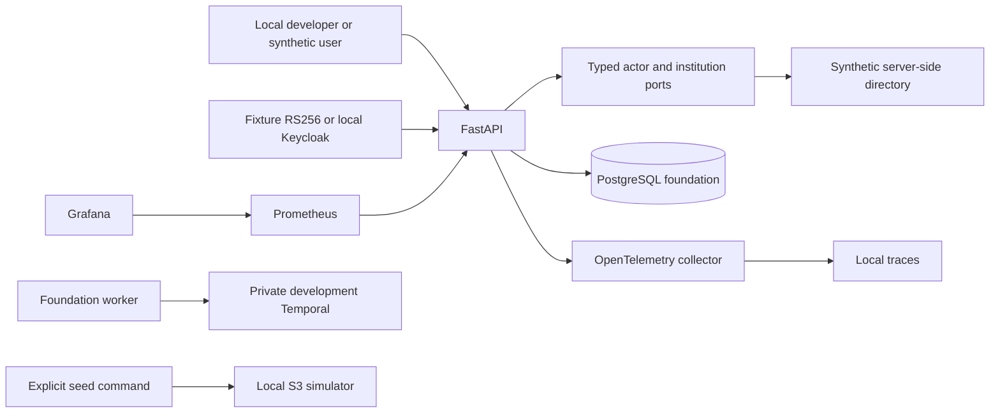

# Foundation architecture and boundaries

The architecture baseline is a modular Python/FastAPI application, PostgreSQL domain store, Temporal durable orchestration, private object storage and isolated processing pools. Phase 1 implements a small authenticated fixture use case and platform contracts; it does not implement the later case engine.

## Ownership and boundaries

Institution ID denotes evidence ownership; regulatory organization/case assignment is a different future authorization relationship. No client role/tenant value grants privileges. Phase 1 actor mapping is a synthetic local adapter. Phase 2 implements database-backed assignments/RLS and privileged approval separation.

Request handlers compose application services; module application code imports typed ports. AST architecture checks reject FastAPI/SQLAlchemy/provider clients and cross-module implementation imports inside business modules. Domain computations must remain free of infrastructure. Infrastructure/network/storage belongs to adapters and platform.

## Deployment and trust

Only loopback ports are exposed by development Compose. Native API binds 127.0.0.1. The local Keycloak direct grant is a development test convenience; production browser identity must use the agreed PKCE/BFF design later. Docker development Temporal and Moto are simulators/development dependencies, not production infrastructure.

Production reference: AWS Mumbai, private ECS workers/API, RDS Multi-AZ for domain and separate workflow persistence, private S3/KMS, scoped secrets, dedicated connector egress, independent audit/archive control. Service availability, budget, credentials, data residency terms and actual recovery targets require Phase 14 approval.

## Compatibility decisions

Python 3.12 is frozen by the project constraint and uv.lock. Container image references are immutable digests resolved from their registries. A registry digest is not a runtime test result; consult the verification report. The security pipeline gates known vulnerabilities and preserves exceptions rather than suppressing them. Native/test fixtures must not be promoted into staging/production; configuration rejects those modes in this foundation.
