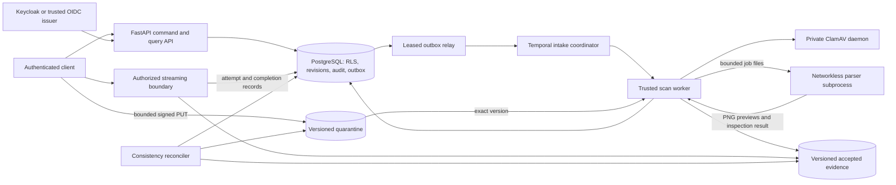

# Phase 2–4 backend implementation

Implementation root: `C:\SideQuest\SIH`. Scope: local, synthetic development release. This document records the implemented architecture and operating contracts; the executed results are in [verification](PHASE_2_4_VERIFICATION.md). The complete roadmap remains [the backend plan](../BACKEND_IMPLEMENTATION_PLAN.md).

## Architecture and service ownership

| Service | Responsibility | Database authority | Other authority |
|---|---|---|---|
| Migrator | Forward migrations, local role provisioning, synthetic seed | Local owner; runs to completion | No applicant data processing |
| API | Identity, assignments, applications, upload commands | `wb_app`, transaction-local verified identity | Quarantine upload signing and exact-version metadata |
| Delivery boundary | Read authorized accepted originals/previews | Separate `wb_delivery` connection pool | Read accepted object versions |
| Relay | Lease events, start stable workflow IDs, acknowledge delivery | `wb_relay`, outbox lease columns only | Temporal client |
| Intake worker | Coordinate scans and acknowledge submissions | `wb_worker`, receipt/task inserts | Temporal queue `intake` |
| Scan worker | Hash, malware scan, inspection, promotion, atomic acceptance | `wb_scanner`, evidence outcome/derivative/task authority | Quarantine reads, clean writes; private ClamAV connection |
| Parser | Inspect untrusted files, render PNG pages, probe MP4 | None | Network disabled; no credentials; input read-only, output writable |
| ClamAV | INSTREAM scanning | None | Internal processing network; signatures read-only |
| Signature updater | Trusted signature downloads, 12 checks/day | None | Internet and signature volume; no evidence mount |
| Reconciler | Expiry, missing objects, stuck scans, orphan review tasks | `wb_scanner`; bounded persisted cursors | Version-specific storage inventory; no original deletion |
| Observability | Request traces, process counters, queue/age gauges | None | Collector, Jaeger, Prometheus and Grafana |

All runtime database logins are non-owner, non-superuser, and cannot bypass RLS. `wb_security_owner` is a separate **NOLOGIN** security-kernel owner with narrowly exposed, fixed-search-path functions. Runtime logins cannot assume that role. The API rejects owner/bypass credentials at startup. Development Moto simulates S3; it does not prove cloud IAM enforcement. The role policy template in `infra/storage/` is a deployment input for later cloud qualification.

## Phase 2: identity and authorization

### 2.1 Authentication and assurance

`JWTVerifier` accepts RS256 access tokens with the configured issuer, audience, subject, issue time and expiry. OIDC mode resolves signing keys through JWKS. Identity is mapped by the persisted `(issuer, subject)` pair; JWT role or institution fields do not grant authority. Missing, disabled, revoked-session and pre-revocation tokens are rejected. Each request rechecks current database authority.

Privileged assignment, membership and emergency commands require a trusted `amr` containing `mfa` and authentication within five minutes. Future auth times beyond the tolerance are denied. Assurance comes from the configured issuer, never an HTTP header or request body. The local token utility can simulate MFA for synthetic tests; it does not demonstrate real multifactor enrollment. The live Keycloak smoke checks JWKS verification and persisted membership. A cloud IdP's claim mapping, key rollover and real MFA enrollment require that organization's configured IdP and are external deployment gates.

Deliverables: `adapters/auth.py`, `contracts/intake.py`, `modules/identity_access/policy.py`, persisted identity tables, `/api/v1/me`, session revocation and identity-disable commands, OIDC smoke and negative assurance tests.

### 2.2 Object/action/property decisions

The central security kernel evaluates active role, institution, case assignment, jurisdiction, stage and read/write purpose. `DomainStore` applies the trusted request context to each transaction and exposes the application command checks. HTTP handlers validate contracts and delegate; they do not accept ownership/stage fields outside those contracts.

| Actor | Reads | Writes and privileged actions |
|---|---|---|
| Institution editor | Own institution cases and evidence | Create/revise drafts, upload, select exact evidence and submit |
| Institution viewer | Own institution cases and accepted delivery | None |
| Officer | Current assigned cases | Future scrutiny actions require their own commands; institution drafts/uploads still require editor authority |
| Auditor | Current assigned cases | None |
| Supervisor | Scoped assignment/grant administration | Recent MFA; no automatic evidence access without assignment |
| Identity administrator | Scoped role administration | Recent MFA; cannot grant supervisor/admin, self-grant, or disable privileged peers |
| Rule author/approver | Reserved for later rule lifecycle | Cannot combine author and approver for the same persisted person, including issuer aliases |
| Emergency requester | One approved case, recent MFA, at most one hour | Read only; independent scoped manager approval; explicit revocation |

Unavailable foreign objects return 404. Forbidden actions on visible objects return 403; read-only RLS can also hide rows from update locks. Missing assurance returns 403. Unmapped/revoked authentication returns 401. Error responses expose stable codes and request IDs without SQL or provider exceptions.

Deliverables: permission catalogue above, `wb.can_access`/`wb.manages`, strict request DTOs, composite ownership FKs, RLS/object/property/function tests. Reports, findings, exports and search are later-phase surfaces and are not exposed prematurely.

### 2.3 Database isolation

The API sets issuer, subject, session, token times and assurance with bound `set_config(..., true)` inside the transaction. Commit/rollback clears these settings before a pooled connection is reused. Every institution/case relation uses RLS; runtime roles neither own the tables nor bypass policies. Composite keys reject foreign slot/upload/version links even if a service check is missed. Evidence identity, accepted outcomes, submitted applications, revisions, audit and access history are protected by grants/triggers.

Administrative triggers enforce jurisdiction and rule duty separation under concurrent writes, including an advisory lock per person. Migration credentials are confined to the one-shot migrator. Runtime source code and configuration never fall back to the owner URL when a dedicated runtime URL is missing.

Deliverables: migrations through `0006_scope_guards`, security SQL, generated local role credentials, no-context query tests, alternating-tenant pool tests, owner-role rejection and alias separation tests.

### 2.4 Operational administration

Assignment grants carry manager, reason, institution/case, access role and expiry. Revoke/expiry takes effect on the next protected operation. Membership administration is jurisdiction-bound and cannot silently elevate administrative roles. Account disable invalidates all mapped aliases of the person. Emergency grants require a distinct person's approval, bound expiry and recent requester assurance; they can be revoked by a scoped manager. See the runbook below for emergency procedure and maintenance boundaries.

## Phase 3: immutable application backbone

### 3.1 Drafts, references and revisions

Create a draft with institution, category, academic cycle, programme, level, declared values and requirement slots. Jurisdiction is read from the persisted institution. Portal source and reference must be supplied together; both use NFKC normalization, trimming and uppercase. The normalized pair has a uniqueness constraint. Every accepted draft revision writes an immutable revision row. An `expected_revision` conflict returns 409. Commands require an actor/route-scoped idempotency key; repeating content replays the receipt, changed content under the same key returns 409.

Declared values are explicitly institution declarations and remain unverified. They are separate from future extracted facts or issuer-confirmed facts. Clients can preserve per-value source/basis in declaration objects; the manifest labels the whole declaration basis. Non-finite values are rejected. JSON command bodies are capped at 1 MiB; file bytes bypass the API through bounded grants.

### 3.2 Slots, versions and submission manifests

Each slot belongs to an institution and application; several immutable evidence versions can support it. Parent references must belong to the same application and slot. No newest-upload pointer decides authority. Submission names accepted evidence IDs, validates their scope and freezes their clean storage versions, hashes, sizes, MIME types and lineage into an immutable revision. Live pending uploads must finish or be aborted/expired before submission.

Manifest format `intake-manifest-v1` uses sorted JSON keys, UTF-8, no insignificant whitespace, no non-finite numbers, and evidence sorted by ID. SHA-256 covers those canonical bytes. This is the application's versioned canonicalization, not a claim of RFC 8785 compliance. Submitted summaries use the selected frozen manifest. Incomplete required slots are reported as missing, without making a regulatory decision. Submission does not fabricate verification or approval.

### 3.3 Atomic audit, outbox and receipts

A business command, its revision, audit entry, idempotency receipt and processing event commit in one PostgreSQL transaction. A write failure rolls everything back. Audit sequence allocation serializes per institution stream using a transaction advisory lock. Each entry hashes the prior hash, stream ID, sequence and the exact PostgreSQL `jsonb::text` event representation under format `postgres-jsonb-text-sha256-v1`. `tools/verify_audit.py` verifies the full stream and reports the head hash. Later signed external checkpoints remain Phase 10/12 work; a database operator with destructive authority is outside this v1 guarantee.

The relay leases up to 20 events using `FOR UPDATE SKIP LOCKED`, uses 45-second leases, and starts `outbox-<event UUID>` workflows. A lost acknowledgement or expired lease can repeat delivery; stable workflow IDs and consumer receipts prevent repeated finalized business effects. Retry delays are bounded. Committed events stay in PostgreSQL during a Temporal outage. An acknowledged submission currently creates an honest `SCREENING_PENDING_PHASE_5` task. The comprehensive processing workflow remains Phase 5.

### 3.4 Stored read models and contracts

Case list, revision history, audit history and access history use bounded pages/cursors. Summaries count stored records and reconcile with selected evidence after submission. Operations tasks come from actual reconciliation/scan/receipt events. The API's generated OpenAPI is available at `/openapi.json` and `/docs`; the contract example is in `docs/api/intake-example.md`. Ownership/time, delivery and object-version indexes are versioned in migrations. Query-plan verification is recorded with the acceptance results.

## Phase 4: secure file lifecycle

### 4.1 Upload sessions and quotas

Single PUT and multipart sessions reserve storage under an institution advisory lock. Defaults: 25 MiB per file, 500 MiB per institution, 250 MiB per actor within that institution, 10 pending processing reservations per institution, 15-minute grants and 5 MiB multipart parts. Limits are configurable within validated bounds. Completed quarantine bytes remain charged; rejection does not silently reclaim retained bytes. Pending sessions release their reservation on expiry or abort.

The grant binds key, type, planned length and SHA-256 expectation. The API checks provider multipart part indices and exact lengths before completion. Finalization pins a non-null provider version ID; scan and promotion always use that exact version. The whole-file SHA-256 is independently computed in the scan worker. Reusing a still-valid grant can create another provider version, but cannot change the pinned evidence or submitted manifest. Revoking a session prevents completion; it cannot invalidate an already-issued signed URL before its signature TTL. Local Moto behavior is tested separately from provider signature enforcement.

### 4.2 Acceptance and isolation

State machine: `QUARANTINED → SCANNING → ACCEPTED / REJECTED`; infrastructure failure becomes `SCAN_FAILED` and an operations task. Temporal retries three times. No unavailable scanner, stale signature, parser failure or missing object is interpreted as a clean file. Terminal evidence and original identity are immutable.

The trusted scanner downloads the pinned version into a bounded shared input volume, recomputes size/hash, calls actual ClamAV INSTREAM, and stages a parser job only after malware checks. The parser has no network, cloud credentials or database connection. Each job runs in a child with CPU, address-space, output-size, file-count and wall-clock limits. Parser outputs are bound to the original SHA and validated before persistence/promotion.

Accepted types are PDF, JPEG, PNG and MP4. Magic/type mismatch is rejected. Encrypted PDFs are unsupported and rejected. PDF inspection rejects active actions/scripts/embedded content, enforces 50 pages and dimensions/object limits, and renders bounded PNG previews. Images are decoded/re-encoded with decompression and animation limits. MP4 is inspected with static ffprobe, local-file protocols only, finite duration and a video stream. Phase 11 adds semantic video checks and frame sampling; Phase 4 does not claim equipment inference. Accepted original bytes are preserved; safe previews are separate versioned objects. An acceptance result means this inspection profile completed, not that content is authentic or guaranteed harmless.

Parser scratch volumes are size-limited. Terminal job input is removed by the trusted worker; the parser removes its own output on a UUID-scoped cleanup marker. Failed-job scratch is retained for bounded retry and operator review. The reconciler never deletes accepted originals.

### 4.3 Delivery and access records

Accepted originals and PNG pages are streamed through authorization on every new request. No raw clean-storage URL is returned. GET and HEAD originals and single byte/suffix ranges are supported. Invalid/multiple/out-of-bounds ranges return 416. Quarantine, rejected and failed evidence return 409. Original content uses attachment disposition, safe ASCII filenames, nosniff, no-store and a restrictive sandbox CSP. PNG derivatives are separately authorized.

An access attempt commits before storage bytes are read. A separate append-only completion records completed, failed or aborted streams and the bytes read for delivery. Iterator close handles cancellation even before the first byte. These counts describe bytes handed to the response stream; they do not prove receipt at the client's device. Database failure at completion leaves a durable started event and increments a failure counter for reconciliation/incident review. Authentication changes stop new requests; already-open streams are not continuously reauthorized per chunk.

### 4.4 Reconciliation and operations

The minute-loop reconciler expires sessions, aborts incomplete multipart uploads, checks exact accepted/quarantine/derivative object versions, identifies scans older than five minutes, and reports unreferenced clean versions older than a ten-minute promotion grace period. Persisted cursors bound each cycle to 500 evidence rows, 500 derivatives and 500 provider inventory entries. A transaction advisory lock prevents overlapping reconciliation cycles. Known objects are checked by indexed `(key, version)` lookup; a truncated database page cannot falsely make a known object an orphan.

Unique `(kind, resource)` tasks deduplicate unchanged conditions. Tasks require operator confirmation before destructive remediation. Original deletion is deliberately absent. Default bucket setup enables versioning, encryption, public access blocking and one-day incomplete multipart abortion; retention/deletion of evidence requires later approved policy.

Metrics: oldest pending outbox seconds, dispatch failures, quarantine age, signature age, scan failures and access-completion failures. Prometheus scrapes the API and private relay/scanner/reconciler metrics endpoints. Metrics contain counts/ages, not applicant identifiers or storage paths.

## Operating procedures

### Startup and verification

Run `scripts/dev.ps1 up` from the repository (or `sh scripts/dev.sh up`). Bootstrap creates local credentials without replacing existing values. The migrator applies forward changes and seeds synthetic identities before runtime services start. Initial ClamAV signature download requires internet and may take time. `scripts/dev.ps1 check` runs platform/OIDC checks. Run the acceptance commands in the verification document for Phase 2–4.

### Emergency access

The officer requests one case with a concrete purpose and bounded lifetime using recent MFA. A different scoped manager reviews the reason and approves. The officer reads with recent MFA; the grant cannot write. Revoke the grant when the purpose ends; expiry is enforced by the database. Inspect the stored request, approver and audit entries. Organizational role provisioning, person alias linking and administrator recovery use reviewed maintenance procedures, never self-service escalation.

### Signature or parser outage

Inspect private service health and metrics. The updater checks signatures every two hours; the daemon checks its signature files for reload. A signature older than 72 hours blocks acceptance. Repair the update path, confirm the signature timestamp, then retry failed workflows using the recorded event ID and the scan-retry runbook. Parser unavailability retains quarantine and creates a task. Never set evidence to accepted manually, skip checksum verification, or expose quarantine to compensate for an outage.

After all automatic attempts are exhausted, `uv run --project backend python backend/tools/retry_intake_scan.py <evidence UUID>` is the local operator path. It permits only `SCAN_FAILED`, checks the original workflow status and queues a complete fresh inspection. A running automatic retry is left in place. Successful terminal inspection resolves the corresponding retry task. Deployed maintenance authorization and centralized job management remain Phase 5/14 work.

### Storage inconsistency

For missing accepted bytes, restore the **exact** recorded version from approved recovery copies; a new latest object cannot satisfy the historical reference. For missing previews, regenerate under a new reviewed derivative version in a future repair path. For orphan clean copies, compare active workflow/receipt/manifest references before retention action. Review stuck scans by event ID. The implemented reconciler reports conditions and does not delete source records or accepted originals.

## External and later-phase gates

Implemented local behavior is distinct from cloud qualification. Real institutional IdP MFA, approved person linking, AWS IAM/KMS/Object Lock/network controls, production backup/restore, external security review and production load/SLO evidence require the organization's deployment and owners. Phase 5 expands workflow operations; Phases 6–12 add extraction, regulatory rules, issuer integrations, reports, rectification, alerts and semantic media checks. No live AICTE decision, issuer authentication, OCR or fraud-detection capability is implied by these phases.
