# Phase 7 Backend Verification: Rule Registry and Deterministic Evaluation

Implementation root: `backend/src/workbench/modules/rule_registry/` and `backend/src/workbench/modules/evaluation/`.
Scope: local, synthetic development release and PostgreSQL RLS integration.
This document details the architectural implementation, schema, deterministic DSL engine, and test verification of Phase 7 as specified in [BACKEND_IMPLEMENTATION_PLAN.md](../../docs/BACKEND_IMPLEMENTATION_PLAN.md) (Section 6.4, 6.5, 6.6, 8.4, and Section 10).

---

## 1. Architecture and Pipeline Topology

```mermaid
flowchart TD
    subgraph Registry ["Subphase 7.1: Versioned Rule Registry"]
        JSONRegister["output/AICTE_PS26261_Rule_Evidence_Register.json (22 Rules)"]
        SourceRegister["output/AICTE_PS26261_Source_Register.json (4 Sources)"]
        Importer["RuleRegistryImporter (+16 Page Offset Verification)"]
        JSONRegister & SourceRegister --> Importer
        Importer --> RuleSources["rule_sources (SHA-256 Hashed Sources)"]
        Importer --> Interpretations["rule_interpretations (INTERPRETATION_PENDING Abstention)"]
        Importer --> Versions["rule_versions (AST DSL Expressions, Immutable Hashes)"]
        Importer --> Releases["rule_releases & release_members (Active Baseline)"]
    end

    subgraph Inputs ["Fact Sets & Declared Claims"]
        FrozenFactSet["Frozen FactSet (fact_sets & fact_set_members)"]
        DeclaredClaims["Application Claims (claims)"]
        EvidenceSlots["Evidence Manifest (evidence_slots check)"]
    end

    subgraph DeterministicEngine ["Subphase 7.2 & 7.3: Pure Deterministic DSL Evaluator"]
        Versions & Releases --> Evaluator["DeterministicEvaluator (Zero Network Calls)"]
        FrozenFactSet & DeclaredClaims & EvidenceSlots --> Evaluator
        Evaluator --> DSL["RuleEvaluatorDSL (Exact Decimal Math & AST Operations)"]
        DSL --> ThresholdOp["threshold_lookup (Bandwidth Tiers)"]
        DSL --> RatioOp["ratio_check (Computers 1:6, Printers 1:30)"]
        DSL --> DateOp["date_validity_check (Fire Safety NOC Validity)"]
        DSL --> CadreOp["abstain_check (UG Cadre Ambiguity -> NOT_EVALUABLE)"]
    end

    subgraph StatusDimensions ["Subphase 7.3: 6 Orthogonal Status Dimensions"]
        Evaluator --> DimCompleteness["completeness_status (COMPLETE / MISSING_EVIDENCE)"]
        Evaluator --> DimSource["source_verification_status (VERIFIED / PENDING / UNVERIFIED)"]
        Evaluator --> DimForensic["forensic_concern_status (NONE_OBSERVED / FLAGGED)"]
        Evaluator --> DimDocValidity["document_validity_status (VALID / EXPIRED / UNKNOWN)"]
        Evaluator --> DimCompliance["compliance_status (PASS / DEFICIENCY / NOT_EVALUABLE)"]
        Evaluator --> DimWorkflow["case_workflow_status (RECOMMENDED_FOR_REVIEW)"]
    end

    subgraph InvariantAndPersistence ["Evaluation Run Persistence & Invariant Enforcement"]
        Evaluator --> RunResult["EvaluationRunResult"]
        RunResult --> InvariantCheck["Invariant: adverse_action_allowed = False"]
        InvariantCheck --> PersistRuns["evaluation_runs (Atomic Audit Hash)"]
        InvariantCheck --> PersistInputs["run_inputs (Lineage Tracking)"]
        InvariantCheck --> PersistOutcomes["requirement_outcomes (Per-Rule Traces)"]
        InvariantCheck --> PersistFindings["findings (Actionable Non-Adverse Flags)"]
    end

    subgraph RESTEndpoints ["Subphase 7.4: Reviewer & Officer HTTP APIs"]
        PersistRuns & PersistFindings --> API["Intake & Evaluation API Router"]
        API --> PostEval["POST /api/v1/applications/{id}/evaluations"]
        API --> GetEval["GET /api/v1/evaluations/{id}"]
        API --> GetFindings["GET /api/v1/evaluations/{id}/findings"]
        API --> GetFindingEvidence["GET /api/v1/findings/{id}/evidence"]
    end
```



---

## 2. Database Schema & Multi-Tenant RLS Policies

Phase 7 introduces 9 relational tables managed by Alembic migration [`0009_phase_7_rules`](file:///c:/Users/indhu/SIH_26/backend/migrations/versions/0009_phase_7_rules.py). Every table enforces PostgreSQL Row Level Security (RLS) with dual protection:
1. **Rule Registry Tables** (`rule_sources`, `rule_interpretations`, `rule_versions`, `rule_releases`, `release_members`):
   - Read access: Accessible to all active actors (`actor_has_active_membership()`).
   - Write access: Restricted strictly to elevated supervisor sessions (`wb.elevated() AND wb.has_role('supervisor')`).
2. **Evaluation & Findings Tables** (`evaluation_runs`, `run_inputs`, `requirement_outcomes`, `findings`):
   - Tenant isolation: Restricted to institutions and case officers assigned to the application (`wb.can_access(institution_id, application_id, true)` or elevated reviewer/officer role).

| Table Name | Primary Key | Description & Key Invariants |
|---|---|---|
| `rule_sources` | `id` (VARCHAR 36) | Authoritative source documents (e.g. AICTE Approval Process Handbook 2024-27). Stores document title, official URL, publication date, and mandatory SHA-256 hash. |
| `rule_interpretations` | `id` (VARCHAR 36) | Legal/regulatory interpretations of policy rules. Tracks `interpretation_state` (`DRAFT`, `INTERPRETATION_PENDING`, `APPROVED`, `SUPERSEDED`, `REJECTED`) and content status (`V-U`, `V-A`, etc.). |
| `rule_versions` | `id` (VARCHAR 36) | Immutable executable rule representations. Stores AST `dsl_expression`, applicability cycle, printed and PDF page locators (+16 offset), content hash, and invariant `adverse_action_allowed = False`. |
| `rule_releases` | `id` (VARCHAR 36) | Bundle of rule versions forming a published baseline (e.g. `AICTE-APH-2024-27-SEED`). Stores canonical SHA-256 manifest hash and activation status. |
| `release_members` | `id` (VARCHAR 36) | Join table mapping releases to rule versions. Unique composite constraint on `(release_id, rule_version_id)`. |
| `evaluation_runs` | `id` (VARCHAR 36) | Records an execution of deterministic rules against frozen facts. Tracks all 6 orthogonal status dimensions, manifest hash, and invariant `adverse_action_allowed = False`. |
| `run_inputs` | `id` (VARCHAR 36) | Lineage log linking evaluation runs to inputs (`FACT_SET`, `APPLICATION_REVISION`, `RULE_RELEASE`). |
| `requirement_outcomes` | `id` (VARCHAR 36) | Per-rule evaluation outcomes (`PASS`, `POTENTIAL_DEFICIENCY`, `NOT_EVALUABLE`, `FLAGGED_FOR_HUMAN_REVIEW`). Stores observed values, required values, and step-by-step arithmetic traces. |
| `findings` | `id` (VARCHAR 36) | Generated deficiency or abstention items requiring human review. Enforces `adverse_action_allowed = False`. |

---

## 3. Subphase Implementation Details

### Subphase 7.1: Versioned Rule Registry & Research Register Import
- **Source Document Import**: Loaded 4 authoritative regulatory sources from `output/AICTE_PS26261_Source_Register.json` with verified SHA-256 digest (`153d54816f2cf11489218e239113544e8d49b73680009688baa7dc4880636051` for U02 AICTE Approval Process Handbook 2024-27).
- **Rule Evidence Register Import**: Imported all 22 rules from `output/AICTE_PS26261_Rule_Evidence_Register.json`.
- **Page Offset Verification**: Verified and enforced the invariant `pdf_page == printed_page + 16` for all APH citations.
- **Calibrated Abstention on Ambiguity**: Kept unresolved rules in `INTERPRETATION_PENDING` so they abstain (`NOT_EVALUABLE`), including:
  - `FACULTY.CADRE.AMBIGUITY`: UG engineering faculty cadre ratio ambiguity (1:2:6 cadre distribution conflicting across clauses).
  - `CATEGORY.BBA_BMS_BCA.2026`: 2026-27 transition category ambiguity for undergraduate management/computer programs.
  - `ELP.50_PERCENT.CONFLICT`: Conflict regarding 50% physical vs digital course delivery quotas.

### Subphase 7.2: Pure Python Deterministic DSL Compiler
- **AST Architecture**: Implemented pure Python AST evaluator [`RuleEvaluatorDSL`](file:///c:/Users/indhu/SIH_26/backend/src/workbench/modules/evaluation/dsl.py) with zero third-party dependencies, zero network I/O, and zero dynamic code execution (`eval`/`exec`).
- **Exact Decimal Arithmetic**: All numbers, ratios, thresholds, and calculations use Python's `Decimal` module with strict `quantize` to eliminate IEEE-754 floating-point inaccuracies:
  - Bandwidth tiers lookup: exact threshold boundary comparisons (`1-300` -> 100 Mbps, `301-600` -> 300 Mbps, `601-900` -> 500 Mbps, `>900` -> 1000 Mbps).
  - Ratio checking: exact rational divisions quantized to 4 decimal places with minimum absolute requirement enforcement (e.g., computers 1:6 ratio, printers 1:30 ratio with minimum 2).
  - Date validity: ISO 8601 comparison between document `valid_upto` date and the review date `evaluation_as_of`.

### Subphase 7.3: 6 Orthogonal Status Dimensions & Adverse Action Invariant
- **Orthogonal Dimensions Enforced**:
  1. `completeness_status`: `COMPLETE` (all mandatory slots filled) or `MISSING_MANDATORY_EVIDENCE`.
  2. `source_verification_status`: `VERIFIED`, `VERIFICATION_PENDING`, or `UNVERIFIED_SOURCE`.
  3. `forensic_concern_status`: `NONE_OBSERVED` or `FLAGGED_FOR_HUMAN_REVIEW`.
  4. `document_validity_status`: `VALID_ON_REVIEW_DATE`, `EXPIRED_ON_REVIEW_DATE`, or `UNKNOWN`.
  5. `compliance_status`: `PASS`, `POTENTIAL_DEFICIENCY`, or `NOT_EVALUABLE`.
  6. `case_workflow_status`: `RECOMMENDED_FOR_REVIEW`, `PENDING_ADDITIONAL_INPUT`, or `READY_FOR_DECISION`.
- **Adverse Action Invariant**: Machine evaluation runs and findings strictly hardcode `adverse_action_allowed = False`. An automated tool can never trigger adverse regulatory action without human officer review.

### Subphase 7.4: Reviewer & Officer HTTP APIs
- `POST /api/v1/applications/{id}/evaluations`: Triggers deterministic evaluation over active frozen FactSets and declared claims using the active rule release baseline. Returns run summary, dimension outcomes, and audit hash.
- `GET /api/v1/evaluations/{id}`: Returns complete evaluation run details, 6 orthogonal status dimensions, and execution parameters.
- `GET /api/v1/evaluations/{id}/findings`: Returns list of all generated findings and non-compliance flags for the run.
- `GET /api/v1/findings/{id}/evidence`: Returns detailed calculation trace, rule citation, clause, page locators (+16 offset), and observed vs expected delta.

---

## 4. Test Verification & Golden Vectors

The comprehensive test suite in [`backend/tests/test_phase_7_evaluation.py`](file:///c:/Users/indhu/SIH_26/backend/tests/test_phase_7_evaluation.py) exercises every subphase and golden policy vector against real PostgreSQL with RLS enabled.

### Golden Test Vectors Summary

| Test Vector | Domain Scenario | Input Facts / Claims | Expected Outcome | Verification Status |
|---|---|---|---|---|
| **Bandwidth Tier: Pass** | Approved intake 500 (Tier 301–600 requires 300 Mbps) | `intake: 500, bandwidth: 350 Mbps` | `PASS` (`observed=350, required=300`) | PASSED |
| **Bandwidth Tier: Deficient** | Approved intake 500 (Tier 301–600 requires 300 Mbps) | `intake: 500, bandwidth: 100 Mbps` | `POTENTIAL_DEFICIENCY` (`delta=-200`) | PASSED |
| **Computing Ratio: Pass** | Intake 600 students, 1:6 ratio | `intake: 600, computers: 100` | `PASS` (`ratio=0.1667 >= 0.1667`) | PASSED |
| **Computing Ratio: Deficient** | Intake 600 students, 1:6 ratio | `intake: 600, computers: 80` | `POTENTIAL_DEFICIENCY` (`ratio=0.1333 < 0.1667`) | PASSED |
| **Printer Ratio: Pass** | 90 computers, 1:30 ratio & min 2 | `computers: 90, printers: 3` | `PASS` (`ratio=0.0333 >= 0.0333, count=3 >= 2`) | PASSED |
| **Printer Ratio: Deficient** | 90 computers, 1 printer | `computers: 90, printers: 1` | `POTENTIAL_DEFICIENCY` (Fails absolute minimum of 2) | PASSED |
| **Fire Safety: Valid** | Review date 2026-10-26, certificate valid upto 2027-05-10 | `valid_upto: 2027-05-10` | `PASS` & `VALID_ON_REVIEW_DATE` | PASSED |
| **Fire Safety: Expired** | Review date 2026-10-26, certificate expired on 2025-05-10 | `valid_upto: 2025-05-10` | `POTENTIAL_DEFICIENCY` & `EXPIRED_ON_REVIEW_DATE` | PASSED |
| **Cadre Ratio Ambiguity** | Ambiguous UG engineering faculty cadre clause | `faculty_count: 50` | `NOT_EVALUABLE` & `INTERPRETATION_PENDING` | PASSED |
| **Adverse Action Invariant** | Any deficient evaluation run or finding | Deficient bandwidth | `adverse_action_allowed == False` strictly enforced | PASSED |

---

## 5. Verification Run Logs

### Phase 7 Test Suite Execution
```
$ uv run --project backend pytest backend/tests/test_phase_7_evaluation.py -v

backend\tests\test_phase_7_evaluation.py::test_rule_registry_importer_page_offsets_and_unresolved_abstentions PASSED [ 12%]
backend\tests\test_phase_7_evaluation.py::test_dsl_bandwidth_tiers_pass_and_deficiency PASSED [ 25%]
backend\tests\test_phase_7_evaluation.py::test_dsl_computing_and_printer_ratios PASSED [ 37%]
backend\tests\test_phase_7_evaluation.py::test_dsl_fire_certificate_valid_and_expired PASSED [ 50%]
backend\tests\test_phase_7_evaluation.py::test_cadre_ambiguity_abstention_never_adverse PASSED [ 62%]
backend\tests\test_phase_7_evaluation.py::test_deterministic_evaluator_orthogonal_dimensions PASSED [ 75%]
backend\tests\test_phase_7_evaluation.py::test_evaluation_service_database_lifecycle PASSED [ 87%]
backend\tests\test_phase_7_evaluation.py::test_api_endpoints_evaluations_and_findings PASSED [100%]

======================== 8 passed, 1 warning in 10.47s ========================
```

### Full System Regression Test Suite Execution
```
$ uv run --project backend pytest backend/tests/test_api.py backend/tests/test_config.py backend/tests/test_database_integration.py backend/tests/test_foundation.py backend/tests/test_intake_integration.py backend/tests/test_phase_5_workflows.py backend/tests/test_phase_6_extraction.py backend/tests/test_phase_7_evaluation.py backend/tests/test_telemetry.py backend/tests/test_trace_context.py -q

74 passed, 1 warning in 125.88s (0:02:05)
```

### Static Analysis and Code Formatting
- **Linter (`ruff check`)**:
  ```
  $ uv run --project backend ruff check backend/src backend/tests backend/migrations
  All checks passed!
  ```
- **Formatter (`ruff format --check`)**:
  ```
  $ uv run --project backend ruff format --check backend/src backend/tests backend/migrations
  147 files already formatted
  ```
- **Type Checker (`mypy`)**:
  ```
  $ uv run --project backend mypy --config-file backend/pyproject.toml backend/src/workbench
  Success: no issues found in 105 source files
  ```

---

## 6. Phase 7 Deliverables Matrix

| Requirement | Implementation Artifact | Status |
|---|---|---|
| Alembic Migration for 9 Rule & Evaluation Tables | [`backend/migrations/versions/0009_phase_7_rules.py`](file:///c:/Users/indhu/SIH_26/backend/migrations/versions/0009_phase_7_rules.py) | Verified |
| SQLAlchemy Schema with Multi-Tenant RLS | [`backend/src/workbench/adapters/tables.py`](file:///c:/Users/indhu/SIH_26/backend/src/workbench/adapters/tables.py) | Verified |
| Research Register Importer (+16 Offset, Ambiguity Abstention) | [`backend/src/workbench/modules/rule_registry/importer.py`](file:///c:/Users/indhu/SIH_26/backend/src/workbench/modules/rule_registry/importer.py) | Verified |
| Rule Registry Models & Domain Enums | [`backend/src/workbench/modules/rule_registry/models.py`](file:///c:/Users/indhu/SIH_26/backend/src/workbench/modules/rule_registry/models.py) | Verified |
| Evaluation Domain Models (6 Dimensions, Invariant) | [`backend/src/workbench/modules/evaluation/models.py`](file:///c:/Users/indhu/SIH_26/backend/src/workbench/modules/evaluation/models.py) | Verified |
| Pure Python Deterministic DSL Engine (`Decimal` Math) | [`backend/src/workbench/modules/evaluation/dsl.py`](file:///c:/Users/indhu/SIH_26/backend/src/workbench/modules/evaluation/dsl.py) | Verified |
| Deterministic Evaluator Engine | [`backend/src/workbench/modules/evaluation/evaluator.py`](file:///c:/Users/indhu/SIH_26/backend/src/workbench/modules/evaluation/evaluator.py) | Verified |
| Rule Registry & Evaluation Database Adapters | [`backend/src/workbench/adapters/rule_registry_service.py`](file:///c:/Users/indhu/SIH_26/backend/src/workbench/adapters/rule_registry_service.py) & [`evaluation_service.py`](file:///c:/Users/indhu/SIH_26/backend/src/workbench/adapters/evaluation_service.py) | Verified |
| Evaluations & Findings REST Endpoints | [`backend/src/workbench/api/intake.py`](file:///c:/Users/indhu/SIH_26/backend/src/workbench/api/intake.py) | Verified |
| Golden Vectors & End-to-End Test Suite | [`backend/tests/test_phase_7_evaluation.py`](file:///c:/Users/indhu/SIH_26/backend/tests/test_phase_7_evaluation.py) | Verified |
