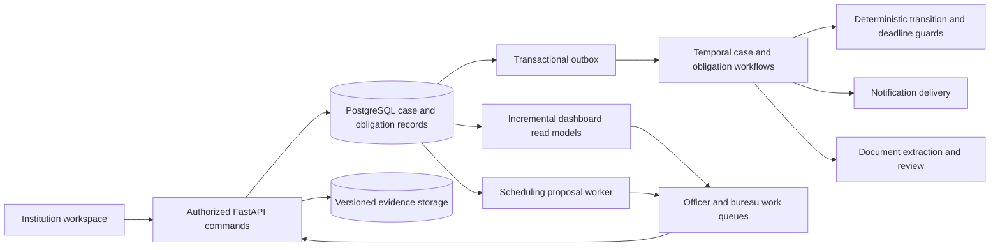

# NiyamFlow: Complete Solution for SIH26262

> **Evaluator review update:** For the refined build scope, online/offline scheduling distinction, measurement requirements and exact PPT references, read [Evaluator Review and PPT References](SIH26262_EVALUATOR_REVIEW_AND_PPT_REFERENCES.md). Its recommendations supersede illustrative performance targets and any broader optimization claims in this document.

**Problem statement:** SIH26262  
**Prepared:** 30 October 2026, Asia/Kolkata  
**Purpose:** Complete consolidated solution, research, architecture, backend contracts, prototype plan, evaluation, PPT content and source catalogue.  
**Status:** Proposed new-statement design, grounded in public primary sources and the current repository. This document does not claim that the new approval-routing, obligation or scheduling modules are already implemented.

## Contents

- [1. Recommended direction](#1-recommended-direction)
- [2. What the official statement requires](#2-what-the-official-statement-requires)
- [3. Existing solutions: what the research actually establishes](#3-existing-solutions-what-the-research-actually-establishes)
- [4. Policy fidelity before automation](#4-policy-fidelity-before-automation)
- [5. Proposed product behavior](#5-proposed-product-behavior)
- [6. AI with a bounded, useful role](#6-ai-with-a-bounded-useful-role)
- [7. Efficient architecture using your existing project](#7-efficient-architecture-using-your-existing-project)
- [8. What to reuse and what is genuinely new](#8-what-to-reuse-and-what-is-genuinely-new)
- [9. Prototype scope and screens](#9-prototype-scope-and-screens)
- [10. Recommended five-minute demonstration](#10-recommended-five-minute-demonstration)
- [11. How to make 'optimized' a measurable claim](#11-how-to-make-optimized-a-measurable-claim)
- [12. Build order for the pivot](#12-build-order-for-the-pivot)
- [13. Pitch claims and difficult questions](#13-pitch-claims-and-difficult-questions)
- [14. Research sources and limits](#14-research-sources-and-limits)
- [15. Proposed backend contracts and implementation acceptance](#15-proposed-backend-contracts-and-implementation-acceptance)
- [16. PPT content and prototype handoff](#16-ppt-content-and-prototype-handoff)
- [17. Complete research source catalogue](#17-complete-research-source-catalogue)
- [18. Embedded synthetic scheduling experiment](#18-embedded-synthetic-scheduling-experiment)
- [19. Final build decision](#19-final-build-decision)

## 1. Recommended direction

Build a regulator-facing workbench that turns each pending case into an explained, authorized next action. Retain your evidence backend, then connect it to application movement, continuing institutional obligations and committee availability.

The three product promises are:

1. **Explain the next action:** what is blocking this case, who can act, what evidence is required and when action is due.
2. **Track each condition to verified closure:** uploading a renewal or undertaking response does not, by itself, close the obligation.
3. **Improve deadline performance under real constraints:** recommend feasible scheduling and workload actions, show the reasons and measure the result against credible baselines.

Suggested tagline: **From pending files to verified action.**

The core innovation thesis is this combined behavior in a bounded AICTE process. Individual features such as dashboards, workflow diagrams, OCR, audit trails or a chatbot are established capabilities. Present demonstrable integration and measured improvements rather than a claim to have invented them.

## 2. What the official statement requires

The official brief concerns approval-stage movement, regional and officer pendency, EVC planning, time-bound institutional conditions, document validity, reminders and escalation. It also calls for configurable procedures, secure role-scoped information and retained competent-authority decisions. Its evaluation emphasizes working routing, reliable dates, visible pendency and complete action history. [Official SIH statement, SIH26262](https://www.sih.gov.in/sih2026PS).

For the proposal, translate that scope into an observable acceptance condition: a case can progress through its selected route; a missed due action reaches the right owner; a response stays pending until verified; and an auditor can reconstruct the sequence.

## 3. Existing solutions: what the research actually establishes

This is a public-documentation review, not an authenticated product trial or a full feature audit. Vendor capabilities below are attributed claims. No private AICTE portal screens or APIs were accessed. Public silence about a capability is not evidence that a product lacks it.

| Existing system | Publicly documented capability | Design implication for us |
| --- | --- | --- |
| AICTE's established approval process and web portal | The handbook describes portal-mediated scrutiny, committee selection and publication of reports/approval-related outputs. | Integrate around the authorized process. Do not claim that AICTE has no digital approval system. [AICTE APH](https://www.aicte.gov.in/sites/default/files/APH%20Final.pdf). |
| NIC eOffice | Government documentation describes electronic approval/file exchange, digital signatures, API integration and role-scoped MIS reporting. | File movement and pendency reporting are baseline expectations. [NIC Udupi](https://udupi.nic.in/en/nic/). |
| NIC File Pendency Monitoring System, Chittoor | NIC describes departmental pending-file tracking, status updates and centralized dashboards. | A dashboard showing pending counts is insufficient differentiation. [NIC's FPMS account](https://informatics.nic.in/files/websites/july-2026/chittoor.php). |
| Creatrix Campus accreditation management | The vendor describes configurable workflows, reviewer/committee assignment, visit scheduling, evidence management, deadlines and progress reporting. | Even educational committee scheduling and accreditation workflows already exist. Compete through the proposed AICTE-specific execution and evidence, not an unsupported absence claim. [Creatrix product page](https://www.creatrixcampus.com/accreditation-management-software). |
| vmedulife | The vendor lists accreditation-related products, IQAC reporting, academic administration and committee/meeting tools. | An institution ERP is an adjacent integration source, not proof of regulator-wide process coverage. [vmedulife products](https://vmedulife.com/products/). |
| Camunda | Official documentation describes durable process orchestration, timers, process analytics and controlled migration of running process versions. | Workflow durability, bottleneck analysis and version migration are established technical patterns. [Process orchestration](https://camunda.com/orchestrate/processes/), [instance migration](https://docs.camunda.io/docs/components/concepts/process-instance-migration/). |

**Research conclusion:** The strongest defensible position is a focused AICTE execution layer joining policy-bound case routing, verified continuing obligations and explained resource planning. Whether particular commercial or internal systems already combine all of these requires stakeholder discovery and product trials; that market gap is a hypothesis, not a verified universal novelty claim.

Useful discovery questions for an authorized officer: Where do they record an undertaking today? What event starts its deadline? Who verifies a submitted response? Which delays legally stop a clock? How is a committee roster selected? Where do they learn that a renewal was uploaded but never reviewed? Do not contact officials or vendors on the team's behalf without authorization.

## 4. Policy fidelity before automation

The accessed APH covers academic years 2024–25 through 2026–27. It records different application contexts and committee procedures; it should not be reduced to one universal sequential route. Committee selection already has an authorized portal process. The scheduler must respect that process rather than independently appoint committee members. Current amendments, circulars and the target application cycle must be checked before activating a real process pack. [APH, clauses 1.8–1.10 and Annexure 7](https://www.aicte.gov.in/sites/default/files/APH%20Final.pdf).

For demonstration, implement three clearly labeled **synthetic process templates**: scrutiny-only; scrutiny followed by an EVC; and a scrutiny/EVC route containing an authorized additional review. These illustrate branching and exceptions; they are not asserted to be the legal route for every application category.

Each published process pack should contain scope, source document hash and locator, effective period, permitted transitions, role permissions, evidence gates, calendar, deadline-start events, pause rules and escalation recipients. An independent approver signs its content hash. Existing cases retain their pack unless a separately authorized migration records the before/after effects.

## 5. Proposed product behavior

### 5.1 Case workspace: a reason beside every action

For a selected case, show a timeline and an actionable panel:

| Field | Illustrative display |
| --- | --- |
| Current step | Scrutiny: awaiting permitted institution response |
| Blocker | Renewed lease evidence has not yet been reviewed |
| Next actor | Assigned institution editor, then assigned reviewing officer |
| Required action | Upload into the permitted lease slot; officer verifies the new version |
| Deadline | Exact timestamp, time zone, clock basis and process-pack version |
| Reason | Gate identifier plus the approved policy/source reference |
| Action availability | Enabled for the authorized actor, otherwise a specific explanation |

The server executes deterministic transition guards. A language model can explain the guard in plain language, but cannot decide whether the guard passes. Reject stale case revisions and duplicate commands safely. A return creates a new stage attempt with a recorded reason; it does not erase earlier reviews.

### 5.2 Obligation ledger: a condition remains open until verified

Represent an undertaking or renewal as a first-class record, with:

- The originating order/condition, institution, responsible person, required evidence and verifier.
- The authorized due-date basis and any approved extension history.
- Evidence-version links, response rounds, review outcome and closure authority.
- Separate states such as OPEN, EVIDENCE_SUBMITTED, UNDER_REVIEW, FULFILLED, OVERDUE, DISPUTED and CANCELLED.

An upload can move an item to EVIDENCE_SUBMITTED. Only a permitted verification command can fulfil it. If review is late, identify that review as pending without silently moving the institution's submission timestamp. Preserve both whether evidence arrived on time and whether the reviewing action finished on time.

An approval case and its continuing obligations have separate lifecycles. Where an authorized decision imposes later conditions, closing the approval application must not terminate those obligation timers. Missed conditions create review/escalation work, not automatic withdrawal or a new statutory finding.

### 5.3 Three visible clocks

Use these as proposed accountability views; the process owner must approve their legal meaning:

1. **Total elapsed time:** never hidden by reassignment, return or administrative pause.
2. **Accountable processing time:** excludes only intervals expressly permitted by the selected process pack, each with reason, actor and evidence.
3. **Obligation deadline:** independent due dates for individual conditions and renewals.

Store instants in UTC and display the selected local zone, including Asia/Kolkata. Use an approved holiday/business-day calendar where required. Returning a case or uploading a document must not reset a statutory clock by accident. An unspecified pause rule means no automatic exclusion.

### 5.4 EVC planning: feasible proposals with explanations

Start with authorized committee rosters and policy-provided eligibility; do not replace any mandated selection or randomization procedure. Propose visit slots only after required upstream gates have completed.

Hard constraints include authorization, prescribed composition, declared conflicts of interest, readiness, confirmed availability, no double-booking and any mandated ordering. A supervisor's convenience override cannot bypass a hard statutory constraint.

Within the permissible planning space, optimize in this order:

1. Satisfy all hard constraints.
2. Maximize cases that can be scheduled before their relevant deadlines; expose any unavoidable misses.
3. Reduce tardiness and starvation among discretionary choices.
4. Minimize disruption to confirmed bookings, then travel/resource cost when reliable inputs exist.

Use a transparent earliest-deadline heuristic that gives scarce compatible slots priority as the initial implementation. Add OR-Tools CP-SAT when larger constrained fixtures show a benefit. CP-SAT distinguishes a feasible schedule from a proven optimum and also reports infeasible or unresolved searches; display the returned status and solve-time bound. [Google's CP-SAT documentation](https://developers.google.com/optimization/cp/cp_solver).

If no permissible plan exists, explain the unmet constraints and create an escalation task. Do not invent availability or silently drop a required member. Authorized staff confirm appointments; recommendations are not issued committee orders.

### 5.5 Pendency dashboard: reasons and actions, not just totals

The primary screen is an officer's work queue. Its columns should answer: case, institution, current step, age, deadline, blocker, next actor and permitted next action. Add saved views for unassigned work, near deadlines, awaiting institution, awaiting source, awaiting committee, and overdue review.

A regional/bureau view aggregates bottlenecks and capacity without exposing another institution's documents. Keep case counts separate from open-obligation counts to avoid double counting. Render data freshness and any delayed integration feed explicitly.

For proactive triage, calculate **planning slack** as the time remaining to a due instant minus the estimated remaining work duration, using one consistent calendar. Negative slack indicates a planning concern, not institutional non-compliance or a calibrated probability of delay. Use declared estimates initially. Show assumptions and respect mandatory ordering; do not advertise predictive ML until there is suitable labeled historical data.

### 5.6 Notifications that create accountable work

Each reminder points to an open task, its responsible recipient and a permitted action. Generate one semantic notification per obligation/version/threshold/recipient/channel. Replacement evidence, a closed obligation or an authorized new deadline invalidates obsolete generations.

Track intent, sending, uncertainty and acknowledgement separately. An SMTP/network timeout is not proof of failed or successful delivery. Acknowledging a message is not fulfilling an undertaking. Escalation creates a task for the defined authority; sending the escalation does not close the original work.

## 6. AI with a bounded, useful role

Use AI/document intelligence to draft structured obligations from a supplied order: action, date, responsible party and exact page/paragraph. Require an authorized officer to confirm every actionable field before it creates timers. OCR ambiguity becomes a highlighted missing/uncertain field.

Optional explanation assistance may summarize the case and draft a reminder from authorized data, with links to the source facts. Evaluate whether citations actually support each statement. Treat uploaded text as data and never as system instructions. A failure or unavailable model leaves a structured manual form and deterministic routing operational.

Do not put a conversational agent in charge of approvals, committee appointments, date extensions, adverse action or rule publication. Do not let broad chat access bypass case permissions. Automatic shortage detection, facial recognition, nationwide fraud scoring and model training are outside the first prototype.

## 7. Efficient architecture using your existing project

Keep the modular FastAPI/PostgreSQL architecture, private versioned object storage, the transactional outbox and Temporal. Add a frontend using the team's strongest existing web stack; if there is none, React with TypeScript is a reasonable proposed choice, not a mandatory rewrite.

Temporal supports long-lived waits through recorded histories and replay; activities still need idempotent side effects. Retain opaque references rather than document bytes or unnecessary personal data in histories. [Temporal workflow documentation](https://docs.temporal.io/workflows).

Use one approval workflow per case revision and separate obligation workflows for continuing conditions. PostgreSQL is the authoritative business record; Temporal coordinates waits and work. Establish a reconciliation process so committed outbox events and workflow state cannot diverge silently. Retain the independently checkpointed audit trail beyond workflow-history retention.

For a pilot, use indexed due-date/owner/status queries, keyset pagination and incremental counters. Recompute only obligations or stage gates affected by an evidence change. OCR a new evidence version once; cache results by evidence hash plus extractor version. Run scheduling when relevant readiness, availability or roster inputs change, rather than repeatedly scanning all cases. Use server-sent updates only where they improve the queue; bounded polling is sufficient for the first demo.

Do not add a graph database, Kafka, Elasticsearch, blockchain, a second workflow engine or a large generative model just to expand the architecture. Dependency relationships fit relational tables. A generic BPMN platform is a credible alternative for a new project, but replacing the existing Temporal foundation adds migration effort without an established benefit for this team.

## 8. What to reuse and what is genuinely new

Repository inspection found `applications.stage` constrained to DRAFT/SUBMITTED. Existing document workflows do not establish the new regulatory approval lifecycle. The prior test results are evidence of the old backend scope, not acceptance of SIH26262.

| Existing component | Reuse | Required extension |
| --- | --- | --- |
| `adapters/application_service.py` and `adapters/tables.py` | Institution/application intake and immutable revisions | Add a separate approval-case lifecycle; do not overload the intake-stage field |
| Identity, case assignments and RLS | Authorized actors and tenant/assignment boundaries | Add bureau/region/case-workflow scopes and committee membership checks |
| `adapters/rectification_application_service.py` | Controlled responses and revision lineage | Connect response completion to the appropriate stage attempt and obligation |
| `adapters/tasks_alerts_application_service.py`, `workflows/lifecycle.py` | Tasks, reminders, delivery intents and durable waits | Deadline calendars, pause reasons, owner escalation and cancellation coverage |
| `lifecycle_tasks`, `review_tasks` | Existing task information | Select one canonical task source and migrate/bridge the other; avoid conflicting mutable inboxes |
| Rule governance and frozen snapshots | Version control and independent approval patterns | Create process-definition versions, route tests and authorized case migration |
| Evidence/report/audit adapters | Storage, access checks, PDF reports and event history | Case-progress views, undertaking closure bundles and condition summaries |
| Existing media analysis | Optional EVC evidence attachment support | Keep outside the central pitch; do not spend the new budget expanding CV |

New domain records should cover approval cases, process-definition versions, stage attempts/transitions, blockers, obligations, clock adjustments, authorized committee rosters, availability and appointment proposals. All records need institution/case ownership, versioning and stable event IDs where applicable. Preserve human decisions separately from automation recommendations.

## 9. Prototype scope and screens

Build six purposeful screens:

1. **Officer work queue:** deadline, blocker and next-action columns; actionable filters and a regional drill-down.
2. **Case workspace:** route timeline, evidence pane, clock explanations and authorized transition controls. The institution sees its own pending requests here.
3. **Obligation ledger:** source condition, due basis, owner, evidence status, reviewer and explicit fulfilment action.
4. **EVC planner:** compatible slots, roster restrictions, conflict explanation, proposed/confirmed distinction and re-plan comparison.
5. **Process-pack preview:** source locator, version diff, sample-case impact and independent publication gate. Use bounded templates, not a large drag-and-drop editor.
6. **Audit/report view:** a timeline backed by stored event IDs and a reproducible case/obligation closure export.

Use a synthetic cohort with enough variety to exercise the flows, for example 100 cases across 20 institutions and three fictional administrative units, with a small pre-authorized committee roster. Make counts and identity labels visibly synthetic. The interactive story needs only three named cases; avoid filling screens with random, untraceable metrics.

## 10. Recommended five-minute demonstration

| Time | Action | What must actually work |
| --- | --- | --- |
| 0:00–0:35 | Open a case near its deadline from the work queue | The queue identifies a concrete blocker, next actor and dated action |
| 0:35–1:15 | Submit a permitted renewal response as the institution | A new evidence/revision link appears; the obligation remains unfulfilled pending review |
| 1:15–1:50 | Verify it as the authorized officer | The guard passes and the next eligible step becomes ready; the original evidence remains available |
| 1:50–2:40 | Propose an EVC slot, then introduce a roster/calendar conflict | The planner obeys constraints and explains a new proposal or infeasibility |
| 2:40–3:25 | Jump to a labeled later demo time for a continuing condition | A real due-state transition creates the correct task/escalation; an obsolete reminder does not fire |
| 3:25–4:15 | Publish a changed demo process pack with a different approver | The old case remains pinned; a new case uses the new pack; impact is visible |
| 4:15–5:00 | Show measured comparison and inspect the action history | Metrics point to captured runs; the audit ties the routing, response and alerts together |

Time advancement must use an isolated test clock or a short-duration demo configuration and carry a visible simulation label. Never manipulate production timestamps to make the story work. If durable recovery is demonstrated, kill and restart a real worker and inspect its workflow/event history; otherwise describe it as a pending test.

## 11. How to make 'optimized' a measurable claim

Optimize for workflow correctness and authority first, then deadline attainment, then administrative effort and operating cost. National approval speed is not measurable from a synthetic prototype.

Use four baselines where relevant: static FIFO/manual-style queue; earliest-deadline queue; scarcity-aware earliest-deadline heuristic; and a bounded solver. Give each method identical cases, availability and permissions. Reserve held-out scenarios that were not used to tune weights.

| Metric | Definition and proposed acceptance |
| --- | --- |
| Transition correctness | Compare each command with an independently authored expected result, including forbidden jumps and returns; no critical unauthorized transition accepted |
| Deadline correctness | Boundary, holiday, timezone and authorized-extension fixtures; all mandatory edge-case fixtures pass |
| Alert execution | Commit-to-visible-task latency, obsolete reminders and duplicate semantic alerts under retries/restart; publish p50/p95 and counts |
| Obligation closure integrity | Attempt upload-only closure, wrong-evidence closure and unauthorized closure; all rejected |
| Schedule quality | Eligible appointments, conflicts, unscheduled cases, late cases, tardiness and re-plan disruption; zero hard-constraint violations |
| Officer effort | Paired synthetic-case study using the same task; report completion quality, clicks and active time; a 30% reduction is a proposed target until measured |
| Performance and cost | Declare case count, concurrency, hardware and workload; propose queue-read p95 under 1 second for the bounded demo, then measure rather than prefill |
| Evidence extraction | Field accuracy, coverage, ambiguous dates and reviewer correction; publish denominators and unsupported cases |

An initial runnable experiment is provided in `research/sih26262/scheduling_experiment.py`, with its inputs and results reproduced in Section 18 of this document. On six synthetic cases, two already-authorized committees and three days, FIFO and a basic earliest-deadline greedy method each produced one late case. The scarcity-aware heuristic and exhaustive finite-model optimum produced zero late cases. This is a counterexample to naive greedy planning, not an AICTE field benchmark. Importantly, the simple improved heuristic already matched the optimum on that fixture; do not claim that a heavier solver is always necessary or superior.

## 12. Build order for the pivot

**First, change the product story:** replace forgery/infrastructure-AI as the lead with case action, continuing conditions and deadline reliability. Preserve the old project and evidence history; identify the new-statement scope in new documents and tests.

**Next, build the approval vertical slice:** one explicit process template, persisted stage attempts, guarded transitions, next-actor ownership and a queue showing actual pending tasks. Add a small authoritative test fixture before building charts.

**Then, implement obligation and clock behavior:** confirmed source conditions, an institution response, officer verification, authorized extensions and continuing timers. Add two more route templates and forbidden-transition tests.

**After those work, add EVC planning:** availability/eligibility input, a constraint-aware heuristic, human confirmation, cancellation and infeasibility. Use CP-SAT only if it improves the declared evaluation scenarios or is needed to express the constraints cleanly.

**Finally, add process-pack impact, benchmark captures and a rehearsal:** use separate identities for publication; retain old-case history; run transport failures, concurrent commands, late responses and replay tests; capture the final demo on actual APIs.

A focused vertical slice is the first submission milestone. A fuller prototype is a multi-day effort depending on team availability and frontend progress; the new statement is not implemented by merely changing the title in the old deck. Section 16 of this document provides the slide content and prototype handoff.

## 13. Pitch claims and difficult questions

**Can say now:** we have an existing tested evidence/workflow backend; the new design reuses it; the repository records 186 passing tests in its last full old-scope verification. Those tests do not certify the new routing/scheduling features.

**Can say after demonstrating:** a verified evidence change releases the right blocked step; a condition remains open after upload until review; a failed or retried workflow does not duplicate the demonstrated action; a schedule respects the published constraints in the evaluated dataset.

**Must measure first:** real officer-time savings, general prediction accuracy, cost per live case, nationwide throughput and schedule improvement outside the declared fixtures.

**Must not claim:** guaranteed selection or victory, first-ever workflow automation, a live AICTE integration without authorization, statutory auto-approval, universally optimal planning, or production readiness inferred from unit tests.

If asked why this is better than an ERP or Camunda: answer that those products already supply strong building blocks; our proposal packages a specific authorized AICTE operating model and proves its institution-to-officer-to-committee-to-condition behavior on traceable cases. If asked why AI is needed: show confirmed extraction of a condition from a document, while deterministic guards remain responsible for execution.

## 14. Research sources and limits

The complete source catalogue is embedded in Section 17 of this document. All retrieval dates are 30 October 2026. Primary official/product/technical sources were used; no competitors' private features, deployment prices or performance were independently audited. The Creatrix product description was available in search-indexed page content; a subsequent direct open returned a gateway error. The original PS26261 student-project research is background only and was not relabeled as direct SIH26262 competition. Indexed GitHub searches for the exact ID and AICTE/EVC/pendency terms did not locate a verifiable exact-statement student implementation; a problem-list tracker was excluded. This limited search does not establish that competing implementations do not exist.

The recommendation is a strategy for a stronger, reviewable entry. Finale outcomes depend on implementation, demonstration, evaluation and other teams; the work plan therefore emphasizes what can be shown and measured.

## 15. Proposed backend contracts and implementation acceptance

This section is a proposed implementation specification. The names below describe the intended new system; they are not assertions that these tables or endpoints already exist. Existing intake/evidence endpoints should be preserved and adapted deliberately.

### 15.1 Core data records

| Record | Principal fields and invariant |
| --- | --- |
| Approval case | Application/revision reference, institution, administrative scope, current stage attempt, process-pack version, case revision and authority-decision reference. Intake submission state remains separate. |
| Process-pack version | Scope, source references/hash, effective period, route definition, guard expressions, roles, calendar version, author, distinct approver and published content hash. Published versions are immutable. |
| Stage attempt | Stage key, attempt number, entered/completed timestamps, assigned actor/team, status and outcome. Returns create new attempts instead of overwriting the old one. |
| Case transition | Prior/new stage attempts, command ID, expected case revision, guard result, actor and reason. A duplicate command must not produce a second transition. |
| Blocker | Case/stage reference, blocker type, owner, linked evidence/obligation/source and resolution condition. Its state comes from actual work, not a manually colored dashboard card. |
| Obligation | Institution, case/order reference, condition text/locator, owner, verifier role, required evidence, due basis, current status, deadline generation and fulfilment decision. |
| Obligation response | Obligation version, evidence manifest, submitter, submitted time, response round and permitted changes. Original submissions are retained. |
| Clock adjustment | Clock affected, permitted reason, start/end, authority, evidence and policy version. It cannot erase gross elapsed time. |
| Calendar version | Time zone, working intervals, holidays, effective scope and approval history. Previously computed dates retain their calculation basis. |
| Committee roster | Authorized roster/reference, composition metadata, eligibility scope, validity and declared conflicts. The planner does not independently appoint members. |
| Availability | Roster/resource, available intervals, confirmation source, freshness and reservations. Unknown availability is not assumed available. |
| Appointment proposal | Case, compatible slot, roster reference, input snapshot/hash, objective, constraints, planner status and explanation. PROPOSED is distinct from CONFIRMED. |
| Business task | Canonical pending-work record, responsible actor/team, resource link, deadline and semantic deduplication identity. Existing task tables need a deliberate consolidation/bridge. |
| Audit event | Event/command ID, actor, resource references, time, reason and independently verifiable checkpoint references. Technical workflow logs do not replace the business audit record. |

### 15.2 Proposed API groups

| Intent | Proposed endpoint | Required server behavior |
| --- | --- | --- |
| Import/validate case | `POST /api/v1/approval-cases/import-preview` | Validate external IDs and ownership; produce a dry-run mapping/conflict report before committing an import. |
| View work queue | `GET /api/v1/approval-cases` | Scope results to the actor; support due, owner, stage and blocker filters with pagination. |
| Explain the next step | `GET /api/v1/approval-cases/{case_id}/next-actions` | Return permitted commands, unmet guards, policy references and next responsible actor. |
| Execute transition | `POST /api/v1/approval-cases/{case_id}/transitions` | Require expected revision and idempotency key; validate authority and guards; persist transition, task changes and outbox events atomically. |
| Create/confirm obligation | `POST /api/v1/approval-cases/{case_id}/obligations` | Require a source condition and authorized confirmation before activating timers. |
| Submit obligation evidence | `POST /api/v1/obligations/{obligation_id}/responses` | Validate scope, admitted object versions and deadline; preserve the manifest and create review work. |
| Review fulfilment | `POST /api/v1/obligations/{obligation_id}/reviews` | Verify reviewer assignment, evidence and current version. Record an explicit disposition; an upload is insufficient. |
| Record a permitted extension | `POST /api/v1/obligations/{obligation_id}/extensions` | Require authority and rationale; retain the old due date and invalidate obsolete timer generations. |
| Generate appointment proposals | `POST /api/v1/evc-plans` | Use authorized roster/calendar snapshots; return feasibility, objective values and unmet constraints. |
| Confirm an appointment | `POST /api/v1/evc-appointments/{proposal_id}/confirm` | Recheck current availability and permissions atomically before reservation; reject stale proposals. |
| Review a process change | `POST /api/v1/process-packs/{candidate_id}/impact-preview` | Evaluate selected frozen test cases without mutating their current versions. |
| Approve/publish process pack | `POST /api/v1/process-packs/{candidate_id}/approve` and `/publish` | Enforce distinct identities, exact approved content hash and required test evidence. |
| Read audit/export | `GET /api/v1/approval-cases/{case_id}/history` and `/export` | Apply disclosure policy to records, evidence links and generated reports. |

Process packs must distinguish an automated administrative movement from an action requiring an officer's explicit decision. AI-generated text never grants an API permission.

### 15.3 State separation

Maintain distinct state dimensions:

- **Case processing:** the current permitted step and stage-attempt status.
- **Evidence admission:** quarantine, accepted or rejected according to the existing intake pipeline.
- **Source observation:** verified, mismatch, unavailable, pending or manual-review outcomes according to the supported source contract.
- **Obligation fulfilment:** open, evidence submitted, under review, fulfilled, overdue, disputed or cancelled.
- **Appointment:** proposed, confirmed, completed, cancelled or requiring replanning.
- **Notification delivery:** queued, sent, uncertain, failed or acknowledged as supported by the transport.
- **Authority decision:** a separately recorded competent-authority action with its own authorization requirements.

A source outage cannot become an institution's mismatch. A reminder acknowledgement cannot become obligation fulfilment. An appointment proposal cannot become an issued committee order. A completed technical job cannot become statutory approval.

### 15.4 Consistency and failure handling

1. Store the domain mutation and its outbox event in one database transaction.
2. Consume messages with stable command/event identities and transactionally guarded state changes.
3. On a stale case, evidence or appointment revision, return a conflict and explain that a refresh is required.
4. Before a timer acts, check its current generation and whether the underlying obligation or step is still open.
5. Keep long-lived obligation work independent from the parent application's processing completion.
6. Record ambiguous delivery as uncertainty; do not blindly repeat an irreversible side effect.
7. Reconcile undelivered events and unexpected workflow/domain differences through visible operational tasks.
8. Log rejected access attempts without exposing document content, tokens or credentials.
9. Bind reports and explanations to frozen inputs and resolve every cited source/evidence reference within the viewer's permissions.
10. Require an explicit authorized event for process migration, cancellation, extension, exceptional routing or case reopening.

### 15.5 Acceptance scenarios before the demonstration

| Scenario | Expected evidence |
| --- | --- |
| Authorized normal route | Correct stage attempts, guard evaluations and next-actor assignments |
| Forbidden jump | Command rejected; case state unchanged; reason visible |
| Two officers act concurrently | One valid command wins; stale command conflicts; no duplicate movement |
| Duplicate command/event | Same business result returned; no second transition, task or appointment |
| Institution submits an unrelated replacement | Out-of-scope submission rejected; original manifest preserved |
| Evidence arrives before due time but review is later | Submission timing and review timing remain distinct |
| An obligation is uploaded but unverified | It stays open for review; it does not become fulfilled |
| Authorized deadline extension | Old date/authority retained; old reminder generation suppressed |
| Application completes while a condition remains open | Continuing timer and responsible task remain active |
| Conflict or unavailable committee | No invalid booking; specific constraints and unresolved work displayed |
| Calendar/holiday boundary | Deadline computed from the selected approved calendar, with a visible trace |
| Process pack changes | Old case remains pinned; new case uses the applicable approved version |
| Worker restarts after a commit | Activity retry preserves the business result and existing audit trail |
| Model unavailable or ambiguous extraction | Manual structured confirmation works; no fabricated actionable date |
| Wrong institution or unauthorized role | Record, attachment, export and search access denied |
| Source unavailable | Source-related waiting state and follow-up task; no adverse institutional result |

### 15.6 Cost and deployment approach

Use the existing local stack for synthetic development. Measure API, database, workflow, storage, scanning and document-processing resource use separately. Keep media processing optional to the central demonstration and impose explicit per-file and per-institution quotas. Scale constrained workers before adding new infrastructure.

A defensible operating-cost calculation is:

`cost per completed case = attributable hosting + database + storage + workflow + document/model + notification costs, divided by completed cases in the same measurement window`.

Report currency, region, workload, amortization assumptions and excluded organizational costs alongside any price. No deployment bill or commercial price estimate was measured in this research, so no rupee figure is presented as an achieved cost.

Adopt in stages: labeled import/export prototype; supervised shadow processing; approved limited pilot; separately authorized integrations/writeback and broader rollout. Each stage needs its own data, policy, access, support and recovery acceptance. Preserve the existing source-integration and production-qualification gates.

## 16. PPT content and prototype handoff

Keep the organizer's prescribed presentation template. The following content blocks and screen contracts are ready to adapt to that template.

### 16.1 Title and 30-second opening

**Working product name:** NiyamFlow  
**Subtitle:** AICTE Approval and Compliance Workbench  
**Official statement:** SIH26262 — Integrated AICTE Approval Workflow Automation, Compliance Monitoring and Alert Management System. [Official listing](https://www.sih.gov.in/sih2026PS).

**Opening script:**

“An approval case can be visible on a dashboard and still remain stuck. NiyamFlow shows the exact blocker, responsible actor and permitted next action. It follows each institutional condition through evidence submission and officer verification, and helps officials plan committee work around real constraints. We reuse our evidence backend and focus the new prototype on measurable workflow outcomes.”

Do not describe AICTE's current process as entirely paper-based. Do not present the previous PS26261 document-authentication project as a completed implementation of this statement.

### 16.2 Six slide-content blocks

#### Block 1 — Problem, users and central idea

**Headline:** Every pending case should have a clear next action.

- Users: institution staff, assigned officers, committee coordinators, bureau supervisors and auditors.
- Problem to demonstrate: a case can wait on evidence, review, committee capacity or a continuing condition, each with a different responsible actor.
- Solution: one case workspace connecting status, owner, deadline, evidence and authorized action.

**Visual:** A case card with “blocked by lease review → assigned officer → review due → source evidence.” Use an illustrative synthetic case, not an invented AICTE incident statistic.

#### Block 2 — Solution and defensible differentiation

**Headline:** Route the case. Verify the condition. Explain the plan.

- Explained routing: the next step and its guard are visible.
- Verified closure: uploading evidence requests review; it does not automatically fulfil a condition.
- Constraint-aware planning: committee proposals respect authorization, compatibility, availability and conflicts.
- Accountability: show total elapsed time separately from any authorized exclusions and obligation deadlines.

**Competition sentence:** Government file systems, educational accreditation platforms and BPM products already offer many workflow features. Our differentiating proposition is a focused AICTE execution model demonstrated across all three behaviors, with traceable evidence and comparative evaluation.

#### Block 3 — Technical approach

**Headline:** Reuse the backend; add the missing approval lifecycle.

**Diagram labels:** institution/officer UI → authenticated commands → PostgreSQL + evidence storage → outbox → durable case/condition workflows → tasks, scheduling proposals and dashboard updates.

- Deterministic guards control transitions and deadlines.
- An officer confirms document-extracted conditions before they become actionable.
- A scheduling heuristic is the baseline; a bounded solver is an extension when justified.
- Existing cases retain their approved process version; updates need a recorded migration decision.

Do not make a chatbot or an architectural logo cloud the main diagram. Show which component handles a user's actual action.

#### Block 4 — Feasibility and adoption

**Headline:** A small deployable slice, with explicit integration boundaries.

- Reuse identity, evidence storage, revision history, review, tasks, timers and audit infrastructure.
- Build new approval cases, process templates, obligations, calendar semantics and EVC planning.
- Demonstrate on labeled synthetic cases and a pre-authorized sample roster.
- Begin integration with a validated import/export adapter, then supervised shadow operation, then separately authorized writeback.
- Human officers retain regulatory verification and decisions.

**Risk-to-mitigation examples:** absent source API → labeled adapter; unclear policy → publication blocked; no feasible committee slot → explanation and escalation; model unavailable → structured manual confirmation.

#### Block 5 — Evidence and expected impact

**Headline:** Measure better case handling, not hypothetical national savings.

Use three clearly separated rows:

| Label | What can appear |
| --- | --- |
| Existing foundation | The prior backend's recorded test result; identify its original scope |
| Executed synthetic experiment | Six cases, two authorized committees, three days: naive FIFO/EDF each had one late case; scarcity-aware EDF and the exact finite-model optimum had zero |
| Proposed prototype targets | All mandatory routing/deadline/authorization fixtures pass; no hard scheduling conflicts; evaluate active officer-time reduction, targeting 30% only until measured |

The scheduling result is from the supplied reproducible fixture, not a production performance claim. Include the improved heuristic baseline; do not hide that it matched the exhaustive optimum. Do not put “30% achieved,” “99% accuracy” or “nationwide-ready” on a slide without executed evidence.

#### Block 6 — Research and demonstration

Use a short citation list with source names and direct URLs: the SIH brief, AICTE APH, NIC eOffice/FPMS, Creatrix's product page, Camunda documentation, and Google's scheduling documentation. The full register is supplied separately.

**Closing script:** “Our demonstration connects a blocked application, a verified response, a feasible committee appointment and a continuing condition. Every action has a responsible actor, a policy basis and an audit record.”

### 16.3 Prototype screen contracts

#### Screen A — Work queue

Top filters: role scope, administrative unit, processing step, due range and blocker type. Main table: institution, case ID, step, age, due instant, blocking reason, next actor and action button. Summary counts drill into real rows and show data freshness. Lead with work to perform rather than decorative charts.

#### Screen B — Case workspace

Left: route and stage-attempt timeline. Centre: selected evidence/version and observations. Right: next-action card, deadline basis and role-appropriate command. A blocked button explains the unmet guard. The institution's view shows only its permitted submissions; it cannot see internal notes or another institution's case.

#### Screen C — Conditions and renewals

Columns: condition, originating order, responsible party, due basis, submission timing, review state and closure verifier. Provide “submit evidence,” “request clarification,” “verify fulfilment,” “record authorized extension” and “view history” according to role. Upload-only closure must fail.

#### Screen D — EVC planner

Show the policy-provided roster, readiness and compatible calendar slots. Display unavailable/conflicted options with reasons. Proposed appointments require confirmation. A cancellation shows what changes and what remains confirmed. An infeasible plan produces an unresolved-work task rather than a fabricated booking.

#### Screen E — Process preview

Three bounded sample routes, effective period, source references, transition guard list and test cases. Show before/after impact for a candidate update. Publishing requires a different authorized person. Avoid building a general workflow design platform for the first demo.

#### Screen F — History and export

Filter by case, condition, action, actor and time. Link events to evidence versions and command IDs. A readable export summarizes what happened and which items remain open; it does not issue an official approval certificate.

### 16.4 Synthetic demonstration cases

| Case | Initial condition | Demonstration outcome |
| --- | --- | --- |
| College A | Lease renewal response is requested | Submission creates a new version; authorized review clears the guard; the case becomes ready for its next permitted step |
| College B | Ready for a committee action but has limited compatible slots | Planner avoids a conflicting appointment; staff confirm a feasible proposal or receive a specific infeasibility explanation |
| College C | A continuing condition remains open after an application decision | A labeled demo clock reaches its due instant; one task/escalation is created; application closure has not erased the condition |

Use explicit synthetic-policy labels for all reminder intervals and processing durations. If the demonstration uses time travel, display it. Keep evidence images, API records and displayed counts consistent across all screens.

### 16.5 Development sequence

The first milestone is submission-ready clarity and one working case, not a claim to have completed a national platform.

| Milestone | Deliverable | Exit check |
| --- | --- | --- |
| M0 — Pitch pivot | New PS identity, product promise, six content blocks and story | Every slide supports the new workflow problem |
| M1 — Core path | Approval case and one process template; real transitions; actor-scoped work queue | A forbidden stage jump and an unauthorized actor are rejected |
| M2 — Verified condition | Source-linked condition, evidence response, review, clocks and escalation | Upload does not close it; valid officer verification does; deadline generations behave correctly |
| M3 — EVC planning | Authorized roster/calendar input, heuristic, proposal and confirmation | No conflicts or disallowed appointments; unmet constraints visible |
| M4 — Governance and branches | Additional templates and independent process-pack publication | Old-case version remains reproducible |
| M5 — Evidence and rehearsal | Baseline comparisons, failure/retry checks and five-minute API-backed story | Recorded metrics match captured test runs; unavailable integrations stay labeled |

For an initial 48-hour push, prioritize M0 plus the M1–M2 vertical slice, and a basic slot-conflict/confirmation path from M3 if the team can complete it. Reach the remaining milestones before making finale-readiness claims. Allocate work by deliverable and actual team availability; this is not an elapsed-time guarantee.

### 16.6 Five questions to rehearse

**“How is this different from an ERP?”** Existing products already handle records and workflow. Demonstrate the proposed source-bound action, continuing condition and constrained appointment in one case trail.

**“Why AI?”** To draft a condition from a document with a resolvable citation. Show a human correcting or rejecting the draft. AI is not required to execute an approval.

**“What if policy changes?”** A new approved pack applies according to its scope. Existing cases stay pinned unless an authorized migration is reviewed and recorded.

**“What if there is no authorized API?”** The demo uses synthetic/imported records through a labeled adapter. It does not claim a live AICTE connection or bypass portal controls.

**“What have you measured?”** Separate the existing backend results, the small executed scheduling experiment, new routing/clock tests and proposed future targets. Provide denominators, fixtures and limitations.

### 16.7 Reference links

- [SIH2026 problem statements](https://www.sih.gov.in/sih2026PS)
- [AICTE Approval Process Handbook](https://www.aicte.gov.in/sites/default/files/APH%20Final.pdf)
- [NIC eOffice documentation overview](https://udupi.nic.in/en/nic/)
- [NIC Chittoor FPMS account](https://informatics.nic.in/files/websites/july-2026/chittoor.php)
- [Creatrix accreditation product description](https://www.creatrixcampus.com/accreditation-management-software)
- [Camunda process-version migration](https://docs.camunda.io/docs/components/concepts/process-instance-migration/)
- [Google CP-SAT solver and statuses](https://developers.google.com/optimization/cp/cp_solver)

## 17. Complete research source catalogue

Research date: 30 October 2026. Sources are included here so this Markdown document can be used independently.

### R01. Official SIH 2026 problem statements, entry SIH26262

- Source: [Official SIH 2026 problem statements, entry SIH26262](https://www.sih.gov.in/sih2026PS)
- Evidence type: `official_problem_brief`; `public_text`.
- Supports: Scope and evaluation priorities.
- Limits: Public listing does not establish access to production APIs or permission to issue decisions.

### R02. AICTE Approval Process Handbook 2024–25 to 2026–27

- Source: [AICTE Approval Process Handbook 2024–25 to 2026–27](https://www.aicte.gov.in/sites/default/files/APH%20Final.pdf)
- Evidence type: `official_regulatory_baseline`; `official_pdf_opened_231_pages`.
- Supports: Established portal and committee process.
- Limits: Not an exhaustive current amendment review or a legal opinion; scope-specific policy activation still needs approval.

### R03. NIC Udupi: eOffice capabilities

- Source: [NIC Udupi: eOffice capabilities](https://udupi.nic.in/en/nic/)
- Evidence type: `government_product_documentation`; `public_page`.
- Supports: Electronic approvals, exchange, signatures, integration and scoped MIS.
- Limits: No authenticated deployment inspected; no absence claim about AICTE-specific capabilities.

### R04. NIC Informatics: Chittoor FPMS

- Source: [NIC Informatics: Chittoor FPMS](https://informatics.nic.in/files/websites/july-2026/chittoor.php)
- Evidence type: `government_implementation_account`; `public_primary_publisher_page`.
- Supports: Pendency tracking and centralized administrative dashboards already exist.
- Limits: Reported benefits were not independently benchmarked in this review.

### R05. Creatrix Campus accreditation management product

- Source: [Creatrix Campus accreditation management product](https://www.creatrixcampus.com/accreditation-management-software)
- Evidence type: `vendor_claim`; `search_indexed_product_page_text; subsequent_direct_open_502`.
- Supports: Configurable accreditation workflows, reviewer and committee work, visit planning and reporting.
- Limits: Not an executed product test, independent performance audit, or proof of exact SIH26262 coverage.

### R06. vmedulife product catalogue

- Source: [vmedulife product catalogue](https://vmedulife.com/products/)
- Evidence type: `vendor_claim`; `public_product_page_opened`.
- Supports: Academic, accreditation, IQAC and committee tools are established adjacent products.
- Limits: Not a regulator-wide deployment audit or a verified market-share comparison.

### R07. Camunda process orchestration

- Source: [Camunda process orchestration](https://camunda.com/orchestrate/processes/)
- Evidence type: `vendor_platform_description`; `public_primary_page`.
- Supports: Durable orchestration, analytics and process evolution are established patterns.
- Limits: Vendor scale/performance claims were not reproduced; not a recommendation to migrate this repository.

### R08. Camunda 8 process instance migration

- Source: [Camunda 8 process instance migration](https://docs.camunda.io/docs/components/concepts/process-instance-migration/)
- Evidence type: `official_technical_documentation`; `public_documentation_opened`.
- Supports: Running process versions can be migrated under explicit mappings and constraints.
- Limits: Does not validate a local migration implementation or justify automatic regulatory rule changes.

### R09. Google OR-Tools CP-SAT solver

- Source: [Google OR-Tools CP-SAT solver](https://developers.google.com/optimization/cp/cp_solver)
- Evidence type: `official_technical_documentation`; `public_documentation_opened`.
- Supports: Constraint solving and explicit optimal, feasible, infeasible and unknown statuses.
- Limits: Does not establish national scheduling gains; prototype uses a separate exhaustive toy model.

### R10. Temporal workflows and replay

- Source: [Temporal workflows and replay](https://docs.temporal.io/workflows)
- Evidence type: `official_technical_documentation`; `public_documentation`.
- Supports: Durable workflows use recorded event histories and deterministic replay.
- Limits: A framework capability does not prove local recovery tests or exactly-once external delivery.

### Student-project search boundary

No verifiable exact-statement student implementation located in these indexed searches. A problem-list/submission-history repository was excluded as a solution comparator. Search visibility is incomplete and cannot establish absence of competing implementations.

The public problem-list tracker was not treated as a deployed competitor. The earlier PS26261 repository research remains background for the original statement. No private product trial or confidential AICTE system evaluation is implied.

## 18. Embedded synthetic scheduling experiment

**Scope:** 6 cases, 2 pre-authorized committees, 3 days, one visit per committee per day. All cases are ready on day 1. Eligibility is fixed input for already-authorized committees. Each committee has one slot per day. Due dates are illustrative fixture values, not statutory periods.

| Case | Created order | Due day | Compatible committees |
| --- | ---: | ---: | --- |
| A | 1 | 1 | C1, C2 |
| B | 2 | 1 | C1 |
| C | 3 | 2 | C2 |
| D | 4 | 2 | C1, C2 |
| E | 5 | 3 | C1 |
| F | 6 | 3 | C2 |

| Method | Cases scheduled | Late cases | Total tardiness, days |
| --- | ---: | ---: | ---: |
| FIFO_greedy | 6 | 1 | 1 |
| earliest_deadline_greedy | 6 | 1 | 1 |
| scarcity_aware_deadline_greedy | 6 | 0 | 0 |
| exhaustive_optimum | 6 | 0 | 0 |

An exact optimal schedule for this bounded fixture is:

| Case | Day | Committee |
| --- | ---: | --- |
| B | 1 | C1 |
| A | 1 | C2 |
| D | 2 | C1 |
| C | 2 | C2 |
| E | 3 | C1 |
| F | 3 | C2 |

Exhaustive enumeration checked 72 compatible complete assignments. The objective minimized late cases first and total tardiness second. The scarcity-aware heuristic matched that optimum. This result does not establish general solver superiority, real officer-time savings or nationwide scheduling performance.

Reproduction within the project: `backend\.venv\Scripts\python.exe research/sih26262/scheduling_experiment.py`. The explanatory inputs and outcomes are embedded above; the project script and JSON retain the executable record.

## 19. Final build decision

Build one connected vertical slice first: an authorized case transition, a source-linked condition, a permitted institution response, an officer's verification, a valid appointment proposal and a continuing deadline. Use real persisted outputs for the six prototype screens. Expand only after the corresponding acceptance scenarios pass.

The strongest presentation evidence is a coherent working case with an explainable history and a fair measured comparison. A broader feature list or a larger model is not a substitute for that evidence.
