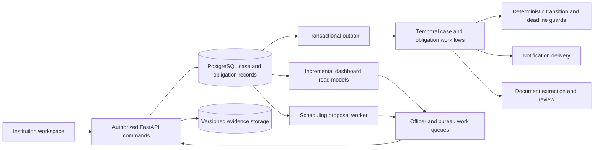

# NiyamFlow: AICTE Approval and Compliance Workbench

**Problem statement:** SIH26262  
**Prepared:** 30 October 2026, Asia/Kolkata  
**Purpose:** Revised product strategy, existing-solution research and implementation direction for the PPT and prototype.  
**Status:** Proposed new-statement design, grounded in public primary sources and the current repository. This document does not claim that the new approval-routing, obligation or scheduling modules are already implemented.

## 1. Recommended direction

Build a regulator-facing workbench that turns each pending case into an explained, authorized next action. Retain your evidence backend, then connect it to application movement, continuing institutional obligations and committee availability.

The three product promises are:

1. **Explain the next action:** what is blocking this case, who can act, what evidence is required and when action is due.
2. **Track each condition to verified closure:** uploading a renewal or undertaking response does not, by itself, close the obligation.
3. **Improve deadline performance under real constraints:** recommend feasible scheduling and workload actions, show the reasons and measure the result against credible baselines.

Suggested tagline: **From pending files to verified action.**

The core innovation thesis is this combined behavior in a bounded AICTE process. Individual features such as dashboards, workflow diagrams, OCR, audit trails or a chatbot are established capabilities. Present demonstrable integration and measured improvements rather than a claim to have invented them.

## 2. What the official statement requires

The official brief concerns approval-stage movement, regional and officer pendency, EVC planning, time-bound institutional conditions, document validity, reminders and escalation. It also calls for configurable procedures, secure role-scoped information and retained competent-authority decisions. Its evaluation emphasizes working routing, reliable dates, visible pendency and complete action history. [Official SIH statement, SIH26262](https://www.sih.gov.in/sih2026PS).

For the proposal, translate that scope into an observable acceptance condition: a case can progress through its selected route; a missed due action reaches the right owner; a response stays pending until verified; and an auditor can reconstruct the sequence.

## 3. Existing solutions: what the research actually establishes

This is a public-documentation review, not an authenticated product trial or a full feature audit. Vendor capabilities below are attributed claims. No private AICTE portal screens or APIs were accessed. Public silence about a capability is not evidence that a product lacks it.

| Existing system | Publicly documented capability | Design implication for us |
| --- | --- | --- |
| AICTE's established approval process and web portal | The handbook describes portal-mediated scrutiny, committee selection and publication of reports/approval-related outputs. | Integrate around the authorized process. Do not claim that AICTE has no digital approval system. [AICTE APH](https://www.aicte.gov.in/sites/default/files/APH%20Final.pdf). |
| NIC eOffice | Government documentation describes electronic approval/file exchange, digital signatures, API integration and role-scoped MIS reporting. | File movement and pendency reporting are baseline expectations. [NIC Udupi](https://udupi.nic.in/en/nic/). |
| NIC File Pendency Monitoring System, Chittoor | NIC describes departmental pending-file tracking, status updates and centralized dashboards. | A dashboard showing pending counts is insufficient differentiation. [NIC's FPMS account](https://informatics.nic.in/files/websites/july-2026/chittoor.php). |
| Creatrix Campus accreditation management | The vendor describes configurable workflows, reviewer/committee assignment, visit scheduling, evidence management, deadlines and progress reporting. | Even educational committee scheduling and accreditation workflows already exist. Compete through the proposed AICTE-specific execution and evidence, not an unsupported absence claim. [Creatrix product page](https://www.creatrixcampus.com/accreditation-management-software). |
| vmedulife | The vendor lists accreditation-related products, IQAC reporting, academic administration and committee/meeting tools. | An institution ERP is an adjacent integration source, not proof of regulator-wide process coverage. [vmedulife products](https://vmedulife.com/products/). |
| Camunda | Official documentation describes durable process orchestration, timers, process analytics and controlled migration of running process versions. | Workflow durability, bottleneck analysis and version migration are established technical patterns. [Process orchestration](https://camunda.com/orchestrate/processes/), [instance migration](https://docs.camunda.io/docs/components/concepts/process-instance-migration/). |

**Research conclusion:** The strongest defensible position is a focused AICTE execution layer joining policy-bound case routing, verified continuing obligations and explained resource planning. Whether particular commercial or internal systems already combine all of these requires stakeholder discovery and product trials; that market gap is a hypothesis, not a verified universal novelty claim.

Useful discovery questions for an authorized officer: Where do they record an undertaking today? What event starts its deadline? Who verifies a submitted response? Which delays legally stop a clock? How is a committee roster selected? Where do they learn that a renewal was uploaded but never reviewed? Do not contact officials or vendors on the team's behalf without authorization.

## 4. Policy fidelity before automation

The accessed APH covers academic years 2024–25 through 2026–27. It records different application contexts and committee procedures; it should not be reduced to one universal sequential route. Committee selection already has an authorized portal process. The scheduler must respect that process rather than independently appoint committee members. Current amendments, circulars and the target application cycle must be checked before activating a real process pack. [APH, clauses 1.8–1.10 and Annexure 7](https://www.aicte.gov.in/sites/default/files/APH%20Final.pdf).

For demonstration, implement three clearly labeled **synthetic process templates**: scrutiny-only; scrutiny followed by an EVC; and a scrutiny/EVC route containing an authorized additional review. These illustrate branching and exceptions; they are not asserted to be the legal route for every application category.

Each published process pack should contain scope, source document hash and locator, effective period, permitted transitions, role permissions, evidence gates, calendar, deadline-start events, pause rules and escalation recipients. An independent approver signs its content hash. Existing cases retain their pack unless a separately authorized migration records the before/after effects.

## 5. Proposed product behavior

### 5.1 Case workspace: a reason beside every action

For a selected case, show a timeline and an actionable panel:

| Field | Illustrative display |
| --- | --- |
| Current step | Scrutiny: awaiting permitted institution response |
| Blocker | Renewed lease evidence has not yet been reviewed |
| Next actor | Assigned institution editor, then assigned reviewing officer |
| Required action | Upload into the permitted lease slot; officer verifies the new version |
| Deadline | Exact timestamp, time zone, clock basis and process-pack version |
| Reason | Gate identifier plus the approved policy/source reference |
| Action availability | Enabled for the authorized actor, otherwise a specific explanation |

The server executes deterministic transition guards. A language model can explain the guard in plain language, but cannot decide whether the guard passes. Reject stale case revisions and duplicate commands safely. A return creates a new stage attempt with a recorded reason; it does not erase earlier reviews.

### 5.2 Obligation ledger: a condition remains open until verified

Represent an undertaking or renewal as a first-class record, with:

- The originating order/condition, institution, responsible person, required evidence and verifier.
- The authorized due-date basis and any approved extension history.
- Evidence-version links, response rounds, review outcome and closure authority.
- Separate states such as OPEN, EVIDENCE_SUBMITTED, UNDER_REVIEW, FULFILLED, OVERDUE, DISPUTED and CANCELLED.

An upload can move an item to EVIDENCE_SUBMITTED. Only a permitted verification command can fulfil it. If review is late, identify that review as pending without silently moving the institution's submission timestamp. Preserve both whether evidence arrived on time and whether the reviewing action finished on time.

An approval case and its continuing obligations have separate lifecycles. Where an authorized decision imposes later conditions, closing the approval application must not terminate those obligation timers. Missed conditions create review/escalation work, not automatic withdrawal or a new statutory finding.

### 5.3 Three visible clocks

Use these as proposed accountability views; the process owner must approve their legal meaning:

1. **Total elapsed time:** never hidden by reassignment, return or administrative pause.
2. **Accountable processing time:** excludes only intervals expressly permitted by the selected process pack, each with reason, actor and evidence.
3. **Obligation deadline:** independent due dates for individual conditions and renewals.

Store instants in UTC and display the selected local zone, including Asia/Kolkata. Use an approved holiday/business-day calendar where required. Returning a case or uploading a document must not reset a statutory clock by accident. An unspecified pause rule means no automatic exclusion.

### 5.4 EVC planning: feasible proposals with explanations

Start with authorized committee rosters and policy-provided eligibility; do not replace any mandated selection or randomization procedure. Propose visit slots only after required upstream gates have completed.

Hard constraints include authorization, prescribed composition, declared conflicts of interest, readiness, confirmed availability, no double-booking and any mandated ordering. A supervisor's convenience override cannot bypass a hard statutory constraint.

Within the permissible planning space, optimize in this order:

1. Satisfy all hard constraints.
2. Maximize cases that can be scheduled before their relevant deadlines; expose any unavoidable misses.
3. Reduce tardiness and starvation among discretionary choices.
4. Minimize disruption to confirmed bookings, then travel/resource cost when reliable inputs exist.

Use a transparent earliest-deadline heuristic that gives scarce compatible slots priority as the initial implementation. Add OR-Tools CP-SAT when larger constrained fixtures show a benefit. CP-SAT distinguishes a feasible schedule from a proven optimum and also reports infeasible or unresolved searches; display the returned status and solve-time bound. [Google's CP-SAT documentation](https://developers.google.com/optimization/cp/cp_solver).

If no permissible plan exists, explain the unmet constraints and create an escalation task. Do not invent availability or silently drop a required member. Authorized staff confirm appointments; recommendations are not issued committee orders.

### 5.5 Pendency dashboard: reasons and actions, not just totals

The primary screen is an officer's work queue. Its columns should answer: case, institution, current step, age, deadline, blocker, next actor and permitted next action. Add saved views for unassigned work, near deadlines, awaiting institution, awaiting source, awaiting committee, and overdue review.

A regional/bureau view aggregates bottlenecks and capacity without exposing another institution's documents. Keep case counts separate from open-obligation counts to avoid double counting. Render data freshness and any delayed integration feed explicitly.

For proactive triage, calculate **planning slack** as the time remaining to a due instant minus the estimated remaining work duration, using one consistent calendar. Negative slack indicates a planning concern, not institutional non-compliance or a calibrated probability of delay. Use declared estimates initially. Show assumptions and respect mandatory ordering; do not advertise predictive ML until there is suitable labeled historical data.

### 5.6 Notifications that create accountable work

Each reminder points to an open task, its responsible recipient and a permitted action. Generate one semantic notification per obligation/version/threshold/recipient/channel. Replacement evidence, a closed obligation or an authorized new deadline invalidates obsolete generations.

Track intent, sending, uncertainty and acknowledgement separately. An SMTP/network timeout is not proof of failed or successful delivery. Acknowledging a message is not fulfilling an undertaking. Escalation creates a task for the defined authority; sending the escalation does not close the original work.

## 6. AI with a bounded, useful role

Use AI/document intelligence to draft structured obligations from a supplied order: action, date, responsible party and exact page/paragraph. Require an authorized officer to confirm every actionable field before it creates timers. OCR ambiguity becomes a highlighted missing/uncertain field.

Optional explanation assistance may summarize the case and draft a reminder from authorized data, with links to the source facts. Evaluate whether citations actually support each statement. Treat uploaded text as data and never as system instructions. A failure or unavailable model leaves a structured manual form and deterministic routing operational.

Do not put a conversational agent in charge of approvals, committee appointments, date extensions, adverse action or rule publication. Do not let broad chat access bypass case permissions. Automatic shortage detection, facial recognition, nationwide fraud scoring and model training are outside the first prototype.

## 7. Efficient architecture using your existing project

Keep the modular FastAPI/PostgreSQL architecture, private versioned object storage, the transactional outbox and Temporal. Add a frontend using the team's strongest existing web stack; if there is none, React with TypeScript is a reasonable proposed choice, not a mandatory rewrite.

Temporal supports long-lived waits through recorded histories and replay; activities still need idempotent side effects. Retain opaque references rather than document bytes or unnecessary personal data in histories. [Temporal workflow documentation](https://docs.temporal.io/workflows).

Use one approval workflow per case revision and separate obligation workflows for continuing conditions. PostgreSQL is the authoritative business record; Temporal coordinates waits and work. Establish a reconciliation process so committed outbox events and workflow state cannot diverge silently. Retain the independently checkpointed audit trail beyond workflow-history retention.

For a pilot, use indexed due-date/owner/status queries, keyset pagination and incremental counters. Recompute only obligations or stage gates affected by an evidence change. OCR a new evidence version once; cache results by evidence hash plus extractor version. Run scheduling when relevant readiness, availability or roster inputs change, rather than repeatedly scanning all cases. Use server-sent updates only where they improve the queue; bounded polling is sufficient for the first demo.

Do not add a graph database, Kafka, Elasticsearch, blockchain, a second workflow engine or a large generative model just to expand the architecture. Dependency relationships fit relational tables. A generic BPMN platform is a credible alternative for a new project, but replacing the existing Temporal foundation adds migration effort without an established benefit for this team.

## 8. What to reuse and what is genuinely new

Repository inspection found `applications.stage` constrained to DRAFT/SUBMITTED. Existing document workflows do not establish the new regulatory approval lifecycle. The prior test results are evidence of the old backend scope, not acceptance of SIH26262.

| Existing component | Reuse | Required extension |
| --- | --- | --- |
| `adapters/application_service.py` and `adapters/tables.py` | Institution/application intake and immutable revisions | Add a separate approval-case lifecycle; do not overload the intake-stage field |
| Identity, case assignments and RLS | Authorized actors and tenant/assignment boundaries | Add bureau/region/case-workflow scopes and committee membership checks |
| `adapters/rectification_application_service.py` | Controlled responses and revision lineage | Connect response completion to the appropriate stage attempt and obligation |
| `adapters/tasks_alerts_application_service.py`, `workflows/lifecycle.py` | Tasks, reminders, delivery intents and durable waits | Deadline calendars, pause reasons, owner escalation and cancellation coverage |
| `lifecycle_tasks`, `review_tasks` | Existing task information | Select one canonical task source and migrate/bridge the other; avoid conflicting mutable inboxes |
| Rule governance and frozen snapshots | Version control and independent approval patterns | Create process-definition versions, route tests and authorized case migration |
| Evidence/report/audit adapters | Storage, access checks, PDF reports and event history | Case-progress views, undertaking closure bundles and condition summaries |
| Existing media analysis | Optional EVC evidence attachment support | Keep outside the central pitch; do not spend the new budget expanding CV |

New domain records should cover approval cases, process-definition versions, stage attempts/transitions, blockers, obligations, clock adjustments, authorized committee rosters, availability and appointment proposals. All records need institution/case ownership, versioning and stable event IDs where applicable. Preserve human decisions separately from automation recommendations.

## 9. Prototype scope and screens

Build six purposeful screens:

1. **Officer work queue:** deadline, blocker and next-action columns; actionable filters and a regional drill-down.
2. **Case workspace:** route timeline, evidence pane, clock explanations and authorized transition controls. The institution sees its own pending requests here.
3. **Obligation ledger:** source condition, due basis, owner, evidence status, reviewer and explicit fulfilment action.
4. **EVC planner:** compatible slots, roster restrictions, conflict explanation, proposed/confirmed distinction and re-plan comparison.
5. **Process-pack preview:** source locator, version diff, sample-case impact and independent publication gate. Use bounded templates, not a large drag-and-drop editor.
6. **Audit/report view:** a timeline backed by stored event IDs and a reproducible case/obligation closure export.

Use a synthetic cohort with enough variety to exercise the flows, for example 100 cases across 20 institutions and three fictional administrative units, with a small pre-authorized committee roster. Make counts and identity labels visibly synthetic. The interactive story needs only three named cases; avoid filling screens with random, untraceable metrics.

## 10. Recommended five-minute demonstration

| Time | Action | What must actually work |
| --- | --- | --- |
| 0:00–0:35 | Open a case near its deadline from the work queue | The queue identifies a concrete blocker, next actor and dated action |
| 0:35–1:15 | Submit a permitted renewal response as the institution | A new evidence/revision link appears; the obligation remains unfulfilled pending review |
| 1:15–1:50 | Verify it as the authorized officer | The guard passes and the next eligible step becomes ready; the original evidence remains available |
| 1:50–2:40 | Propose an EVC slot, then introduce a roster/calendar conflict | The planner obeys constraints and explains a new proposal or infeasibility |
| 2:40–3:25 | Jump to a labeled later demo time for a continuing condition | A real due-state transition creates the correct task/escalation; an obsolete reminder does not fire |
| 3:25–4:15 | Publish a changed demo process pack with a different approver | The old case remains pinned; a new case uses the new pack; impact is visible |
| 4:15–5:00 | Show measured comparison and inspect the action history | Metrics point to captured runs; the audit ties the routing, response and alerts together |

Time advancement must use an isolated test clock or a short-duration demo configuration and carry a visible simulation label. Never manipulate production timestamps to make the story work. If durable recovery is demonstrated, kill and restart a real worker and inspect its workflow/event history; otherwise describe it as a pending test.

## 11. How to make 'optimized' a measurable claim

Optimize for workflow correctness and authority first, then deadline attainment, then administrative effort and operating cost. National approval speed is not measurable from a synthetic prototype.

Use four baselines where relevant: static FIFO/manual-style queue; earliest-deadline queue; scarcity-aware earliest-deadline heuristic; and a bounded solver. Give each method identical cases, availability and permissions. Reserve held-out scenarios that were not used to tune weights.

| Metric | Definition and proposed acceptance |
| --- | --- |
| Transition correctness | Compare each command with an independently authored expected result, including forbidden jumps and returns; no critical unauthorized transition accepted |
| Deadline correctness | Boundary, holiday, timezone and authorized-extension fixtures; all mandatory edge-case fixtures pass |
| Alert execution | Commit-to-visible-task latency, obsolete reminders and duplicate semantic alerts under retries/restart; publish p50/p95 and counts |
| Obligation closure integrity | Attempt upload-only closure, wrong-evidence closure and unauthorized closure; all rejected |
| Schedule quality | Eligible appointments, conflicts, unscheduled cases, late cases, tardiness and re-plan disruption; zero hard-constraint violations |
| Officer effort | Paired synthetic-case study using the same task; report completion quality, clicks and active time; a 30% reduction is a proposed target until measured |
| Performance and cost | Declare case count, concurrency, hardware and workload; propose queue-read p95 under 1 second for the bounded demo, then measure rather than prefill |
| Evidence extraction | Field accuracy, coverage, ambiguous dates and reviewer correction; publish denominators and unsupported cases |

An initial runnable experiment is provided in `research/sih26262/scheduling_experiment.py`, with its captured result in `scheduling_results.json`. On six synthetic cases, two already-authorized committees and three days, FIFO and a basic earliest-deadline greedy method each produced one late case. The scarcity-aware heuristic and exhaustive finite-model optimum produced zero late cases. This is a counterexample to naive greedy planning, not an AICTE field benchmark. Importantly, the simple improved heuristic already matched the optimum on that fixture; do not claim that a heavier solver is always necessary or superior.

## 12. Build order for the pivot

**First, change the product story:** replace forgery/infrastructure-AI as the lead with case action, continuing conditions and deadline reliability. Preserve the old project and evidence history; identify the new-statement scope in new documents and tests.

**Next, build the approval vertical slice:** one explicit process template, persisted stage attempts, guarded transitions, next-actor ownership and a queue showing actual pending tasks. Add a small authoritative test fixture before building charts.

**Then, implement obligation and clock behavior:** confirmed source conditions, an institution response, officer verification, authorized extensions and continuing timers. Add two more route templates and forbidden-transition tests.

**After those work, add EVC planning:** availability/eligibility input, a constraint-aware heuristic, human confirmation, cancellation and infeasibility. Use CP-SAT only if it improves the declared evaluation scenarios or is needed to express the constraints cleanly.

**Finally, add process-pack impact, benchmark captures and a rehearsal:** use separate identities for publication; retain old-case history; run transport failures, concurrent commands, late responses and replay tests; capture the final demo on actual APIs.

A focused vertical slice is the first submission milestone. A fuller prototype is a multi-day effort depending on team availability and frontend progress; the new statement is not implemented by merely changing the title in the old deck. The companion PPT/prototype brief provides a six-block content plan and a more detailed task sequence.

## 13. Pitch claims and difficult questions

**Can say now:** we have an existing tested evidence/workflow backend; the new design reuses it; the repository records 186 passing tests in its last full old-scope verification. Those tests do not certify the new routing/scheduling features.

**Can say after demonstrating:** a verified evidence change releases the right blocked step; a condition remains open after upload until review; a failed or retried workflow does not duplicate the demonstrated action; a schedule respects the published constraints in the evaluated dataset.

**Must measure first:** real officer-time savings, general prediction accuracy, cost per live case, nationwide throughput and schedule improvement outside the declared fixtures.

**Must not claim:** guaranteed selection or victory, first-ever workflow automation, a live AICTE integration without authorization, statutory auto-approval, universally optimal planning, or production readiness inferred from unit tests.

If asked why this is better than an ERP or Camunda: answer that those products already supply strong building blocks; our proposal packages a specific authorized AICTE operating model and proves its institution-to-officer-to-committee-to-condition behavior on traceable cases. If asked why AI is needed: show confirmed extraction of a condition from a document, while deterministic guards remain responsible for execution.

## 14. Research sources and limits

The source register is `SIH26262_SOURCE_REGISTER.json`. All retrieval dates are 30 October 2026. Primary official/product/technical sources were used; no competitors' private features, deployment prices or performance were independently audited. The Creatrix product description was available in search-indexed page content; a subsequent direct open returned a gateway error. The original PS26261 student-project research is background only and was not relabeled as direct SIH26262 competition. Indexed GitHub searches for the exact ID and AICTE/EVC/pendency terms did not locate a verifiable exact-statement student implementation; a problem-list tracker was excluded. This limited search does not establish that competing implementations do not exist.

The recommendation is a strategy for a stronger, reviewable entry. Finale outcomes depend on implementation, demonstration, evaluation and other teams; the work plan therefore emphasizes what can be shown and measured.
